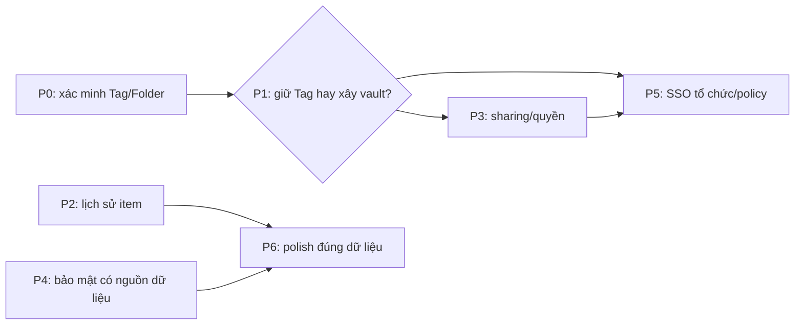

# NodeWarden × Proton Pass: kế hoạch đối chiếu

> **Trạng thái: kế hoạch, chưa triển khai các khoảng thiếu dưới đây.** Nguồn: phân tích ảnh/tài liệu Proton trong `proton-pass-research/BRD.md` và `proton-pass-research/UX-UI.md` (chưa khảo sát trực tiếp ứng dụng Proton đang chạy). Hai file nghiên cứu và ảnh vẫn là tài liệu tham khảo *chưa được đưa vào Git*; các mã F bên dưới là mã trong BRD đó, không phải cam kết tương thích giao thức Proton. NodeWarden tiếp tục dùng giao thức Bitwarden. Tag/Folder không phải vault Proton; Send không phải chia sẻ item; Password History không phải lịch sử phiên bản item.

## Danh mục không bỏ sót

| Mã BRD | Hiện trạng | Hướng xử lý / cổng |
|---|---|---|
| F-01–05 | All Items có; Tag/Folder dùng phân loại, Trash toàn cục, chưa có vault độc lập/ACL/share vault | P1 quyết định mô hình; P3 chỉ khi chốt quyền và khóa |
| F-10–16 | CRUD, form Login, Trash có; move đến Folder/Tag; detail có địa chỉ Open/Copy, mật khẩu che mặc định, **Last copied**; không có Last autofill hay nhãn Vulnerable inline | P0 kiểm chứng move/tag; P4 chỉ hiển thị đánh giá có dữ liệu; P6 polish địa chỉ |
| F-20–23 | Search, All/Recent 30 ngày, multiple select và nhóm ngày khi sort Edited có; chưa có nhãn Today/Yesterday | P6 nếu cần |
| F-30–31 | Soft delete/Restore và một Trash chung có | Trash theo vault phụ thuộc P1 |
| F-40–45 | Metadata và Password History có; chưa có snapshot/timeline/compare/Restore toàn item, không có Current version hoặc Last autofill | P2; không đổi tên Password History thành Item History |
| F-50–56 | Password Health quét thủ công và kiểm tra rò rỉ email tài khoản có; không phải giám sát credential Proton; thiếu Inactive 2FA, excluded items, Account protection và card hướng dẫn | P4; trạng thái unknown/lỗi phải rõ |
| F-60–64 | Nội dung item mã hóa client-side, có passkey tài khoản và mã TOTP item; Web Vault không tạo passkey website, autofill do client; thiếu Emergency Access và advanced protection tương ứng | P4 đánh giá threat model trước khi tuyên bố tương đương Proton |
| F-70–74 | Generator tạo alias qua provider SimpleLogin-compatible bên ngoài; chưa quản lý mailbox/domain hoặc gửi mail từ alias tại NodeWarden | P5; chốt provider vs tự vận hành |
| F-80–85 | Attachment, SSO OIDC và audit log có; share item/vault, organization/role, compliance report và policy enforcement chưa có | P3/P5; Send không thay thế share item |
| F-90–93 | Đồng bộ client Bitwarden và import nhiều nguồn có; không có CLI phát hành riêng hay hệ ứng dụng Proton cho app switcher | P6 mặc định không làm CLI/app switcher |
| Pricing tiers | NodeWarden chưa có gói Free/Plus/Business của Proton | Ngoài phạm vi nếu không có yêu cầu sản phẩm/billing riêng |

## Phụ thuộc và cổng quyết định

- **P1-A (mặc định):** giữ Tag/Folder, không nhận F-01/02/04/05/14 là vault Proton. Chỉ thiết kế chia sẻ bản sao qua link nếu có nhu cầu; không thêm ACL/vault giả.
- **P1-B (chỉ khi cần nhiều vùng chứa có quyền độc lập):** định nghĩa owner, membership/role, vault mặc định, item thuộc vault nào, Tag tách khỏi vault, khóa theo vault, cấp/thu hồi quyền, Trash và cách client Bitwarden cũ nhìn thấy item. Khi đó mới lập migration và thiết kế P3/P5 thực thi. Thiết bị đã tải plaintext không thể bị thu hồi dữ liệu từ xa.
- P2 và các lát P4 không dựa vào vault có thể được thiết kế độc lập; P3 và phần tổ chức của P5 **không được vượt cổng P1**. Không thêm nút, trạng thái hoặc tính năng giả trong lúc chờ.

## P0 — tính đúng Tag/Folder trước mọi mở rộng

**Hợp đồng hiện tại:** Tag đầu tiên là vị trí Folder tương thích Bitwarden; các Tag sau là nhãn bổ sung (`src/handlers/ciphers.ts:348-400`). Client cập nhật Tag sau bulk move (`webapp/src/hooks/useVaultSendActions.ts:778-798`); server bulk move cập nhật `folder_id`, còn `/sync` backfill Tag từ Folder (`src/services/storage-cipher-repo.ts:397-427`, `src/handlers/sync.ts:60-106`). Vì vậy **chưa chứng minh bulk move làm mất item khỏi bộ lọc**: cần tái hiện trước khi sửa.

1. Dùng item có ≥2 Tag, kiểm tra tạo/sửa, bulk move sang Folder khác và về không Folder, rename/delete Tag đầu và Tag phụ; đo DB, API response, UI ngay sau thao tác, sau `/sync` và sau đăng nhập lại. Thử web lẫn client Bitwarden, lỗi giữa batch và concurrent edits.
2. Chỉ nếu có sai lệch, sửa ở đường ghi chung để `folder_id` và `tags[0]` bền vững, giữ Tag phụ; patch client chỉ là phản hồi tức thời. Xác định dữ liệu legacy và migration/backfill đã có trước khi thêm migration mới.
3. Nghiệm thu: owner khác không move được; không ghi đè ciphertext, không mất Tag phụ; count/filter và folder client cũ đúng trước/sau reload; revision conflict không âm thầm ghi đè. Sao lưu dữ liệu trước mọi sửa dữ liệu production.

## P1 — quyết định kiến trúc Vault

- **A — giữ Tag/Folder:** chốt giới hạn F-01/02/04/05/14 trong tài liệu và UI. Phù hợp khi chỉ cần phân loại item; không đổi giao thức để giống giao diện.
- **B — xây vault thật:** sau khi có yêu cầu quyền/cộng tác, lập hợp đồng storage–khóa–API–sync cho mọi đường đọc/ghi item, attachment, import/export, Trash và notification. Server không được trả item của vault sai quyền qua `/sync` chỉ vì UI đã ẩn. Migration item hiện có vào vault mặc định phải giữ ID, ciphertext và Tag; thử idempotency, backup và rollback có cả thay đổi phát sinh sau migration. Thử hai user, thiết bị cũ/mới, revoke, offline và concurrent writes trước UI vault.
- **Đầu ra P1:** quyết định A/B được duyệt và hợp đồng dữ liệu/quyền/tương thích; chưa tạo bảng/nút vault khi chưa có quyết định.

## P2 — Item History (F-40–45)

**Hiện trạng:** card metadata và danh sách mật khẩu cũ (`webapp/src/components/vault/VaultDetailView.tsx:780-824`); `ciphers` chỉ giữ bản hiện tại (`src/services/storage-schema.ts:43-56`). Không thể tái tạo phiên bản cũ từ metadata.

1. Chốt snapshot những trường nào, attachment (metadata vs bytes), mã hóa, dung lượng/retention, bản Created/Modified, xóa vĩnh viễn và dữ liệu có sẵn chỉ bắt đầu được tính từ khi bật tính năng.
2. Tạo version **chỉ với ghi item thành công, có thay đổi**; ghi cùng giao dịch/đảm bảo nguyên tử với item, gắn owner/item/revision; không lưu plaintext hoặc tạo version cho no-op/lỗi.
3. API lịch sử kiểm tra quyền trước danh sách/snapshot. Restore kiểm tra revision hiện tại; giữ bản đang có thành version mới, bảo toàn item ID và không tự nhận khôi phục bytes attachment đã xóa. Quy định xử lý conflict và metadata đồng bộ.
4. Khi backend đã thật, thêm View item history → timeline → xem mốc → so sánh → xác nhận Restore; giữ Password History riêng. Test sửa username/website/notes/TOTP, concurrent edits, item bị xóa, quyền sai, retention và rollback.

## P3 — Sharing (F-05, F-80–81)

**Phụ thuộc P1.** `/api/ciphers/:id/share` hiện chỉ trả lại item; organizations/collections rỗng (`src/router-authenticated.ts:364,428-438`). Bitwarden Send chia sẻ text/file tạm, không cấp quyền đọc/sửa item.

1. Quyết định **link chia sẻ bản sao** hay **quyền thành viên trên item/vault**; không gọi link Send là vault share. Nếu P1-A, không đưa ra lời hứa chia sẻ vault có ACL.
2. Với quyền thành viên: hợp đồng invitation/accept/expiry, read/edit role, phân phối khóa client-side, revoke/rotate, attachment, audit, quyền ở từng endpoint và `/sync`; không gửi khóa plaintext cho server. Với link: payload xác định, khóa, hết hạn, giới hạn lượt, revoke và lộ metadata.
3. Xây authorization và API thật trước UI; route stub không được trả thành công giả. Test owner/invitee/người lạ, link hết hạn, nhiều thiết bị, offline, revoke, import/export và attachment. Nêu rõ thiết bị từng tải plaintext không thể bị xóa từ xa.

## P4 — bảo mật sản phẩm (F-50–56, F-60–64)

Lập **plan riêng cho từng lát**; không biến Pass Monitor thành tập hợp card báo “an toàn” không có dữ liệu.

| Lát | Nguồn/cổng bắt buộc và nghiệm thu |
|---|---|
| Password Health inline | Tái sử dụng kết quả quét thủ công trong `webapp/src/lib/password-security-cache.ts`, gắn revision/fingerprint item; chưa quét/lỗi/hết hạn ≠ Strong/Safe. Exposed/Weak/Reused chỉ hiện khi có kết quả hợp lệ. |
| Credential monitoring | Xác định corpus/provider, dữ liệu gửi ra, đồng ý người dùng, tần suất/quota và định nghĩa kết quả theo từng credential; kiểm tra rò rỉ **email tài khoản** hiện tại không đồng nghĩa Dark Web Monitoring cho toàn vault. |
| Inactive 2FA | Chỉ kết luận website hỗ trợ 2FA từ nguồn đáng tin; item không có TOTP không đủ làm bằng chứng. Tách không rõ/không hỗ trợ/chưa bật. |
| Excluded items | Chốt nơi lưu trạng thái theo item, phạm vi từng phép quét, sync, opt-in/out và audit; item excluded không được báo safe. |
| Account protection | Định nghĩa biện pháp bật/tắt có thực thi ở auth/API và cách khôi phục khi mất thiết bị; new-device verification hiện bị từ chối khi thiếu kênh email (`src/handlers/accounts.ts:870-910`). |
| Emergency Access | Threat model riêng: người nhận, thời gian chờ, hủy, xác thực, thông báo, cấp/thu hồi khóa và audit; không gửi master password/secret thô. |
| Passkey/2FA/zero-knowledge | Phân biệt passkey tài khoản và passkey website; TOTP item và 2FA đăng nhập; autofill ở client Bitwarden. Rà mô hình mã hóa thực tế trước khi tuyên bố tương đương Proton. |

Mọi lát phải kiểm tra trạng thái unknown/error, không lộ secret khi log/export, và review bảo mật trước phát hành. Card giáo dục F-56 là nội dung tùy chọn sau khi luồng thật ổn định.

## P5 — Alias và doanh nghiệp (F-70–74, F-83–85)

- **Alias:** quyết định tích hợp SimpleLogin-compatible hay tự vận hành mail trước. Với tích hợp hiện tại (`webapp/src/lib/simplelogin-forwarder.ts`): kiểm tra provider hỗ trợ list/disable/delete alias → chọn mailbox chuyển tiếp → domain do provider xác nhận → gửi thư từ alias *chỉ nếu có API thực*. Chốt token/secret, quota, lỗi upstream, đồng bộ cấu hình, và không hứa tính năng Proton do NodeWarden sở hữu. Không thêm pricing tier giả.
- **SSO tổ chức:** OIDC account link hiện có (`README.md:54`) không phải membership/SCIM; phụ thuộc P1/P3. Chốt ánh xạ user–organization, provisioning/deprovisioning, thu hồi quyền và case IdP mất kết nối; không suy ra quyền từ `domainHint`.
- **Compliance:** audit log đang có (`src/handlers/admin.ts:121-165`). Chốt scope/role, metadata được phép xuất, định dạng, retention và redaction trước CSV/PDF; thử không lộ secret và user không được phép không truy cập được.
- **Policy:** `/api/policies` hiện rỗng (`src/router-authenticated.ts:483-488`). Chỉ thêm sau khi có đối tượng organization và hành vi cần kiểm soát; kiểm thử enforcement tại share/export/sync/API với client cũ, không chỉ khóa nút UI.

## P6 — polish độc lập và các mục cố ý không làm

- F-23: Today/Yesterday theo locale/múi giờ, chỉ với sort nhóm ngày; test chuyển ngày/nửa đêm và ngày không hợp lệ (`VaultListPanel.tsx:130-137`).
- F-15: Website giữ Open/Copy; nếu chuyển sang hyperlink thực, chỉ URL an toàn, keyboard/screen-reader hợp lệ và không tạo hai Open trùng nhau (`VaultDetailView.tsx:510-529`). Last copied **không** đổi nhãn thành Last autofill nếu chưa có sự kiện autofill từ client.
- F-50/56: chỉ đổi bố cục/tên Pass Monitor sau P4, không nhân bản nội dung hay trạng thái đo không có. Kiểm tra dark/light, mobile/desktop, tương phản và focus.
- F-92/93: mặc định **không làm** CLI riêng hoặc app switcher Proton; server đã tương thích client Bitwarden CLI, NodeWarden không sở hữu hệ Proton Mail/Drive/VPN. Pricing tiers cũng ngoài phạm vi trừ khi có yêu cầu sản phẩm thực.

## Mẫu chốt plan cho từng item và cổng phát hành

Mỗi item phải có: (1) hành vi và mã BRD, điều **không** làm; (2) đường UI → state → API → storage → sync/client đang chạy và tái hiện lỗi nếu có; (3) ranh giới quyền/khóa/metadata/retention; (4) tương thích dữ liệu cũ, client Bitwarden, backup/rollback; (5) lát triển khai không có stub; (6) nghiệm thu hành vi thành công, lỗi, offline, đồng thời, desktop/mobile, accessibility; (7) review security, test hợp đồng và smoke đường thực trước release. Push code **không chứng minh** deploy thành công hoặc an toàn production.
