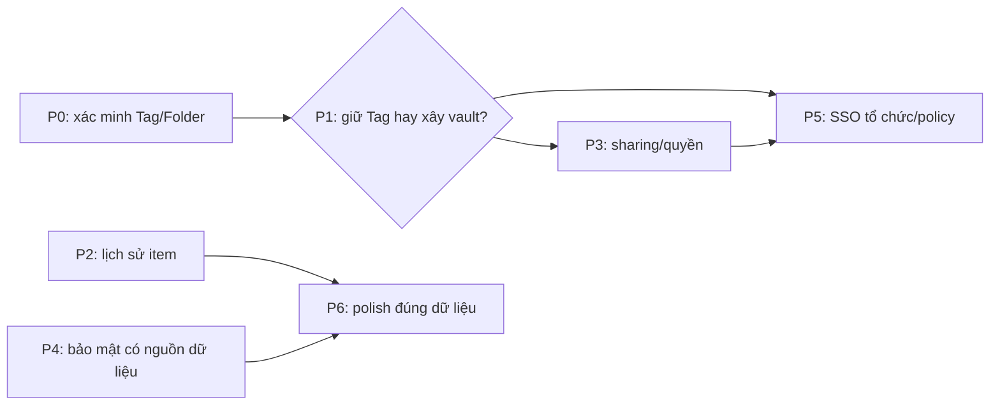

# NodeWarden × Proton Pass: kế hoạch đối chiếu

> **Trạng thái: kế hoạch, chưa triển khai các khoảng thiếu dưới đây.** Nguồn: phân tích ảnh/tài liệu Proton trong `proton-pass-research/BRD.md` và `proton-pass-research/UX-UI.md` (chưa khảo sát trực tiếp ứng dụng Proton đang chạy). Hai file nghiên cứu và ảnh vẫn là tài liệu tham khảo *chưa được đưa vào Git*; các mã F bên dưới là mã trong BRD đó, không phải cam kết tương thích giao thức Proton. NodeWarden tiếp tục dùng giao thức Bitwarden. Tag/Folder không phải vault Proton; Send không phải chia sẻ item; Password History không phải lịch sử phiên bản item.

## Danh mục không bỏ sót

| Mã BRD | Hiện trạng | Hướng xử lý / cổng |
|---|---|---|
| F-01–05 | All Items có; Tag/Folder dùng phân loại, Trash toàn cục, chưa có vault độc lập/ACL/share vault | P1 quyết định mô hình; P3 chỉ khi chốt quyền và khóa |
| F-10–16 | CRUD, form Login, Trash có; move đến Folder/Tag; detail có địa chỉ Open/Copy, mật khẩu che mặc định, **Last copied**; không có Last autofill hay nhãn Vulnerable inline | P0 kiểm chứng move/tag; P4 chỉ hiển thị đánh giá có dữ liệu; P6 polish địa chỉ |
| F-20–23 | Search, All/Recent 30 ngày, multiple select và nhóm ngày khi sort Edited có; chưa có nhãn Today/Yesterday | P6 nếu cần |
| F-30–31 | Soft delete/Restore và một Trash chung có | Trash theo vault phụ thuộc P1 |
| F-40–45 | Metadata và Password History có; Item History (timeline/compare/Restore toàn item) đã có trong Web Vault; `Last autofill` chưa có; app/extension chính thức chưa hiện timeline | P2 xong phần Web; app chưa thu; không đổi tên Password History thành Item History |
| F-50–56 | Password Health quét thủ công và kiểm tra rò rỉ email tài khoản có; không phải giám sát credential Proton; thiếu Inactive 2FA, excluded items, Account protection và card hướng dẫn | P4; trạng thái unknown/lỗi phải rõ |
| F-60–64 | Nội dung item mã hóa client-side, có passkey tài khoản và mã TOTP item; Web Vault không tạo passkey website, autofill do client; thiếu Emergency Access và advanced protection tương ứng | P4 đánh giá threat model trước khi tuyên bố tương đương Proton |
| F-70–74 | Generator tạo alias qua provider SimpleLogin-compatible bên ngoài; chưa quản lý mailbox/domain hoặc gửi mail từ alias tại NodeWarden | P5; chốt provider vs tự vận hành |
| F-80–85 | Attachment, SSO OIDC, audit log, organization/collection/role (owner/admin/user), group, policy và share item có; share **vault** (nhiều item cùng lúc), compliance report và policy enforcement chưa có | P3/P5; Send không thay thế share item |
| F-90–93 | Đồng bộ client Bitwarden và import nhiều nguồn có; không có CLI phát hành riêng hay hệ ứng dụng Proton cho app switcher | P6 mặc định không làm CLI/app switcher |
| Pricing tiers | NodeWarden chưa có gói Free/Plus/Business của Proton | Ngoài phạm vi nếu không có yêu cầu sản phẩm/billing riêng |

## Phụ thuộc và cổng quyết định

- **P1-A (mặc định):** giữ Tag/Folder, không nhận F-01/02/04/05/14 là vault Proton. Chỉ thiết kế chia sẻ bản sao qua link nếu có nhu cầu; không thêm ACL/vault giả.
- **P1-B (chỉ khi cần nhiều vùng chứa có quyền độc lập):** định nghĩa owner, membership/role, vault mặc định, item thuộc vault nào, Tag tách khỏi vault, khóa theo vault, cấp/thu hồi quyền, Trash và cách client Bitwarden cũ nhìn thấy item. Khi đó mới lập migration và thiết kế P3/P5 thực thi. Thiết bị đã tải plaintext không thể bị thu hồi dữ liệu từ xa.
- P2 và các lát P4 không dựa vào vault có thể được thiết kế độc lập; P3 và phần tổ chức của P5 **không được vượt cổng P1**. Không thêm nút, trạng thái hoặc tính năng giả trong lúc chờ.

## P0 — tính đúng Tag/Folder trước mọi mở rộng

**Đã xác minh trên Worker/D1 local cô lập:** tạo Login với `Work, Shared`, tạo Tag `Personal`, bulk move sang `Personal` cho kết quả `Personal (1), Shared (1), Work (0)` ngay sau thao tác, sau Sync Vault và sau đăng xuất/đăng nhập lại. Move về “No tag” đưa `Shared` lên đầu, hiển thị `Shared (1), Personal (0)` và detail `Shared`. Lỗi phát hiện trong lần kiểm tra đầu: Folder Web có tên mã hóa nhưng backend đã chèn ciphertext vào Tag, khiến detail hiển thị Personal còn lọc `Personal (0)`; đường tạo/đổi Folder nay ghi tên Tag riêng, còn tên Folder trả cho client vẫn mã hóa. Item nhiều Tag được kiểm tra qua UI thật; các kiểm thử DB/API, `/sync`, quyền owner, rename/delete và conflict ở `scripts/vault-compatibility.test.ts`, `scripts/user-key-id.test.ts`, `scripts/cipher-tags.test.ts`.

**Hồi quy hiện tại:** `scripts/vault-compatibility.test.ts` kiểm tra 32 trường hợp, gồm full/partial/bulk move, Folder mã hóa thiếu `tag_name`, move lặp, owner, conflict và chuyển đổi Folder có điều kiện revision. `scripts/cipher-tags.test.ts` 7/7; `scripts/user-key-id.test.ts` 7/7; `scripts/folder-legacy-encryption.test.ts` 3/3; `scripts/folder-tag-backup.test.ts` 3/3; `scripts/folder-plaintext-inventory.test.ts` 5/5. Hai typecheck, i18n và build đạt. Các phép thử mật mã dùng khóa thật; không coi chuỗi giả EncString là bằng chứng giải mã. Sửa lỗi kèm theo: endpoint revision giờ luôn đẩy revision của vault lên (tối thiểu +1 ms so với revision trước) sau khi repair Tag, vì revision là tín hiệu để client tải payload đã sửa; trước đó repair chạy trong cùng mili-giây với revision cũ thì client không tải lại.

**Cùng vault Web/CLI chính thức trên Worker/D1 local cô lập:** Web Vault tạo tài khoản với khóa thật và Login `Work, Shared`; CLI Bitwarden 2025.1.0 đăng nhập, unlock, giải mã tên Folder, tên item và username, cùng thấy Folder ID `Work`. Web bulk move sang `Personal` giữ Tag phụ `Shared`; sau `bw sync`, CLI thấy item trong Folder `Personal` cùng ID. CLI đổi Folder item sang `Shared`; Web Sync Vault thấy `Shared`. Web thêm Tag phụ `Extra`, CLI đổi Folder sang `Shared`; Web Sync Vault thấy `Shared, Extra`. CLI tạo Folder `CLI Created`, Web Sync Vault thấy Folder đó và bulk move item vào giữ `Extra`; CLI sync thấy đúng Folder ID, tên item và username. Web đăng xuất/đăng nhập lại vẫn hiển thị `CLI Created (1), Extra (1)`. CLI không hiển thị Tag phụ vì giao thức Bitwarden chỉ có Folder; chỉ Web xác nhận Tag phụ còn nguyên.

**Extension Bitwarden chính thức 2026.10.2 trên cùng vault local:** tải bản Chrome từ release `browser-v2026.10.2` của `bitwarden/clients`, đối chiếu SHA-256 với asset công bố, chạy trong Chromium/profile riêng qua HTTPS local. Extension đăng nhập và tải item `P0 Crossclient Login`, username `crossclient-user`; lọc Folder `CLI Created` thấy đúng item. Extension sửa Folder item sang `Personal`; detail hiển thị `Folder Personal`. Web Vault đăng nhập cùng vault thấy `Personal (1), Extra (1)`; lọc từng Tag và Sync Vault vẫn thấy item; D1 giữ `folder_id` của Personal và `tags=["Personal","Extra"]`. Đây là bằng chứng browser extension, không phải app desktop/mobile.

**Desktop Bitwarden chính thức 2026.10.2 trên cùng vault local:** AppImage Linux từ release `desktop-v2026.10.2` của `bitwarden/clients`, SHA-256 khớp asset công bố (`07ce693427984332832be0889e652a74a65c1f0b680cf9fc3684a6fb0458494c`), chạy với profile riêng và CA thử nghiệm chỉ tin trong profile đó. App đăng nhập self-hosted qua HTTPS local, giải mã Folder `CLI Created`, `Extra`, `Personal`, `Shared`, `Work`, item `P0 Crossclient Login` và username `crossclient-user`. Lọc `Personal` thấy item; sửa Folder sang `CLI Created`, detail và lọc `CLI Created` thấy item, lọc `Personal` không còn item. Web Vault đăng nhập cùng vault thấy `CLI Created (1), Extra (1), Personal (0)`; lọc `CLI Created` và `Extra` vẫn thấy item sau Sync Vault. D1 giữ Folder ID `63d8b710-ed6a-4812-9ad6-002b4ef8e38d` và `tags=["CLI Created","Extra"]`. Không suy ra tương thích app mobile từ desktop.

**Bulk move desktop đã sửa và xác minh:** lỗi 409 trước đây được tái hiện bằng desktop 2026.10.2. Sau sửa, UI “Add to folder” gửi `PUT /api/ciphers/move` vào `Desktop Untagged P0` (`tag_name=NULL`) và nhận 204. Server giữ Folder ID, bỏ Tag vị trí cũ và giữ `Extra`, không chèn ciphertext. Web dùng khóa phía client giải mã tên Folder và dựng Tag đầu: `Desktop Untagged P0 (1), Extra (1), CLI Created (0)`; lọc đúng sau Sync Vault và đăng xuất/đăng nhập lại. Desktop lọc và detail xác nhận Folder đích. Full/partial move dùng cùng quy tắc; move khỏi Folder chưa biết tên không làm mất Tag phụ.

**Android chính thức đã xác minh:** APK từ [release v2026.11.0-bwpm](https://github.com/bitwarden/android/releases/tag/v2026.11.0-bwpm), SHA-256 khớp `84d2d210aeefbba18bd32d72c45fd539d66bfe8d533eb8bbec33a13bc1ecb592`, chạy trên emulator Android 14 riêng; không thao tác điện thoại thật. App từ chối HTTP; sau tin CA thử nghiệm trong emulator, đăng nhập HTTPS cùng vault, giải mã item/username và lọc `Desktop Untagged P0`. App sửa Folder sang `Personal`, manual Sync báo hoàn tất, lọc `Personal` thấy item; Web Sync và D1 xác nhận `tags=["Personal","Extra"]`. App chỉ biết Folder nên `Extra (0)` trong app không thay thế `Extra (1)` trong Web. UI được quan sát qua hierarchy thật; FLAG_SECURE chặn screenshot, không tắt bảo vệ app.

**Khôi phục backup admin đã chạy thật trên hai D1 cô lập:** nguồn là đúng vault crossclient (8 Folder có `tag_name`, một Folder không tag, item `P0 Crossclient Login` với `tags=["Legacy Plain P0","Extra"]`). `POST /api/admin/backup/export` trả ZIP mà tên file mang checksum của chính bytes; `POST /api/admin/backup/import` multipart vào một D1 trống (đăng ký admin tạm để cấp quyền, archive thay users bằng tài khoản gốc). Sau khôi phục, hàng `folders`/`ciphers`/`users` của D1 đích giống hệt nguồn, `/api/sync` trả cùng layout, và giải mã phía client bằng đúng master password gốc cho lại đúng 8 tên Folder (Folder không tag vẫn không tag), đúng `folder_id` và `tags` của item. `scripts/folder-tag-backup.test.ts` 3/3 giữ hồi quy cho đường archive/khôi phục.

**Ranh giới archive admin (mới):** `POST /api/admin/backup/export` trả **ZIP thường, không mã hoá**; hàng `users` trong đó mang `master_password_hash`, `totp_secret` (hạt giống TOTP) và `totp_recovery_code` **dạng plaintext** — server phải tự kiểm tra mã 2 lớp nên nó giữ bí mật dạng đọc được, và khôi phục phải trả lại đúng tài khoản nên archive mang theo. Hệ quả: **file archive nhạy cảm như mật khẩu** (giữ nó là giữ luôn đường vào 2 lớp của mọi tài khoản trong file). Nay màn Backup Center **nói rõ điều đó** trước khi tạo file ("The archive holds the accounts' password hashes and two-step secrets. Keep it like a password."), và export vẫn phải **xác minh lại bằng mật khẩu chủ** như trước. Ngược lại, **session, thiết bị và thiết bị tin cậy 2 lớp không vào archive** (theo contract của `backup-archive.ts`) → bản khôi phục không mang theo đường bypass 2 lớp. Mã hoá archive bằng mật khẩu là **tính năng mới**, chưa làm.

**Chuyển đổi Folder plaintext có backup boundary:** Web → Import & Export → Folder compatibility kiểm kê tên raw; chỉ chuyển đổi khi người dùng xác nhận có backup và xác nhận lần hai. Bỏ qua tên mã hóa/không giải mã được, tên có padding, quá 64 ký tự hoặc lệch Tag. GET lại trước mỗi PUT và `If-Match` revision ngăn ghi đè concurrent rename; lỗi được báo riêng và có thể thử lại. Smoke D1 cô lập đã tạo backup SQLite trước, chuyển `Legacy Plain P0` thành ciphertext với khóa vault thật, giữ nguyên Folder ID, `folder_id`, `tags=["Legacy Plain P0","Extra"]` và timestamp item. Web báo `Encrypted 1, skipped 0, failed 0`; Android sync giải mã đúng tên, lọc và detail vẫn thấy item. Folder có tên plain nhưng `tag_name=NULL` (ví dụ nhập từ Bitwarden JSON) khi mã hóa tên sẽ lấy chính tên cũ làm `tag_name`, nên Tag của item không bị thay bằng ciphertext; `scripts/vault-compatibility.test.ts` giữ trường hợp này. Chạy lại đúng đường UI sau khi sửa trên D1 cô lập: panel liệt kê 2 Folder plaintext, xác nhận 2 bước, báo `Encrypted 2, skipped 0, failed 0`; 12/12 tên Folder thành ciphertext, `tagName` giữ nguyên văn, menu Tags hiện đủ tên thật và lọc Folder vừa chuyển trả đúng item.

**Dọn Tag rác dạng ciphertext:** bản build trước backfill `tags[0] = folder.name` vô điều kiện, nên vault nhập từ Bitwarden với Folder mã hóa bị ghi chính ciphertext tên Folder vào Tag của item. Kiểm kê một vault thật: [most items] như vậy, cả toàn bộ Folder đều `tag_name=NULL`. Migration nay bỏ mọi tag mang đúng dạng EncString khi Folder không có tên plain để backfill, giữ nguyên `folder_id` và Tag thật; Tag thật bị giới hạn 64 ký tự nên không thể có dạng EncString. Diễn tập trên archive thật: 822 → 0 tag rác, 0 Folder đổi, 0 `folder_id` đổi, 0 Tag thật mất, chạy lần hai không đổi; không ghi plaintext nào nên `tag_name` vẫn NULL. Hai lỗi phải sửa kèm mới làm được trên production: (1) migration sửa cipher mà không bump revision nên cache `/sync` (key theo revision) vẫn trả payload cũ; (2) Web Vault và client chính thức hỏi `/api/accounts/revision-date` trước rồi **bỏ qua `/api/sync` khi revision không đổi**, nên một vault không đổi dữ liệu sẽ không bao giờ chạm tới migration — revision endpoint nay chạy đúng migration đó một lần cho mỗi tài khoản (marker `tags.legacy-repair.v1:<userId>`) và bump revision khi có ghi. Kết quả trên production sau deploy: 822 → 0 tag rác, `max(ciphers.updated_at)` và `revision_date` nhảy sang thời điểm sửa; toàn bộ Folder giữ nguyên id/name/`tag_name`, 0 khác biệt ở `folder_id`/`name`/`notes`/`key`/`type`, `data` chỉ khác ở `tags`, users giống hệt.

**Đọc trạng thái sống của production không cần mở khóa vault:** server giữ tên Folder và payload item ở dạng ciphertext, nên nó tự trả lời được "vault còn sạch không": tên Folder không phải chuỗi mã hóa là plaintext, còn Tag là chuỗi mã hóa thì chỉ có thể là dư lượ của đường backfill folder→tag cũ. `npm run audit:prod-vault` đọc D1 production qua Cloudflare API, chỉ in số đếm và marker (không in nội dung vault, không ghi gì); workflow `prod vault audit` chạy script đó bằng secret sẵn có trong repo. Test `scripts/prod-vault-audit.test.mjs` chạy audit trước một API cục bộ đặt hàng bằng hàng của archive thật: vault sạch phải báo sạch, vault còn Tag dạng ciphertext phải bị báo.

**Kiểm kê Folder plaintext trước cutover:** `npm run inventory:folders -- <backup.zip>` đọc archive admin hoàn toàn offline (không gọi server, không cần khóa tài khoản), nhóm Folder theo user trong `db.json` và chỉ liệt kê tên mà đúng quy tắc của Web Vault coi là plain text (dùng chung `inspectFolderNames`), kèm lý do `plaintext`/`padded`/`too_long` và Folder ID. Smoke: archive thật sinh từ import Bitwarden JSON có Folder `Legacy JSON Folder` (tên plaintext do đường import lưu nguyên) được liệt kê đúng một dòng cho đúng tài khoản; archive của instance vừa khôi phục (toàn tên mã hóa) trả "nothing to convert"; thiếu tham số exit 2, file hỏng exit 1.

**Phạm vi phát hành:** code P0 và P2 đã lên production (deploy 2026-11-07). **Trạng thái sống của production đã được đọc trực tiếp** bằng `npm run audit:prod-vault` (đọc D1 qua Cloudflare API, chỉ in số đếm và marker, không ghi gì) — **trước migrate** (2026-11-07): [production counts removed]; **0 tên Folder plaintext**, **0 Tag dạng ciphertext**, 0 Folder trùng tên, 0 item trỏ vào Folder không tồn tại, 0 payload không parse được, 0 Tag quá 64 ký tự; marker `tags.legacy-repair.v1` = `done` và revision = 2026-11-07T08:37:20Z — tức repair Tag **đã tự chạy trên production** ngay sau deploy 08:31, **không cần đăng nhập thủ công**. [most items] nằm trong Folder và **không item nào còn Tag** (kể cả Tag phụ): Tag của item suy ra từ Folder, Tag phụ nằm trong `data.tags`. toàn bộ Folder có `tag_name=NULL` và tên đã mã hóa ⇒ **không còn tên Folder plaintext để chuyển đổi**; đường Folder compatibility và repair Tag chỉ còn là công cụ dự phòng. Audit này chạy tự động sau **mỗi lần deploy** (workflow `deploy`), nên một thay đổi phá layout vault bị bắt trong chính lần deploy đó; workflow `prod vault audit` chạy tay được khi cần kiểm tra ngoài lúc deploy. **Archive đã qua diễn tập khôi phục và archive đang chạy là cùng một vault:** `npm run test:local-restore -- <backup.zip>` trên archive export của vault production (`nodewarden_backup_20261107_084308_5124e.zip`) — 21/21 xanh: checksum trong tên file khớp SHA-256 của file, mọi item nằm trong Folder của chính tài khoản, không tài khoản nào có hai Folder trùng tên, mọi payload parse được, không Tag nào dạng ciphertext, không Tag nào vượt 64 ký tự, import trả đủ toàn bộ Folder + toàn bộ item + toàn bộ tài khoản, và hàng `folders`/`ciphers`/`users` sau khi khôi phục giống hệt archive. Cùng công cụ `vaultDigest` in ra digest của các hàng quyết định layout: digest archive = digest vault production sống = `c1622e034a9c7a923e5ad2d4a624391a44f74473320036df06e00adca4bda7a0`. Vì `vaultRevision` vẫn là `2026-11-07T08:37:20Z`, vault không đổi sau lúc repair chạy, nên **mọi archive export từ vault này từ 08:37 trở đi đều mang cùng digest** — file backup anh tạo lúc 12:14 chứa đúng dữ liệu đã qua diễn tập, không chỉ là bản sao của nó; server còn tự kiểm checksum tên file lúc import nên file hỏng bị chặn ngay. Không tự đổi production hoặc coi checkbox là backup đã được kiểm tra; iOS và macOS không được suy ra từ Android/Linux. **Sau migrate sang organization (2026-11-08):** số đếm đã đổi — vault giờ có **1 organization `Homelab`**, **35 collection**, và **876/876 item nằm trong org, 0 item cá nhân** (`folder_id` của item đã xoá, item mang `organization_id` + `collection_id`); `tag_name` của Folder vẫn `NULL` và tên Folder vẫn mã hoá nên các khẳng định "0 tên plaintext / 0 Tag dạng ciphertext" ở trên vẫn đúng. Chi tiết và cách đối chiếu: mục P5.

## P1 — quyết định kiến trúc Vault

- **A — giữ Tag/Folder:** chốt giới hạn F-01/02/04/05/14 trong tài liệu và UI. Phù hợp khi chỉ cần phân loại item; không đổi giao thức để giống giao diện.
- **B — xây vault thật:** sau khi có yêu cầu quyền/cộng tác, lập hợp đồng storage–khóa–API–sync cho mọi đường đọc/ghi item, attachment, import/export, Trash và notification. Server không được trả item của vault sai quyền qua `/sync` chỉ vì UI đã ẩn. Migration item hiện có vào vault mặc định phải giữ ID, ciphertext và Tag; thử idempotency, backup và rollback có cả thay đổi phát sinh sau migration. Thử hai user, thiết bị cũ/mới, revoke, offline và concurrent writes trước UI vault.
- **Đầu ra P1:** quyết định A/B được duyệt và hợp đồng dữ liệu/quyền/tương thích; chưa tạo bảng/nút vault khi chưa có quyết định.

**Đã chốt: P1-B theo model Bitwarden** (Organization + Collection + Group, không phải vault độc lập của Proton). Lý do: client Bitwarden chính thức đã nói chuyện theo mô hình này, nên dùng nó thì client chính thức hiểu ngay; mô hình vault của Proton không có client nào hỗ trợ. Hợp đồng quyền đã chốt và đã có hồi quy:

1. **Ba cờ:** `readOnly`, `hidePasswords`, `manage` — mỗi collection mà user chạm tới mang một bộ ba cờ này, lấy từ gán trực tiếp (`CollectionUser`) hoặc từ group (`CollectionGroup`).
2. **Gán trực tiếp thắng gán qua group** cho cùng một collection: group là lối tắt tới collection, không phải cách mở rộng quyền đã bị giữ lại. Nếu user ở hai group cùng cấp quyền cho một collection thì lấy bộ quyền tốt hơn.
3. **Item lấy bộ quyền cao nhất user chạm tới**, xếp theo thứ tự `manage` (4) > `edit` (2) > `view password` (1) — **không** phải AND/OR. Đây là quy tắc của server Bitwarden chính thức: `src/Sql/dbo/Vault/Stored Procedures/Cipher/CipherDetails_ReadByUserId.sql` (đường `/sync`) và `GetCipherPermissionsForUserQuery` (đường organization). Client chính thức đọc đúng ba boolean `edit`/`viewPassword`/`manage` từ server, nên server phải ra đúng ba số đó.
4. **Lọc quyền nằm ở tầng query, không ở UI**: item user không chạm tới thì không được trả trong `/sync`, kể cả khi UI đã ẩn.
5. **`/sync` trả về** `collections` (kèm quyền của user trên từng collection), `organizations` và `policies` cùng `ciphers`; client tự tính quyền theo `collectionIds` của item.

**Lưu ý khi đọc vaultwarden:** vaultwarden dùng AND cho `readOnly`/`hidePasswords` và OR cho `manage` (`src/db/models/cipher.rs:660-677`), **khác** quy tắc rank của server chính thức — khác nhau ngay ở case item nằm trong một collection read-only và một collection có `manage`. NodeWarden theo **server chính thức**, không theo vaultwarden, vì client chính thức dựa vào đó. Hàm `src/services/collection-access.ts` cài đúng quy tắc rank và `scripts/collection-access-sql.test.ts` chạy SQL gốc của upstream trên SQLite rồi so kết quả, nên sai lệch sẽ lộ ra.

**Đã có (đo được bằng test):**

- `src/services/collection-access.ts` — hợp đồng quyền, hàm thuần, không chạm DB.
- `scripts/collection-access.test.ts` — 9 case cho quy tắc rank và gán trực tiếp thắng group.
- `scripts/collection-access-sql.test.ts` — 4 case chạy **chính SQL của server upstream** trên SQLite rồi so với hàm; lệch là đỏ.
- 8 bảng D1: `organizations`, `organization_users`, `collections`, `groups`, `group_users`, `collection_users`, `collection_groups`, `collection_ciphers`, cộng `ciphers.organization_id`. Có cả trong `migrations/0001_init.sql` lẫn `src/services/storage-schema.ts`; schema version đã bump.
- `src/services/storage-collection-repo.ts` — đọc tổ chức/collection/group/quyền, và `getVisibleCiphers` lọc theo quyền **trong query**.
- `/sync` trả `collections` (kèm `readOnly`/`hidePasswords`/`manage`) và `organizations` thật; item của organization mà user không chạm tới **không** được trả về.
- `GET /api/collections` và `GET /api/organizations` trả danh sách thật. Route tạo/sửa/xoá trả **501** thay vì giả thành công.
- Backup export/import đã mang theo 8 bảng và `ciphers.organization_id`; diễn tập khôi phục trên archive production thật vẫn 21/21.
- `npm run test:collection-access` (13 case) và `npm run test:collection-storage` (9 case), cả hai đã nối vào `npm run test:local`.

**Phân phối khóa organization (đã có):** server **không bao giờ thấy khóa organization**. Owner tự sinh khóa đối xứng + cặp khóa RSA cho organization phía client, gửi lên dạng đã bọc:

- `organizations.private_key` — khóa riêng RSA của organization, đã mã hóa bằng khóa organization.
- `organizations.public_key` — khóa công khai RSA.
- `organization_users.key` — khóa organization **bọc riêng cho từng thành viên** bằng public key của họ.

Luồng: owner `POST /api/organizations` (kèm `key` đã bọc + `keys`), admin `POST /api/organizations/:id/users` để mời, rồi `POST /api/organizations/:id/users/:memberId/confirm` để gắn khóa đã bọc cho thành viên đó. `POST /api/organizations/:id/users/public-key` cho client của admin lấy public key của người cần bọc. `/sync` trả `profile.organizations[].key` đúng dạng đã bọc cho người đang hỏi; thành viên mới được mời nhưng chưa confirm thì nhận `key: null`.

`scripts/organization-keys.test.ts` (5 case) chạy **RSA-OAEP + AES-GCM thật**: tạo organization, mời, confirm, rồi chứng minh owner và member mở ra **cùng một khóa**, người ngoài **không mở được**, người ngoài không thấy organization, plain member không confirm được, không tạo được owner thứ hai, và backup mang theo khóa đã bọc.

**Item chia sẻ (đã có):**

- `POST /api/ciphers` nhận `organizationId` + `collectionIds`; từ chối 400 khi không có collection nào (`a shared item must be placed...`), 404 khi collection thuộc organization khác, 403 khi member chỉ có quyền đọc collection đó.
- `PUT /api/ciphers/:id`: chủ sở hữu item cá nhân, hoặc member có quyền ghi trên item chia sẻ. Quyền đọc-only → **403**, không đọc được → **404**. Đổi `collectionIds` cần quyền ghi trên collection đích; `organizationId` **không đổi** qua đường edit (khớp upstream).
- `GET /api/ciphers/:id`, `GET /api/ciphers`, `/api/sync` trả item theo quyền đọc; response có `organizationId` + `collectionIds`. `GET /api/ciphers` và `/api/sync` dùng `getVisibleCiphers` nên item ngoài quyền không rời server.
- Owner/admin của organization chạm tới **mọi** collection của nó (khớp `AllowAdminAccessToAllCollectionItems` của upstream); member thường chỉ chạm collection được gán trực tiếp hoặc qua group.
- `scripts/shared-item.test.ts` (6 case) chạy qua router thật: tạo item chia sẻ, member đọc thấy, người ngoài 404, read-only member sửa → 403, không đặt được vào organization khác, không để item không thuộc collection nào, và chuyển collection cần quyền ghi ở đích.

**Kiểm quyền ở đường ghi (đã có):** mọi thao tác trên item — sửa, xoá mềm, khôi phục, archive/unarchive, move, xoá vĩnh viễn, cả bản một item lẫn bản hàng loạt — đều lọc qua `filterWritableCipherIds` trước khi chạm dữ liệu:

- Quyền ghi = `!readOnly || manage` trên **mức cao nhất** member chạm tới (rank ≥ 2); owner/admin của organization có rank 7 nên chạm mọi collection của nó.
- **Xoá vĩnh viễn** item chia sẻ đòi **manage** (rank ≥ 4): người chỉ có quyền sửa không được xoá item của cả tổ chức.
- Đọc-only → **403** ở đường một item, và **không đổi gì** ở đường hàng loạt (id bị lọc bỏ, request vẫn 204).
- Người ngoài → **404**, không phân biệt được "không có" với "không có quyền".
- Đường đọc (`getCiphersByIds`) vẫn chỉ trả item của chính user; danh sách sau bulk đọc lại từng item qua `getCipherForUser` nên id do client gửi không thể kéo ra item ngoài quyền.
- `scripts/shared-item.test.ts` phủ cả hai đường, gồm move thật vào folder và xoá vĩnh viễn bị chặn cho editor.

**Một quy tắc đọc cho cả ba đường:** `list`, `/sync` và **phân trang** dùng chung `visibleCiphersSql` trong `storage-cipher-repo.ts`. Trước đó phân trang chỉ đọc item cá nhân nên client chính thức (dùng phân trang khi vault lớn) không thấy item chia sẻ; nay cả ba trả cùng một tập. `scripts/shared-item.test.ts` có case đi hết các trang với `pageSize=1` và kiểm phần tử chia sẻ xuất hiện.

**Quản trị organization (đã có):**

| Route | Việc |
|---|---|
| `POST /api/organizations/:id/collections` | owner/admin tạo collection |
| `PUT /api/organizations/:id/users/:memberId` | owner/admin đổi role và **thay toàn bộ** quyền collection của member (`collections: [{id, readOnly, hidePasswords, manage}]`) |
| `DELETE /api/organizations/:id/users/:memberId` | owner/admin thu hồi member |

- Chỉ owner/admin (type ≤ 1) làm được; member thường nhận **404**, không phải 403.
- Collection của organization khác → **404**.
- Owner **không bị thu hồi** (400); không tự thu hồi mình; không tạo owner thứ hai.
- Quyền thay đổi **có hiệu lực ngay** ở request kế tiếp (test: cấp quyền ghi → reader sửa được; thu về read-only → 403 ngay).
- **Thu hồi member**: xoá membership + collection assignments + group memberships, nên mọi query quyền trả rỗng ngay. Test xác nhận member bị xoá không còn thấy organization, collection hay item.

**Hai lỗ hổng phát hiện khi làm phần này:**

1. `getCipherForUser` khớp `user_id` nên **người bị thu hồi vẫn đọc được item do chính họ tạo**. Nay đường đọc cá nhân chỉ khớp `organization_id IS NULL`; item chia sẻ chỉ đến từ quyền collection.
2. `getCollectionRights` trả cờ 0 cho collection owner chưa được gán — owner thấy collection nhưng `manage=false`. Nay owner/admin nhận `readOnly=false, hidePasswords=false, manage=true` trên **mọi** collection của organization (khớp `CanEditAllCiphersAsync` của upstream), và `getCollectionRightsForCollections` dùng cùng quy tắc.

**Xoay khóa organization (đã có):** `POST /api/organizations/:id/rotate-key` — **chỉ owner** (admin xoay được sẽ khoá owner ra ngoài). Client của owner sinh khóa mới rồi gửi lên:

| Trường | Nội dung |
|---|---|
| `privateKey` | khóa riêng RSA của organization, mã hóa lại bằng khóa mới |
| `members[]` | `{ membershipId, key }` — khóa mới bọc cho **từng** member còn lại |
| `ciphers[]` | `{ id, key, data }` — item key bọc lại bằng khóa mới, kèm payload đã mã hóa lại |

Server **không đọc được blob nào** và **không tự xoay được**. Ba tính chất đã kiểm bằng test: ghi trong **một batch** nên xoay dở dang không để lại member/item lẻ; revision của **mọi** member được đẩy lên nên client tải blob mới thay vì dùng cache; một id không thuộc organization (member hoặc item) làm **toàn bộ** request bị từ chối — không có chuyện xoay nửa chừng.

**Giới hạn đã biết, và cách xoay khóa giải quyết:** thu hồi member **không** lấy lại được khóa organization họ đã mở — dữ liệu họ đã tải vẫn đọc được. Xoay khóa sau khi thu hồi mới là thứ khiến việc thu hồi có nghĩa: member đó không còn nhận được khóa mới nên không mở được item đã xoay. Dữ liệu họ **đã tải trước đó** thì không thể thu hồi từ xa — giới hạn của zero-knowledge, không phải lỗi cài đặt.

**Xoay khóa phía client (đã có):** `webapp/src/lib/organization-key-rotation.ts` làm toàn bộ phần mật mã, không gọi server:

- Sinh khóa organization mới (64 byte), **không** giữ lại sau khi trả về.
- Mã hóa lại khóa riêng RSA của organization bằng khóa mới.
- Bọc khóa mới cho từng member bằng RSA-OAEP SHA-1, dạng `4.` mà client chính thức đọc.
- Mỗi item chia sẻ nhận **item key mới** và **payload được mã hóa lại** — đây là điểm quan trọng: chỉ bọc lại item key cũ thì ai giữ khóa organization cũ vẫn mở được item. Item vốn dùng khóa organization trực tiếp (không có `key`) cũng được cấp key riêng.
- Payload không phải chuỗi mã hóa (`type`, `tags`, username plaintext…) giữ nguyên. Một chuỗi **trông như** mã hóa nhưng không giải được bằng khóa cũ sẽ **dừng cả lần xoay** thay vì để lại payload nửa cũ nửa mới.

`scripts/organization-key-rotation.test.ts` (7 case, RSA + AES thật): hai member mở ra **cùng khóa mới** và khác khóa cũ; khóa organization cũ **không** mở được private key mới, item key mới, hay tên/payload mới; payload giải đúng dưới khóa mới; giá trị không mã hóa giữ nguyên; payload lạ dừng lần xoay; một member mở được khóa bằng private key của chính họ và người khác thì không.

Case cuối chạy **toàn bộ đường** qua router thật: `openOrganizationKey` → `rotateOrganizationKey` → `POST /api/organizations/:id/rotate-key` → D1, rồi member thứ hai mở khóa mới từ API và đọc lại item đã xoay. Đây là chỗ phát hiện ra **`name`/`notes` là cột riêng**, không nằm trong `data`: xoay khóa mà chỉ mã hóa lại `data` thì tên item vẫn nằm dưới khóa cũ. Nay rotation mang theo `name`/`notes`, và câu UPDATE dùng `COALESCE(?, name)` để archive cũ không có trường này vẫn khôi phục được.

Hai hàm phía client: `openOrganizationKey` (mở khóa organization hiện tại bằng private key của member — giải private key bằng vault key rồi RSA-OAEP SHA-1) và `applyOrganizationKeyRotation` (mở khóa cũ → sinh khóa mới → gửi lên).

**Web Vault hiển thị và lọc theo organization/collection (đã có):**

- Sidebar có mục **Organizations**, mỗi organization là một dòng, collection nằm dưới nó, kèm số item. Chọn một trong hai để lọc; item cá nhân biến mất khỏi danh sách khi lọc theo collection.
- Item detail hiện dòng `organization · collection` kèm nhãn **Shared**, nên item chia sẻ không còn bị hiển thị như item cá nhân.
- **Giải mã item chia sẻ:** `decryptVaultCore` mở khóa organization bằng private key của member (RSA-OAEP SHA-1) rồi dùng khóa đó mở item key. Trước bước này, item chia sẻ hiện `(No Name)` — test UI đã bắt đúng lỗi đó và nay đã xanh.
- `webapp/src/lib/api/organizations.ts` đọc `/api/organizations` và `/api/collections`; dữ liệu đi qua `AppMainRoutes` → `VaultPage` → `VaultSidebar`/`VaultDetailView`.
- Kiểm chứng trong Chromium thật (`npm run test:local-ui`, thêm 6 check): sidebar nêu tên organization và collection; chọn collection giữ đúng item chia sẻ và loại item cá nhân; detail nêu tên organization và nhãn Shared.

**Ba rủi ro đã đóng:**

1. **Thu hồi member mà không xoay khóa** — thu hồi nay **bật cờ `key_rotation_required`** trên organization (`organizations.key_rotation_required`, hiện trong `/api/organizations` và `profile.organizations` của `/sync`). Web Vault hiện biểu tượng cảnh báo cạnh tên organization; cờ chỉ tắt khi xoay khóa xong. Test: xóa member → cờ `true`; xoay → cờ `false`.
2. **`rotate-key` nhận payload tùy ý** — trần cứng: 200 member, 200 item, 8 MiB tổng, 64 KiB mỗi trường — quá thì **413**. Quan trọng hơn: trường quá dài bị **từ chối**, không bị cắt, vì ciphertext bị cắt là item hỏng mà client không bao giờ biết. (Đây là lỗi test bắt được: `text()` cắt âm thầm payload 70 KB thành 64 KB rồi trả 200.)
3. **`filterWritableCipherIds` quét toàn bộ organization** — truy vấn rank nay nhận danh sách id cần hỏi, nên bulk action trên vài item không còn đi qua mọi item của organization.

**Nút xoay khóa organization (đã có):**

- Owner thấy nút **Rotate key** ngay dưới organization trong sidebar; bấm ra hộp xác nhận nói rõ hậu quả (mọi thành viên nhận khóa mới, mọi item chia sẻ được mã hóa lại).
- `GET /api/organizations/:orgId/rotation-data` — **chỉ owner** được đọc, trả về private key đã mã hóa của organization, các thành viên còn lại kèm public key RSA, và các item chia sẻ **đúng như server đang lưu** (payload thô, không bị chuẩn hoá khi đi ra) để việc mã hóa lại là tròn vẹn.
- Khóa mới **chỉ tồn tại trong client**: sinh ở `applyOrganizationKeyRotation`, bọc lại cho từng thành viên bằng public key RSA của họ, mỗi item nhận một item key mới và payload được mã hóa lại từ key cũ — nên người đã rời đi giữ khóa cũ cũng không đọc được item.
- Sau xoay, client đọc lại organization, collection và vault, nên item vẫn đọc được ngay.
- Kiểm chứng trong Chromium thật (`npm run test:local-ui`, thêm 4 check): owner thấy nút; hộp xác nhận hỏi trước; xoay xong có thông báo; **item chia sẻ vẫn đọc được sau khi xoay** — đó mới là bằng chứng rằng việc mã hóa lại đúng.

**Editor tạo item chia sẻ (đã có):**

- Trong form tạo/sửa item có ô **Share with**: danh sách `Tổ chức / Collection`, cộng lựa chọn **My vault**. Collection mà member chỉ đọc được thì hiện nhưng không chọn được; item đang nằm trong collection đó vẫn hiện đúng chỗ của nó.
- Item được chia sẻ thì **mã hóa bằng khóa organization**, không phải khóa user: client mở khóa organization (bọc RSA cho riêng member này), sinh một **item key mới**, bọc item key đó bằng khóa organization, và mã hóa toàn bộ payload bằng item key. Server không bao giờ thấy khóa.
- Sửa một item đã chia sẻ: item key cũ được mở bằng khóa organization và **dùng lại**, nên item vẫn đọc được bởi các member khác — không bị đổi thành item cá nhân trong lúc sửa.
- Item chia sẻ không mang tag (tag là folder cá nhân), nên chọn collection sẽ xoá tag.
- Kiểm chứng trong Chromium thật (`npm run test:local-ui`, thêm 3 check): tạo được item trong collection; **item mới đọc được sau khi tạo** (chứng minh payload nằm dưới đúng khóa); sửa xong item **vẫn còn `organizationId`** — đọc thẳng từ API để không phải tin phần hiển thị.

**Quản trị organization (đã có):**

- Nút **Manage organization** dưới organization trong sidebar (owner và admin) mở hộp **Organization**: ai đang ở trong đó, vai trò, và quyền của họ trên từng collection.
- **Mời**: admin nhập email → server tạo membership → client lấy **public key RSA** của người mời, **bọc khóa organization** bằng key đó rồi **confirm**. Người chưa có public key thì mới ở trạng thái *invited*, chưa mở được item — và hộp thoại nói rõ điều đó.
- **Quyền trên collection** là 5 mức: không có / xem / xem trừ mật khẩu / sửa / quản lý — bám đúng ba cờ `read_only`, `hide_passwords`, `manage` mà client chính thức dùng.
- **Thu hồi**: xoá member → mất quyền ngay, nhưng **hộp thoại nói thẳng** rằng họ vẫn giữ khóa organization đã mở → organization bật cờ `key_rotation_required` → nút xoay khóa ngay trong hộp thoại đó.
- **Vai trò**: chỉ **owner** đổi được vai trò (server từ chối admin đổi vai trò, trả 403) — admin không thể trao quyền admin cho người khác, kể cả chính mình.
- Endpoint mới: `GET /api/organizations/:orgId/users` (chỉ owner/admin) trả member + email + vai trò + quyền từng collection.
- Kiểm chứng trong Chromium thật (`npm run test:local-ui`, thêm 6 check): hộp thoại tên organization và liệt kê member; **mời được và member được confirm** (đọc `status` từ API); **xoá được member**; organization báo phải xoay khóa; xoay khóa xong item vẫn đọc được.

**Kiểm chứng bằng client chính thức (đã chạy):**

`npm run test:local-cli` chạy **CLI Bitwarden chính thức 2025.1.0** trên Worker/D1 local qua HTTPS, tổng **42 check**, trong đó nhánh chia sẻ:

- CLI mở **khóa organization** bằng RSA private key của member (định dạng bọc `4.<base64>` đúng như client chính thức).
- CLI **giải mã item chia sẻ do server tạo** (item key bọc dưới khóa organization, payload dưới item key) — đọc đúng tên và username.
- CLI **giải mã tên collection** (tên collection phải là EncString dưới khóa organization).
- CLI **move một item cá nhân vào organization** qua `PUT /ciphers/{id}/share`, rồi đọc lại từ organization; server giữ đúng `organizationId` và `collectionIds`.

Kiểm chứng này tìm ra và đã sửa **5 lỗi tương thích thật**:

1. `POST /api/organizations` **không bump revision date** → client chính thức thấy "không có gì thay đổi" và **không bao giờ thấy organization mới** cho tới khi có thay đổi khác. Nay đã bump + notify.
2. `POST /api/organizations/:orgId/collections` cũng vậy → nay bump revision cho mọi member đã confirm.
3. `GET /api/organizations/:orgId/collections` **không tồn tại** (501) → client không lấy được danh sách collection. Đã thêm (chỉ member đã confirm, trả quyền của họ).
4. `PUT /api/ciphers/:id/share` **không tồn tại** (404) → `bw move`/`bw share` không dùng được. Đã thêm: nhận `{ cipher, collectionIds }` (collection nằm **cạnh** cipher), kiểm quyền ghi, xoá folder/tag cá nhân, đặt `organizationId` + collection.
5. `PUT /api/ciphers/:id/collections_v2` **không tồn tại** → client mới không gán được collection sau khi share. Đã thêm.

**Chia sẻ thật giữa hai thành viên (đã chạy, CLI chính thức):**

- Tạo **account thứ hai** (mời bằng invite code của owner), owner **mời** nó vào organization và **bọc khóa organization bằng public key RSA của người mời**; owner gán **collection** cho member (member chỉ thấy item qua collection mình có quyền).
- Member thứ hai đăng nhập bằng CLI chính thức (data dir riêng) và **đọc được item do owner viết** — đúng tên, đúng username. Đây mới là bài toán chia sẻ thật, không phải mô phỏng phía server.
- **Sau khi xoay khóa**: member vẫn đọc được item bằng khóa mới, và owner vẫn đọc được item nó đã share. Tức là vòng xoay tạo ra khóa mà **client chính thức mở được** — không chỉ mở được bởi Web Vault của chính mình.
- `npm run test:local-cli` nay **59 check**, tất cả xanh (59 = 55 + 4 check vòng mời → nhận → cấp khóa → đọc item).

Ngoài ra Web Vault nay **giải mã tên collection** bằng khóa organization (`decryptCollectionNames`), có fallback hiển thị nguyên văn cho collection cũ lưu plaintext — trước đó tên do client thật tạo sẽ hiện thành `2.xxx`.

**Kiểm chứng bằng extension chính thức 2026.10.2 (đã chạy):**

`npm run test:local-extension` nạp **gói extension chính thức, không sửa một byte** (`dist-chrome-2026.10.2.zip` từ release `bitwarden/clients`) vào Chromium, đăng nhập vào Worker/D1 local qua HTTPS, rồi **7 check**:

- extension nạp được và trỏ về server local;
- đăng nhập được bằng tài khoản thật;
- **thấy item chia sẻ** trong vault của extension;
- **thấy collection** của organization;
- mở item → **tên organization** và **collection của item** hiện đúng.

Cách làm: Chromium 154 đã chặn `--load-extension`, nên gói được nạp qua lệnh CDP `Extensions.loadUnpacked` (trả về đúng id của extension) thay vì cờ dòng lệnh. Màn hình mở đầu (xin làm trình quản lý mật khẩu) và carousel giới thiệu được bước qua; môi trường **self-hosted → Custom environment** rồi dán địa chỉ server.

Cần Chromium + `Xvfb` + gói extension giải nén ở `/tmp/nw-ext` (thiếu thì check tự bỏ qua, không làm đỏ cả suite).

**Sửa lỗi staleness của khóa organization (do test UI bắt được):**

Danh sách organization trước đây được tải riêng với `staleTime` 60 giây. Nếu organization được tạo **sau** lúc đăng nhập, vault đã có item chia sẻ nhưng danh sách vẫn cũ → **item không mở được, tên rỗng** (test UI bắt được lúc sửa item). Nay **khóa organization đi kèm luôn với `/api/sync`** (`profile.organizations`), nên nó không bao giờ cũ hơn item: `VaultCoreSnapshot` mang theo organization, và `decryptVaultCore` ưu tiên bản đó.

**Lời mời có bước trả lời (đã có):**

- `POST /api/organizations/:orgId/accept` — **thành viên được mời tự nhận lời mời** (trạng thái `invited → accepted`). Chỉ chính người được mời được nhận, và chỉ một lần; đã xác nhận rồi thì không nhận lại được.
- Thành viên được mời **thấy organization** trong danh sách của mình (trước đây họ không thấy gì, vì danh sách chỉ lấy membership đã confirm) → sidebar hiện nút **Accept invitation**.
- Khóa organization **không đi kèm lời mời** được (người được mời chưa có public key để bọc) → trong hộp thoại organization, thành viên chưa có khóa có nút **Give the key**: owner lấy public key RSA của họ, bọc khóa organization, rồi confirm.
- Vòng xoay khóa chỉ bọc khóa mới cho **member đã confirm** — thành viên còn lời mời không có khóa để bọc.

**Không dùng mock, và lý do:** phần **mã hóa** đã có bằng chứng thật (CLI check sinh cặp RSA thật, bọc thật, member thứ hai đọc được item); phần **trạng thái** là contract test thuần trên D1. Một mock RSA sẽ không nói gì về việc client chính thức có mở được khóa không — mà đó mới là điều cần biết. Vòng **mời → nhận → owner cấp khóa → đọc được item → xoay khóa → vẫn đọc được** đã chạy trong `test:local-cli` với khóa thật.

**Group (đã có — mục P1-B cuối):**

- Một **group** là đường tắt: gán một bộ collection cho một bộ thành viên trong một lần, thay vì sửa từng người. Tầng phân quyền **đã hiểu group từ trước** (`collection_groups` + `group_users`), thiếu đúng là phần quản lý.
- Endpoint (chỉ owner/admin): `GET`/`POST /api/organizations/:orgId/groups`, `PUT`/`DELETE /api/organizations/:orgId/groups/:groupId`. Thành viên và collection phải thuộc organization, nếu không thì **404**; cập nhật **thay thế** danh sách cũ.
- UI trong hộp thoại organization: mục **Groups** — mỗi group có tên, số thành viên, số collection, nút xoá; form thêm group (tên + tick thành viên + tick collection).
- Kiểm chứng: contract test trên D1 (tạo → thành viên trong group **đọc được item** của collection; thành viên ngoài group **không** đọc được; bỏ khỏi group là mất quyền; member thường không quản lý được group) + 1 check UI trong Chromium.

**Còn làm (P1-B):** không còn. (hiện admin confirm ngay khi người mời đã có public key; nếu chưa có thì phải admin bấm lại sau).

**Tham chiếu thực tế từ `dani-garcia/vaultwarden` (đọc source `17b159b`):** đây là server Bitwarden-compatible tự host, đã làm phần lớn P3/P4/P5 mà NodeWarden còn mở, nên nó cho biết hình hình thực tế trước khi chốt. Những gì **không** có trong vaultwarden, tức là phần NodeWarden đang đi trước: không có bảng `tags` (chỉ `folders`), không có cột usage/`last_used_at` cho cipher, không có bảng version của item (chỉ `password_history`), **không** có kiểm tra tên Folder plaintext — `folders.name` lưu thẳng chuỗi client gửi lên (`src/db/models/folder.rs:52-61`), nên NodeWarden phải tự kiểm tra ciphertext-vs-plaintext như đã làm. Những gì vaultwarden có: Organizations + Collections + Groups + Member Roles (Owner/Admin/Manager/User/Custom), Event Logs, Policies, Directory Connector, Emergency Access, SSO OIDC; SCIM thì **không** (`"useScim": false` vì không thuộc AGPLv3). Bài học dùng được cho P1-B/P3/P5: `/sync` chỉ trả cipher **visible** cho user — `Cipher::find_by_user_visible` (`src/db/models/cipher.rs:926`) và `get_access_restrictions` trả `None` khi user không có quyền, nên lọc quyền nằm ở tầng query chứ không ở UI; và **gán trực tiếp thắng gán qua group** cho cùng collection (upstream cũng vậy: `WHERE NOT EXISTS (SELECT 1 FROM CollectionUser ...)` trong SQL của server chính thức). Lưu ý: vaultwarden cộng dồn quyền bằng AND cho `read_only`/`hide_passwords` và OR cho `manage`, khác quy tắc rank của server chính thức; NodeWarden theo server chính thức, chi tiết ở mục P1.

## P2 — Item History (F-40–45)

**Đã có:** card metadata (đổi tên thành *Item Information*) và danh sách mật khẩu cũ vẫn giữ nguyên (`webapp/src/components/vault/VaultDetailView.tsx`). Bảng `cipher_versions` giữ từng trạng thái cũ của item dưới dạng ciphertext; server không bao giờ thấy plaintext.

**Hợp đồng đã chốt:**

1. **Snapshot:** `type`, `name`, `notes`, `key`, `reprompt` và payload mã hóa **không kèm Tag**. Tag/Folder là tổ chức, không phải nội dung: đổi Folder không tạo version và Restore không kéo item về Folder cũ. Attachment nằm ngoài payload nên metadata và bytes không bị Restore đụng tới; item xóa vĩnh viễn mất luôn version.
2. **Ghi version:** chỉ khi ghi item **thành công** và payload mã hóa thay đổi. Bản ghi version và bản ghi item nằm trong **cùng một batch D1**; version chỉ được ghi khi item thật sự đã tới revision mới, nên ghi bị từ chối (conflict) không để lại version nào. Mỗi version gắn owner (`user_id`), item (`cipher_id`) và revision của vault. Không lưu plaintext. **Server zero-knowledge nên không tự biết plaintext có đổi hay không:** client giữ item key (Web Vault) chỉ mã hóa lại field đã sửa, nên với Web một đổi Folder hay một lưu no-op là không sinh version; client mã hóa lại toàn bộ item (CLI chính thức xoay item key ở mỗi lần sửa) thì mọi lần ghi đều sinh version, kể cả khi nội dung không đổi — UI báo rõ là không có khác biệt.
3. **API:** `GET /api/ciphers/:id/versions` (danh sách, có tên mã hóa và item key của từng mốc), `GET /api/ciphers/:id/versions/:versionId` (snapshot đầy đủ), `POST /api/ciphers/:id/versions/:versionId/restore`. Cả ba kiểm tra quyền trước: version của người khác trả 404, không trả 403. Restore kiểm tra `If-Match` (revision client đang hiển thị) → 409 nếu lệch; giữ trạng thái đang có thành version mới nên Restore hoàn tác được; giữ nguyên item ID và không khôi phục bytes attachment đã xóa; sau khi ghi thì bump revision và báo sync.
4. **Retention:** mỗi item giữ 20 trạng thái mới nhất, bản cũ hơn bị cắt khi ghi version mới. Item có sẵn chỉ có lịch sử từ lần sửa đầu tiên sau khi bật tính năng — không dựng lại lịch sử quá khứ.
5. **UI:** `View Item History` trong card Item Information → timeline (Current Version trước, rồi từng mốc) → bấm một mốc để xem nội dung đã giải mã và so sánh từng trường với bản hiện tại (name, username, password, website, notes, TOTP) → xác nhận Restore. Password History giữ tên và vị trí riêng.
6. **Test:** `scripts/cipher-versions.test.ts` 8/8: ghi version khi sửa nội dung, no-op và đổi Folder không tạo version, ghi thua race không tạo version, quyền sai, item bị xóa, retention 20 mốc, Restore (nội dung cũ về, trạng thái bị thay giữ lại, ID giữ nguyên, revision chạy) và Restore với revision cũ bị từ chối.

**Kế hoạch kiểm thử local (trước khi deploy):** `npm run test:local-cli` chạy CLI Bitwarden chính thức (2025.1.0 và 2026.10.1 đều xanh) với Worker local + D1 cô lập: CLI đăng nhập, tạo item, đọc lại, sửa item (bản ghi cũ được ghi thành version), tạo Folder, chuyển item vào Folder (tên Folder mã hóa không được chèn vào Tag; nội dung item không đổi), sync và đọc lại item sau khi Restore — 27/27 đạt. `npm run test:local-api` chạy cùng luồng qua HTTP để kiểm các đường client không đi tới (quyền sai, revision cũ, payload sync) — 29/29 đạt. `npm run test:local-ui` chạy Web Vault trong Chromium (timeline, so sánh, Restore) — 7/7 đạt. Mỗi lần chạy tự bật Worker riêng (`wrangler dev --local`) với D1 tạm và xóa sau đó; CLI chính thức từ chối http nên Worker được phục vụ qua https với chứng thư tạm mà CLI tin (`NODE_EXTRA_CA_CERTS`). Deploy chỉ là bước cuối, không phải nơi kiểm thử.

**Client chính thức không có đường gọi API này (đã kiểm bằng gói cài thật):** bundle CLI 2025.1.0 (`bw.js`) và gói extension 2026.10.2 (`background.js`, `popup/main.js`) đều **không có** route `ciphers/{id}/versions`; route `ciphers/restore` trong extension là khôi phục item **đã xoá**, không phải khôi phục phiên bản. Nghĩa là API lịch sử phiên bản là **mở rộng riêng của NodeWarden**, không phải hợp đồng upstream có sẵn để client dùng — không có gì để "sửa cho app chính thức chạy được", vì phía client chưa có màn hình nào gọi tới. Muốn có thì phải tự viết UI (đã có: timeline của Web Vault).

**Cổng hồi quy (áp cho mọi pha, không riêng P2):** trước đây **27 script hồi quy không chạy ở đâu cả** và workflow `deploy` chỉ build rồi đẩy lên production — không có test nào chặn một thay đổi phá hợp đồng vault. Nay:

- `npm run test:unit` gom **25 script test offline** (205 check, ~30 giây): vault layout, Tag/Folder, item history, quyền item chia sẻ, khoá organization, bảo mật, WebAuthn, SSO. Chạy đầu `npm run test:local` và chạy trong workflow `deploy` **trước** bước deploy, nên một thay đổi hỏng phải đỏ trước khi lên production.
- Hai lỗi thật lộ ra ngay khi nối lại: fixture của `scripts/vault-compatibility.test.ts` **tự copy bảng cũ** nên mất cột `organization_id` (và `usage_count`, `last_used_at`) khi P1 thêm cột — **31/32 case đỏ từ lâu mà không ai biết**. Nay fixture dựng schema **từ chính `ensureStorageSchema` của production**, nên không thể trôi lệch nữa.
- `PUT/POST /api/ciphers/restore` trả **một item lặp lại** khi client gửi id trùng (id trùng là một item, phải liệt kê một lần) và trả **204 rỗng** khi danh sách rỗng trong khi mọi lần khác trả list — nay cả hai đều trả `{data, object: 'list'}`.
- **CI chạy Node 22, máy dev chạy Node 24:** ba script test (`test:sso`, `test:icons`, `test:email-breach`) nạp TypeScript qua API của `tsx`, mà API đó **tự resolve sai đường dẫn loader của chính nó trên Node 22** → tiến trình chết **không in gì**, cả nhóm test đỏ trong CI trong khi vẫn xanh ở máy dev. Nay TypeScript do `--import tsx` nạp (đường này đúng trên cả hai phiên bản) và hook chỉ còn đăng ký stub `cloudflare:workers`. Toàn bộ 207 check chạy xanh trên **cả Node 22 và Node 24**.
- **CI bắt được một lỗi thật mà máy local không thấy:** đường `/sync` sửa Tag rác rồi bump revision bằng `new Date()`, nên khi sửa rơi vào **cùng một mili giây** với revision trước thì revision **không đổi** → client giữ nguyên payload cũ và **không bao giờ tải bản đã sửa**. Đường `/accounts/revision-date` đã có chốt +1 ms từ trước, đường `/sync` thì không. Nay một hàm `moveRevisionDate` lo cả ba chỗ (`/sync`, `/accounts/revision-date`, tạo Folder): revision luôn dịch lên ít nhất 1 ms. Test khoá đồng hồ (`ctx.mock.timers`) để trường hợp "cùng mili giây" là trường hợp duy nhất — trước khi sửa thì đỏ.

**Còn mở:** app Bitwarden chính thức chưa dùng được API này (client chỉ hiển thị Folder, không có timeline); `Last autofill` (F-40–45) **không làm được với client chính thức, đã kiểm tra bằng gói cài thật**: desktop 2026.10.2 giữ `lastUsedDate` trong **local data** (`localData.lastUsedDate`) và không gửi lên server; extension 2026.10.2 và CLI không có route usage nào; `CiphersController` của upstream `bitwarden/server` cũng không có endpoint usage ⇒ server không thể biết client đã autofill lúc nào. Web Vault chỉ biết lúc người dùng **copy** mật khẩu, đã hiện là `Last copied`; thêm một hàng `Last autofill` sẽ là dữ liệu luôn rỗng, nên không thêm. Phần F-40 còn lại đã có: Item Information hiện `Last copied`, `Last edited`, `Created`, và Item History hiện mốc `Current Version` (số version tính từ bản cũ nhất, server chỉ trả số thứ tự chứ không trả plaintext). dữ liệu có sẵn không hoàn lịch sử quá khứ.

## P3 — Sharing (F-05, F-80–81)

**Đã chốt: hai kiểu chia sẻ, và chúng khác nhau.** (1) **Quyền thành viên** trên item/organization — phần P1-B đã làm xong và đã kiểm chứng bằng CLI chính thức (mời → nhận → cấp khoá → đọc item → xoay khoá → vẫn đọc được). (2) **Link chia sẻ bản sao** — đây là **Bitwarden Send**: một bản sao có khoá riêng, người giữ link đọc được, **không cấp quyền nào lên vault**. Không gọi link Send là "share vault"; nó là link của một bản sao.

**Send đã có đủ API và mã hoá (không có stub):**

- **Hợp đồng:** client sinh khoá Send, mã hoá payload bằng khoá đó, gửi lên `key` **đã bọc bằng khoá vault** → server **không bao giờ thấy khoá**. Link mang khoá ở **fragment** (`#/send/<accessId>/<key>`), nên khoá không nằm trong log, không nằm trong `Referer`, không nằm ở server.
- **Endpoint:** `GET/POST /api/sends`, `GET/DELETE /api/sends/:id`, `POST /api/sends/delete`, `POST /api/sends/file/v2` (tải file lên), `POST /api/sends/access/:accessId` (mở link, có mật khoá), `POST /identity/connect/token` với `grant_type=send_access` (đổi access id + mật khoá lấy token), `POST /api/sends/access` và `POST /api/sends/access/file/:fileId` (theo token), `GET /api/sends/:id/:fileId?t=` (tải file, token **dùng một lần**). `/sync` trả `sends`.
- **Ràng buộc:** hết hạn → 404; hết lượt xem (`maxAccessCount`) → 404; bị tắt (`disabled`) → 404; chủ **xoá** → link chết; mật khoá sai → 400 và **đếm theo IP** (khoá sau N lần sai); ẩn email → link không nói ai là người gửi; **xác minh email không hỗ trợ** → 501 chứ không giả vờ thành công.

**Kiểm chứng mới của P3:**

- `scripts/sends.test.ts` (**11/11**) — hợp đồng đầy đủ qua router thật: chủ tạo Send và thấy nó trong list + `/sync`; tài khoản khác **không thấy gì**; link mở ra bản sao và **câu trả lời không có khoá**; Send có mật khoá thì hỏi mật khoá; đổi `grant_type=send_access` lấy token rồi mở bằng Bearer; **hết hạn** → 404; **hết lượt xem** → 404; **bị tắt** → 404; **xoá** → link chết; chủ thấy **số lần link được mở**; ẩn email → không lộ người gửi.
- **Extension chính thức 2026.10.2** (gói nguyên bản, Chromium, Worker/D1 local) — **4 check mới**: extension **có tab Send**, **mở được trình soạn**, **ghi Send vào server ta**, và server chỉ giữ **ciphertext** (tên, nội dung, khoá đều bắt đầu bằng `2.`) + có `accessId` cho link. Extension báo *"Send created successfully"* và đưa link vào clipboard (popup nền không trả lại clipboard được, nên check đọc phần **server giữ**, không đoán nội dung link).
- **Giới hạn đã nói rõ:** một thiết bị đã tải bản rõ của link thì **không thu hồi được từ xa** — thu hồi chỉ chặn được lần mở **tiếp theo**. Đây là giới hạn của mô hình "bản sao có khoá", không phải lỗi cài đặt.
- **Backup không chứa Send:** Send là thứ tạm, không đưa vào archive (đúng như export của Bitwarden).

**Public page đã có check tự động trong trình duyệt (2026-11-09):** `scripts/local-send-public-e2e.mts` (chạy bằng `npm run test:local-send-public`, có trong `test:local`) mở link Send thật trong Chromium và kiểm **8** điều: link mở ra nội dung và tên của Send; **khoá sai trong link** thì không lộ nội dung và trang báo lỗi thay vì trắng; **link không có khoá** thì không lộ nội dung; **Send đã xoá** thì không mở được; **Send hết lượt xem** thì không mở được (lần mở đầu vẫn được). Check chạy với khoá thật của client (16 byte seed, HKDF ra enc/mac) nên nó bắt được lỗi thật — đã thử cố tình làm sai khoá và check báo fail.

**Send tải file đã có check (2026-11-09):** `scripts/local-extension-e2e.mts` (chạy bằng `npm run test:local-extension`, có trong `test:local`) thêm **6 check** cho Send mang file: server giữ Send file (type 1) và giữ **tên file đã mã hoá**; link mở được bản sao (`send-access`) mà **không** có khoá; **file tải được** qua đường `api/sends/:id/access/file/:fileId` và trả về **file đã niêm phong**, không phải chữ của file. Tổng extension e2e: **19/19**. Đã thử làm hỏng để chắc check bắt được: để tên file không mã hoá thì check "giữ tên file đã mã hoá" báo fail; để tải file sai kích thước thì server trả 400.

## P4 — bảo mật sản phẩm (F-50–56, F-60–64)

Lập **plan riêng cho từng lát**; không biến Pass Monitor thành tập hợp card báo “an toàn” không có dữ liệu.

### Đã làm — lát Password Health inline

**Vấn đề thật đã tìm ra:** cache quét (`webapp/src/lib/password-security-cache.ts`) **chỉ có một người dùng** (trang Password Security). Trang chi tiết item gọi HIBP **riêng** và hiện một **lá chắn xanh** "Not found in the breach database" — đúng cái mà ROADMAP cấm: kết quả **chỉ về breach**, không nói gì về yếu hay trùng lặp, lại đọc như "an toàn". Sửa item một chỗ làm **mất kết quả của mọi item**.

**Cách làm (đo được, không phải suy đoán):**

- **Kết quả gắn với revision của item:** `PasswordSecurityItem` mang `revisionDate` (revision của item lúc quét). Item đổi → kết quả cũ **không còn trả lời cho item hiện tại**; item khác **không bị mất** kết quả.
- **Cache theo từng item, không theo cả vault:** map `cipherId → finding`; trạng thái vault đổi chỉ làm mất *báo cáo tổng*, không xoá kết quả của item không đổi.
- **Có thời hạn:** kết quả cũ hơn **24 giờ** là **không còn là kết quả** → hiện "Not checked", không phải "sạch".
- **Một hàm quyết định, một chỗ:** `passwordHealthState(finding)` trả `unknown` | `breach-only` | `risks` | `clean`. **`unknown` không bao giờ thành `clean`** — đó là luật của ROADMAP, nằm trong code chứ không nằm trong lời.
- **Trang chi tiết item dùng lại kết quả của lần quét vault:** Exposed / Weak / Reused lấy từ cache; không có kết quả hợp lệ → "Not checked" (xám, **không xanh**). Lá chắn xanh bị bỏ hẳn.
- **Nút "Check breach" giữ lại** (check một mật khoá, 1 request thay vì quét cả vault) nhưng câu trả lời của nó là **breach-only**: "Not found in the breach database" + ghi rõ *"chỉ bảng rò rỉ được kiểm, chưa xét yếu và trùng lặp"*. Nó **không** được màu xanh và **không** được gọi là an toàn.
- **Trang Password Security** cũng theo luật hạn: quét cũ hơn 24 giờ → số đếm về "—", danh sách về "Not checked", có dòng "kiểm tra này cũ hơn một ngày".

**Kiểm chứng:** `scripts/password-security.test.ts` (**7/7**): quét thật với **stub bảng rò rỉ** (tính SHA-1 thật) tìm ra exposed / reused / weak và mang revision của item; bảng rò rỉ **không trả lời** → `unknown` chứ không phải sạch; item đổi revision → kết quả cũ không còn hiệu lực; kết quả quá hạn → `unknown`; check một mật khoá → chỉ nói điều bảng rò rỉ biết, yếu/trùng lặp là **null**; item chưa ai quét → `unknown` (không bao giờ `clean`). Thêm 2 check UI trong Chromium: item hiện **"Not checked"** và **không** hiện "Not found in the breach database".

### Đã làm — lát Excluded items

**Vấn đề:** quét mật khoá gửi **tiền tố hash** của mật khoá ra `api.pwnedpasswords.com`. Người dùng có thể **không muốn** điều đó với một item — và trước đây **không có cách nào**: mọi login có mật khoá đều bị quét, không có lựa chọn nào.

**Chốt (vì sao không đặt trong `cipher.fields`):** cờ loại trừ là **thiết lập của tài khoản**, không phải thuộc tính của item. Đặt trong payload mã hoá của item thì nó **lọt sang client Bitwarden khác** và **vào export/backup** — thứ mà người dùng không muốn. Nên nó nằm **cạnh item** trên server, đúng tiền lệ của `usage_count`/`last_used_at`: dữ liệu phụ **không** chạm payload, **không** chạm revision, **không** vào payload `/sync` mà client chính thức đọc.

**Cách làm:**

- Bảng `cipher_scan_exclusions(user_id, cipher_id, scope, created_at)`, khoá chính `(user_id, cipher_id, scope)` → **mỗi tài khoản một danh sách riêng**.
- Endpoint (chỉ chủ tài khoản): `GET /api/security/scan-exclusions`, `PUT /api/security/scan-exclusions/:cipherId`, `DELETE /api/security/scan-exclusions/:cipherId`. Item phải **đọc được** (dùng chung `getCipherForUser`) nếu không → **404**; scope lạ → **400**.
- **Phạm vi (scope)** được ghi rõ trong hàng: `password-health`. Một phép quét khác sẽ có scope khác, không dùng chung.
- **Audit:** `security.scan.exclude` / `security.scan.include`, category `security` — có dấu vết ai loại trừ item nào, lúc nào.
- **Không chạm vào item:** đổi loại trừ **không** đổi `updated_at`/revision của item → client khác không bị đẩy sync vô nghĩa. (Test kiểm: revision của item đứng yên.)
- **Thực thi phía client:** item bị loại **không được quét**, **không được tính** vào `eligibleCount`, và kết quả cũ của nó **bị gỡ khỏi cache** → nó hiện "Excluded from the check", **không bao giờ** hiện "không có rủi ro".
- **UI:** nút **Keep out of the check** / **Include in the check** ở card chi tiết item; trang Password Security liệt kê các item bị loại kèm nút đưa vào lại.

**Kiểm chứng:** `scripts/scan-exclusions.test.ts` (**5/5**): chủ loại trừ → danh sách có; **tài khoản khác không thấy và không loại trừ được** (404); scope lạ → 400; bỏ loại trừ → danh sách rỗng; **loại trừ không đổi revision của item**; item bị loại **không có kết quả** và không bao giờ là "sạch". Thêm 4 check UI trong Chromium: loại trừ → badge "Excluded from the check" + **server giữ loại trừ** → bỏ loại trừ → badge biến mất + danh sách server rỗng.

### Đã làm — lát Account protection

**Nguyên tắc đã chốt:** biện pháp **không thực thi được thì không được hứa**. Mọi biện pháp đang có đều được **thực thi ở tầng auth/API**, và giờ đó **có test chứng minh**.

**Hai lỗ hổng thật tìm ra khi rà từng điểm thực thi:**

1. **Đổi mật khẩu không thu hồi "tin cậy thiết bị".** Server lưu token "nhớ thiết bị" (thiết bị được bỏ qua bước xác thực 2 lớp) trong bảng riêng. Đổi mật khẩu xoá refresh token + xoay `securityStamp` → mọi phiên khác chết, **nhưng token thiết bị tin cậy vẫn còn** → thiết bị đó vẫn đăng nhập **bằng mật khoá, không cần 2 lớp**. Đúng cái người dùng làm khi nghi ngờ mật khẩu bị lộ thì lại **không chặn** được kẻ đã cài thiết bị. Nay đổi mật khoá **thu hồi luôn token thiết bị tin cậy**.
2. **Thay khoá tài khoản không chấm dứt phiên nào.** `PUT /api/accounts/keys` chỉ ghi khoá mới — refresh token còn, `securityStamp` không đổi → **mọi phiên mở trước đó vẫn sống**, và chúng vẫn mang khoá cũ. Thay khoá tài khoản là hành động "khoá cũ có thể đã lộ" → nay nó **làm như đổi mật khoá**: xoay `securityStamp`, xoá refresh token, thu hồi thiết bị tin cậy, xoá cache user.

**Các biện pháp đã có và được thực thi (không đổi):** 2 lớp lúc đăng nhập (TOTP / YubiKey / WebAuthn / mã khôi phục, có chống replay), phiên thiết bị tin cậy, xoay `securityStamp` khi đổi mật khoá, thu hồi thiết bị, thu hồi session khi bật 2 lớp, xoay API key.

**Xác minh thiết bị mới: giữ nguyên là từ chối trung thực.** `PUT /api/accounts/verify-devices` **luôn 400** kèm lý do ("không có kênh email") và ghi audit; `device-verification-settings` trả về trạng thái tắt. Cột `verify_devices` vẫn luôn `0` — **không** bật cờ rồi không ai kiểm tra. Muốn làm thật thì cần kênh email + cửa sổ chờ + cách khôi phục khi mất thiết bị; chưa làm gì cả.

**Kiểm chứng:** `scripts/account-protection.test.ts` (**4/4**), chạy qua router thật:
- thiết bị được tin cậy **đăng nhập được, bỏ qua bước 2 lớp** (200);
- **đổi mật khoá** → thiết bị đó đăng nhập với mật khoá mới thì **bị hỏi 2 lớp trở lại** (không còn token tin cậy);
- đổi mật khoá → **phiên khác chết** (refresh token còn 0);
- **thay khoá tài khoản** → `securityStamp` đổi, phiên khác chết, **thiết bị tin cậy cũng chết**;
- xác minh thiết bị mới → **400 kèm lý do**, không im lặng bỏ qua.

(Test bắt được cả hai lỗ: bỏ hai lần gọi `deleteTrustedTwoFactorTokensByUserId` thì 2 case đỏ.)

### Plan từng lát (đã khảo sát code, 2026-11-08)

| Lát | Hiện trạng đo được | Bước kế tiếp |
|---|---|---|
| **Password Health inline** | ✅ xong (trên) | — |
| **Excluded items** | ✅ xong (trên) | — |
| **Inactive 2FA** | **Chưa có gì**: không nơi nào kết luận website có hỗ trợ 2FA hay không; mọi TOTP/2FA hiện có là 2FA **đăng nhập tài khoản**. Dữ liệu trong vault chỉ chứng minh **người dùng có** TOTP/passkey cho site đó — thiếu TOTP **không** chứng minh site không hỗ trợ. | Chỉ làm được phần vault nói thật: trạng thái `twoFactorState` = `enabled` (có TOTP **hoặc** passkey) | `unknown`; **không** có nhãn "site không hỗ trợ" (chưa có nguồn đáng tin). "Inactive" cần **cột last-used mới** cho TOTP (migration) — chưa có. |
| **Credential monitoring** | Có **hai đường khác nhau**, không được lẫn: (1) Password Health — **trình duyệt** băm SHA-1 và chỉ gửi **5 ký tự tiền tố** tới `api.pwnedpasswords.com`, kết quả **chỉ trong RAM trình duyệt**; (2) Email breach — **server** gửi **email tài khoản** của người dùng tới HIBP (cần `HIBP_API_KEY`) hoặc XposedOrNot (miễn phí), cache `email_breach_cache` 5 phút quét cron. | Chốt rõ: email tài khoản **không** phải Dark Web Monitoring cả vault. Muốn theo dõi **từng credential** thì phải chọn corpus, dữ liệu gửi đi, sự đồng ý, tần suất và định nghĩa kết quả — chưa làm gì cả. |
| **Account protection** | ✅ xong (trên): hai lỗ hổng đã đóng, mọi biện pháp có test chứng minh được thực thi. Xác minh thiết bị mới **giữ là từ chối trung thực** (cần kênh email mà server không có). | — |
| **Emergency Access** | **Đã làm phần View + Takeover (2026-11-09)** — bảng, route, UI, có test; xem mục "Lát Emergency Access" bên dưới. **Chưa có:** thông báo email, thu khoá tự động khi hết hạn, lời mời tới người nhận ngoài Web Vault. | Cần threat model riêng (người nhận, thời gian chờ, hủy, xác thực, thông báo, cấp/thu khoá, audit) và **không** gửi master password/secret thô. Lớn nhất trong P4. |
| **Passkey / 2FA / zero-knowledge** | Passkey **tài khoản** có (`account-passkeys.ts`, `purpose: login | twoFactor`); `cipher.login.fido2Credentials` là passkey **website** (người dùng tự lưu) — hai thứ khác nhau. Mã hoá: server giữ payload mã hoá + khoá bọc, khoá tổ chức bọc theo RSA cho từng thành viên, xoay khoá mã hoá lại từng item. | Không cần gì mới về mã hoá; chỉ cần **rà lại** và **không tuyên bố tương đương Proton** khi chưa đo. Autofill thuộc client Bitwarden, không thuộc server. |

Mọi lát phải kiểm tra trạng thái unknown/error, không lộ secret khi log/export, và review bảo mật trước phát hành. Card giáo dục F-56 là nội dung tùy chọn sau khi luồng thật ổn định.

### Lát Emergency Access — đã khảo sát, chốt plan, chưa code (2026-11-09)

**Đo được về hạ tầng hiện có (đọc code, không suy đoán):**

| Cần | NodeWarden có? |
|---|---|
| Bọc khoá bằng RSA cho một người khác | **Có** — `wrapKeyForMember` (`webapp/src/lib/organization-key-rotation.ts:121`), dạng `4.` + base64, đúng hợp đồng upstream |
| Khoá đối xứng 64 byte, tách enc/mac | **Có** (`deriveSendKeyParts`, `toSendKeyParts`) |
| Re-encrypt payload khi đổi khoá | **Có, nhưng chỉ trong phạm vi hẹp** — `reencryptPayload` dùng cho **một item** và **một tổ chức** (`organization-key-rotation.ts`). **Không** có đường re-encrypt **toàn vault** |
| Bảng | **Chưa có** — repo chỉ có `migrations/0001_init.sql` với 29 bảng, **không** có bảng nào cho emergency/grant (`grep -i "emergency\|grant"` = 0). Bảng `invites` có sẵn nhưng là **mời tài khoản mới** (admin), không phải mời emergency access → cần bảng riêng, vì nó mang **khoá đã bọc** và **hạn thời gian** |
| Route / UI / test | **Chưa có gì** |
| Kênh thông báo (email mời grantee) | **Chưa có** — server không gửi email; `security-alerts.ts` chỉ bắn Telegram |
| Tự thu khoá khi hết thời gian chờ | **Chưa có** — cron `*/5` đang chạy nhưng chưa dùng cho việc này |

**Hợp đồng upstream đã đọc từ `vaultwarden/src/db/models/emergency_access.rs`** (để tương thích client chính thức): type `View` (0) / `Takeover` (1); status `Invited` (0) → `Accepted` (1) → `Confirmed` (2) → `RecoveryInitiated` (3) → `RecoveryApproved` (4); thời gian chờ trong khoảng **1..=90 ngày**; `deadline_at = recovery_initiated_at + wait_time_days`; `is_recovery_allowed(now)` = đã qua hạn.

**Chốt về phạm vi — làm gì và không làm gì:**

- **Không** gửi master password, không gửi khoá tổ chức thô, không có đường đọc vault của người khác ngoài cơ chế **grantor bọc khoá vault của chính mình** (đúng như upstream: grantee nhận khoá đã bọc bằng public key của grantee).
- **View**: grantee xem được item của grantor mà **không** đổi được; khoá bọc theo khoá org của grantor.
- **Takeover**: sau khi hết thời gian chờ và grantor **duyệt**, grantee đổi master key của grantor → **phải re-encrypt toàn vault**. Đây là phần nặng nhất: phải có đường re-encrypt toàn vault, mà hiện NodeWarden **chưa có** (chỉ có re-encrypt *một item* và *một tổ chức*). ⇒ **Takeover không làm trong lát này**; làm `View` trước, có test, rồi mới tính Takeover.
- **Thông báo**: không có kênh email ⇒ **mời bằng link hiển thị trong Web Vault** (grantee phải đăng nhập rồi xem mời), và **nói rõ** đây là giới hạn so với upstream.
- **Thời gian chờ**: `wait_time_days` lưu cùng hàng; hết hạn thì quyền **không** tự mở — nó phải được **thu khoá khi grantor duyệt hoặc khi hết hạn và có người quét**; server không tự chạy việc đó ⇒ ghi rõ: **quyền chỉ hết khi có lần quét tiếp theo**, không hứa tức thì.

**Đề xuất lát đầu tiên (chưa viết code):** bảng + route **View** + UI xem mời và từ chối, mỗi bước có test; **không** làm Takeover, **không** hứa thông báo email, **không** hứa thu khoá tức thì.

#### Lát Emergency Access — phần **View** đã làm (2026-11-09)

**Đã có, mỗi bước có test:**

- **Bảng `emergency_access`** (`migrations/0001_init.sql` + `src/services/storage-schema.ts`), cột theo đúng hình dạng upstream nên client chính thức đọc được: `grantor_id`, `grantee_id`, `email`, `wrapped_key`, `type`, `status`, `wait_time_days`, `recovery_initiated_at`. `schema.version` bump lên `2026-11-09-emergency-access` và bảng được đưa vào `REQUIRED_SCHEMA_TABLES` để instance nào chỉ nâng cấp dở thì chạy lại bootstrap.
- **Storage** (`src/services/storage-emergency-access-repo.ts`): grant tìm được từ **cả hai phía** (người cho và người được cho), grant **chưa ai nhận** tìm được theo **địa chỉ** đã gửi, và hạn chờ tính từ **lúc bắt đầu phục hồi** (`recovery_initiated_at + wait_time_days`), đúng quy tắc upstream.
- **Route** (`src/handlers/emergency-access.ts` + `src/router-authenticated.ts`) theo hình dạng upstream: `GET /trusted`, `GET /granted`, `GET /:id`, `POST /invite`, `PUT /:id/accept`, `PUT /:id/reject`, `DELETE /:id`.
- **UI** (`webapp/src/components/EmergencyAccessSettings.tsx`, mục **Emergency access** trong Settings): xem grant, rút grant, mời người — và **nói thẳng trên trang** những gì nó **không** làm. API calls đi qua `webapp/src/lib/api/emergency-access.ts` như các module API khác.
- **Phía người được mời**: cùng trang đó hiện **lời mời mà tài khoản này nhận được** với nút **Accept** / **Decline**, và nói rõ khi chưa có lời mời nào.

**Ba giới hạn đã nói rõ (không hứa quá):**

1. **Không gửi email.** Server không có kênh email ⇒ lời mời **hiện trong Web Vault** và người được mời phải đăng nhập mới thấy. Trang ghi rõ điều này. (Chủ vault thì **có** được báo qua Telegram — xem lát "chủ vault được báo" bên dưới.)
2. **Không thu khoá — mà tự duyệt khi hết hạn.** Chủ đã nói "sau N ngày thì bạn có thể tiếp quản", nên khi N ngày trôi qua thì **lời hứa đó tự đứng**, không cần chủ trả lời (người được mời không bị kẹt vì một chủ vault không liên lạc được). Cron `*/5` đang có sẵn chạy việc này. **Sửa lại chỗ đã ghi sai trước đó:** ROADMAP từng nói "không hứa thu khoá tức thì" — đó là **sai**: upstream làm đúng như vậy (`emergency_request_timeout_job` chuyển `RecoveryInitiated` → `RecoveryApproved` khi hết hạn), và giữ luật đó thì hợp với client chính thức.

#### Lát Emergency Access — phần **Takeover** đã làm (2026-11-09)

**Sửa lại một chỗ đã ghi sai trước đó:** ROADMAP bảo takeover "phải re-encrypt toàn vault". Đọc `vaultwarden` (upstream) cho thấy **không phải vậy** — takeover của upstream **không** re-encrypt vault: nó trả `salt` + `keyEncrypted` để người được mời tự suy ra master key, rồi gọi `PUT /emergency-access/:id/password`, và server chỉ đổi master hash + `user.key` của chủ. **Vault key giữ nguyên ⇒ item không cần mã hoá lại.** Đường đổi master password NodeWarden **đã có sẵn** (`handleChangePassword` gán `user.masterPasswordHash` và `user.key`). Phần còn thiếu là thao tác trên **hàng người dùng**, không đụng payload của item.

**Đã có, mỗi bước có test:**

- **Bốn route** (`src/handlers/emergency-access.ts`): `POST /:id/initiate` (người được mời bắt đầu chờ), `POST /:id/approve` (chủ duyệt), `POST /:id/takeover` (trả salt + khoá đã bọc), `POST /:id/password` (đặt master password mới).
- **Cổng chờ tính theo ngày, không đổi được:** duyệt sớm hơn hạn thì **400**; hạn là 7 ngày thì 6 ngày **chưa đủ**, 8 ngày thì đủ.
- **Ai được làm gì:** người được mời bắt đầu chờ và xin takeover; **chỉ chủ duyệt**; người được mời **không tự duyệt**; người lạ **không** bắt đầu, không duyệt, không đổi mật khẩu.
- **Master key không bao giờ đi qua mạng:** `/:id/takeover` trả `salt` (là **email** của chủ — đúng như mọi nơi khác trong định dạng) + `keyEncrypted` (khoá **đã bọc sẵn** cho người được mời từ lúc mời). Không có `masterKey` trong câu trả lời.
- **Mật khẩu mới làm mất các lối vào cũ:** `totpSecret` và 5 khoá YubiKey bị **xoá**, `yubikeyNfc` tắt, `securityStamp` làm mới, và **mọi refresh token + trusted-2FA token của chủ bị thu hồi** — một mật khẩu mà chủ không tự đặt không được giữ những cách vào mà chỉ chủ biết.
- **UI:** mời được chọn **View** (xem) hoặc **Takeover** (tiếp quản); phía người được mời có nút **bắt đầu chờ**; phía chủ có nút **duyệt** khi lời mời takeover đã vào trạng thái chờ.
- **Chủ duyệt sớm cũng được (đọc từ upstream):** `approve` của upstream **không** kiểm hạn — chỉ cần trạng thái là "đang chờ". Hạn chờ sinh ra để **lỡ chủ không liên lạc được** thì lời hứa vẫn đứng vững; **chủ trả lời** là ý chủ, nên chủ được duyệt sớm. Trước đây server từ chối (400) nên **nút Approve của client chính thức sẽ báo lỗi** nếu chủ bấm sớm — nay khớp upstream. Người được mời **không** tự duyệt được, và hạn **không** bị rút ngắn bởi bất kỳ ai ngoài chủ.

**Kiểm chứng:** `scripts/emergency-access-storage.test.ts` (**8/8**) và `scripts/emergency-access.test.ts` (**12/12**, qua router thật) — có trong `test:unit`. Thêm **8 check UI** trong `scripts/local-ui-e2e.mts`: trang nói rõ **server không giữ khoá nào mở được**, **không gửi email**, takeover **chỉ sau khi hạn chờ đã qua** (trừ khi chủ tự duyệt sớm), **rút được grant bất cứ lúc nào**, và trang **cho cả hai loại** truy cập. Tổng UI e2e: **54/54**.

**Còn lại của lát này (chưa làm):** phần **lời mời tới người nhận ngoài Web Vault** (người được mời chưa nhận được tin nào qua Telegram — chỉ chủ vault được báo).

#### Lát Emergency Access — **client chính thức đi trọn đường** (2026-11-09)

**Đọc source client chính thức (`clients/` trong workspace) và thấy luồng thật của nó:**

1. `invite(email, type, waitTimeDays)` — **không** có khoá.
2. Người được mời `accept`.
3. Chủ `confirm(id, key)` — chủ **bọc vault key** bằng **public key của người được mời** rồi gửi lên.
4. Người được mời `initiate` → chủ `approve` → `takeover` / `view`.

**Server của tôi hỏng ở chỗ đó:** `invite` **bắt buộc** có khoá (client không gửi ⇒ 400), và **không có route `confirm`** ⇒ grant không bao giờ sang trạng thái *confirmed* ⇒ `initiate` luôn 404. Nghĩa là **client chính thức không dùng được emergency access với server này**.

**Đã có:**

| Route | Việc |
|---|---|
| `PUT /:id/confirm` | Chủ xác nhận + gửi khoá đã bọc (chỉ chủ, chỉ khi grant đang *accepted*) |
| `PUT /:id/view` | Người được mời đọc **danh sách item của chủ** + `keyEncrypted` (chỉ sau khi hết hạn và được duyệt) |
| `PUT /:id` | Chủ đổi loại truy cập / số ngày chờ / khoá đã bọc |
| `POST /:id/reinvite` | Chủ gọi lại; không có kênh mail nên nó **chỉ trỏ lời mời vào tài khoản** sẵn có |
| `GET /:id/policies` | Luật của tổ chức chủ, đi kèm takeover |
| `GET /api/users/:id/public-key` | Public key của một người — chủ cần nó để bọc khoá (client chính thức gọi đúng URL này) |

**Một chỗ tôi đã làm sai và đã sửa:** grant chỉ **xem** (View) trước đây **không phải chờ hạn**. Đọc upstream thì thấy `view` cũng đòi `RecoveryApproved` — và đúng vậy: đọc vault là **đưa cả danh sách item** ra, nên hạn chờ chính là thứ đứng giữa grant và các item. Nay grant View **chờ đúng như grant takeover**.

**Còn lại của lát này (chưa làm):** **Web Vault của tôi** mới chỉ làm được tới bước mời — nó **chưa** bọc khoá được (chưa có UI nhập public key của người được mời), nên lời mời từ Web Vault của tôi **chưa hoàn chỉnh**. Client chính thức thì đi trọn đường.

**Kiểm chứng:** `scripts/emergency-access-flow.test.ts` (**10/10**, qua router thật) — đi trọn luồng client chính thức, hạn không bắt đầu được trước khi chủ xác nhận, chỉ chủ mới xác nhận được và chỉ một lần, grant View mở ra item của chủ **sau khi hết hạn**, grant takeover không xem được item, chủ đổi được grant, chủ gọi lại được, luật của chủ đi kèm takeover, và public key lấy được / không có thì 404. Tổng `test:emergency-access`: **56/56**.

#### Lát Emergency Access — **chủ duyệt sớm** (2026-11-09)

**Đọc lại upstream, thấy một chỗ lệch:** `approve` của upstream **không** kiểm hạn chờ — chỉ cần grant ở trạng thái "đang chờ". Còn server này từ chối (400) khi hạn chưa hết.

**Vì sao phải sửa:** hạn chờ sinh ra để **lỡ chủ không liên lạc được** thì lời hứa vẫn đứng vững. **Chủ còn trả lời được** ⇒ chủ được phép duyệt sớm: đó là ý chủ, và nó làm cho **nút Approve của client chính thức** chạy được (trước đây bấm sớm là client báo lỗi). Người được mời **không** tự duyệt được, và **hạn không bị rút ngắn bởi ai ngoài chủ** — phần tự duyệt vẫn chỉ chạy khi hạn **thật sự** hết.

**Đã có:** `handleApproveEmergencyAccess` bỏ kiểm hạn; phần tự duyệt (`approveExpiredEmergencyAccess`) **giữ nguyên** kiểm hạn.

**Kiểm chứng:** `scripts/emergency-access-takeover.test.ts` — ca "chủ duyệt sớm được" (200, trạng thái chuyển sang Approved), ca "**người được mời không tự duyệt được**" (404) và "chủ thì được" (200), và ca "hạn tính theo ngày" nay kiểm **phần tự duyệt** (6 ngày chưa đủ → 0 grant, 8 ngày → 1 grant) thay vì kiểm nút duyệt. Trang web nói lại đúng luật, **cả 10 ngôn ngữ**. Tổng `test:emergency-access`: **46/46**; UI e2e **54/54**.

#### Lát Emergency Access — **chủ vault được báo** (2026-11-09)

**Vấn đề:** Emergency access là đường duy nhất khiến người khác vào được vault của bạn. Nhưng chủ vault **không hề biết** ai đang xin — lời mời chỉ hiện trong Web Vault, và người được mời có thể bắt đầu chờ ngay cả khi chủ không hề hay biết.

**Đã có** (`src/services/emergency-access-notifier.ts`): chủ vault nhận tin qua **Telegram** — cùng kênh với cảnh báo bảo mật, và **là người duy nhất có thể ngăn việc này**. Ba thông báo, mỗi thằng một lúc:

| Khi nào | Chủ được biết |
|---|---|
| Người được mời **bắt đầu chờ** | "Có người bạn cho vào đang xin tiếp quản vault của bạn" — **còn kịp từ chối**, và chủ **xoá được grant** bất kỳ lúc nào |
| Hạn chờ **hết** (cron tự duyệt) hoặc chủ **duyệt** | "Người đó giờ có thể tiếp quản" — xoá grant nếu không muốn |
| Mật khẩu **đã bị thay** | "Tài khoản của bạn **đã** bị lấy" — mật khẩu chủ đổi, session cũ bị đuổi |

**Ràng buộc đã kiểm:** thông báo **không mang** khoá, mật khẩu, hash hay ciphertext (chỉ 8 ký tự đầu của id, đúng như cảnh báo bảo mật); **một** thông báo mỗi vault mỗi 15 phút + trần toàn cục 10 lần/15 phút nên không thể thành lũy; **gửi hỏng không được làm hỏng request** (best-effort, log lỗi chứ không ném); không có token Telegram thì request vẫn chạy bình thường.

**Kiểm chứng:** `scripts/emergency-access-notice.test.ts` (**6/6**) — chủ được báo, không rò rỉ bí mật, không lũy, mỗi vault một thông báo, thiếu token thì im lặng, Telegram từ chối thì không ném. Thêm **2 check** trong `scripts/emergency-access-takeover.test.ts`: đi qua **router thật** và thấy thông báo "xin tiếp quản", và thấy thông báo "**đã** bị lấy" sau khi mật khẩu bị thay; cùng một check cho thấy **không có token thì request vẫn 200**. Tổng `test:emergency-access`: **44/44**.

#### Lát Emergency Access — phần **chờ tự kết thúc** đã làm (2026-11-09)

**Luật đã chốt (đọc từ `vaultwarden` — upstream):** khi hạn chờ trôi qua, lời hứa của chủ **tự đứng** ⇒ grant chuyển `RecoveryInitiated` → `RecoveryApproved` mà không cần chủ trả lời. Như vậy người được mời không bị kẹt khi chủ vault không liên lạc được — đó là mục đích của cả cơ chế chờ lẫn cơ chế duyệt.

**Đã có:**

- `approveExpiredEmergencyAccess` (`src/services/storage-emergency-access-repo.ts`): duyệt các grant **đang chờ** mà hạn đã qua; grant **chỉ xem** (View) **không** được duyệt bởi việc này — nó vốn không bao giờ cho tài khoản.
- Nối vào cron `*/5` đang có sẵn (`src/index.ts`, `scheduled()`).

**Một lỗ hổng thật tìm được khi đọc lại upstream — đã đóng:** `/:id/takeover` và `/:id/password` **chưa** kiểm grant có phải **Takeover** hay không. Một grant **View** đã đi qua phục hồi và được duyệt có thể bị dùng để **lấy tài khoản**. Upstream kiểm đúng điều đó (`is_valid_request` so sánh `atype` với loại được yêu cầu). Nay cả hai route đều **từ chối** grant không phải Takeover (404), và có test chứng minh: grant View đi trọn đường vẫn **không** đổi được mật khẩu.

**Kiểm chứng:** `scripts/emergency-access-takeover.test.ts` (**15/15**) — gồm ca "hạn chờ tự kết thúc" (6 ngày chưa đủ, 8 ngày thì đủ, sweep duyệt **1** grant) và ca "grant View không bao giờ được sweep duyệt". Tổng `test:emergency-access`: **34/34**, có trong `test:unit`.

**Ba lỗi thật do test bắt được trong lúc làm:**

- `updateEmergencyAccess` ghi **đè mọi** field không nêu ⇒ một bước chỉ đổi trạng thái cũng **xoá thời gian chờ** (deadline ra 2026-01-02 thay vì 2026-01-08). Nay field không nêu thì **giữ nguyên giá trị cũ**.
- Check "mời trùng" so sánh sai (một bên là id, một bên là email) ⇒ **cho phép** mời trùng. Nay cả hai vế so cùng kiểu.
- Component đọc trang trước khi danh sách grant tải xong ⇒ check đọc được trang đang ở trạng thái "Loading...". Nay check **đợi danh sách nạp xong** rồi mới đọc.

**Còn lại của lát này (chưa làm):** takeover, thông báo email, thu khoá tự động, và phần **lời mời tới người nhận theo email** (hiện chỉ thấy được trong Web Vault).

## P5 — Alias và doanh nghiệp (F-70–74, F-83–85)

**Alias — vòng đời alias đã tạo (đã làm):** Generator tạo alias **thật** ở provider SimpleLogin-compatible. Trước đó alias đó **không nhìn thấy và không thu hồi được từ NodeWarden**: nó cứ nhận thư tới khi người dùng tự vào trang provider. Nay màn Generator (chế độ *Forwarded email alias*) liệt kê **alias của provider**: địa chỉ, trạng thái, **mailbox nó chuyển tiếp tới** (theo provider), thời điểm tạo, số thư đã chuyển tiếp/chặn/trả lời; **tắt/mở** alias và **xoá** alias ngay tại đây (xoá có hộp xác nhận). Trạng thái hiển thị **luôn là trạng thái provider trả về**, không phải giả định của client. API dùng đúng hợp đồng provider: `GET /api/v2/aliases`, `POST /api/aliases/:id/toggle`, `DELETE /api/aliases/:id`. Sai API key / hết quota / provider lỗi / mạng hỏng được **phân biệt** (không báo "xong" khi chưa xong).

**Ranh giới (nói rõ, không hứa quá):** provider có **không có API đọc danh sách mailbox** → **không** cho chọn mailbox chuyển tiếp; alias chỉ hiện mailbox nó đang dùng. Provider **không có API gửi thư từ alias** → **không** hứa tính năng đó. NodeWarden **không vận hành mail**: nó là client của provider, không phải hệ thống mail. CSP của Web Vault chỉ cho trang kết nối tới `https:` → provider phải là **https** (provider http trong mạng nội bộ sẽ bị chặn).

**Kiểm chứng:** `scripts/alias-forwarder.test.ts` (5/5) chạy với một provider giả nói đúng API của SimpleLogin (danh sách, toggle, xoá, sai khoá/quota/lỗi/mạng hỏng). `npm run test:local-ui` chạy trình duyệt thật với provider giả **https** (cert thử nghiệm) và kiểm tra: alias hiện ra, mailbox chuyển tiếp có tên, **tắt được alias**, **xoá được alias** (4 check mới).

- **Alias:** quyết định tích hợp SimpleLogin-compatible hay tự vận hành mail trước. Với tích hợp hiện tại (`webapp/src/lib/simplelogin-forwarder.ts`): kiểm tra provider hỗ trợ list/disable/delete alias → chọn mailbox chuyển tiếp → domain do provider xác nhận → gửi thư từ alias *chỉ nếu có API thực*. Chốt token/secret, quota, lỗi upstream, đồng bộ cấu hình, và không hứa tính năng Proton do NodeWarden sở hữu. Không thêm pricing tier giả.
- **SSO tổ chức:** OIDC account link hiện có (`README.md:54`) không phải membership/SCIM; phụ thuộc P1/P3. Chốt ánh xạ user–organization, provisioning/deprovisioning, thu hồi quyền và case IdP mất kết nối; không suy ra quyền từ `domainHint`.
- **Compliance — xuất audit log (đã làm):** Log Center nay có nút **Export CSV**: file CSV đúng các cột auditor cần (`id, created_at, actor_email, action, category, level, target_type, target_id, target_user_email, metadata`), **áp dụng đúng bộ lọc đang bật** trên màn hình, chỉ **admin** được xuất, có BOM để spreadsheet mở đúng UTF-8. Metadata được **làm sạch lần nữa lúc xuất** (allowlist + regex key nhạy cảm) → **một dòng cũ từng lưu kèm secret cũng không mang secret ra file**. Xuất bị chặn ở **10.000 dòng** và **nói ra** khi bị cắt (không giả vờ đã xuất hết).

  **Sửa lại một điều đã nói sai:** retention **đã có sẵn** (mặc định **90 ngày**, đổi được ngay trong Log Center, job dọn chạy kèm ghi log) → lát này **không phải dựng retention**, chỉ là **xuất** + **chứng minh retention chạy đúng**. Kiểm chứng: `scripts/audit-log-export.test.ts` (6/6) + 1 check UI thật (bấm Export CSV trong trình duyệt, thấy thông báo xong). Còn lại trong lát này: **PDF** (không làm — sinh PDF trong Worker quá nặng) và **vai "auditor" riêng** (không làm — thêm vai là thay đổi lớn, hiện chỉ admin được xuất).
- **Policy — lát đầu đã làm (SendControls):** org owner/admin đặt được **"Members may not use Send"** ngay trong hộp thoại organization. Lưu ở bảng `organization_policies` theo **đúng số type và shape của Bitwarden** (`type = 21` = `SendControls`, `data = { DisableSend }`), nên client chính thức đọc được; `/api/policies` và `/api/sync` (cả `policies`, `policiesNew`, `usePolicies` trên organization) trả policy thật thay vì rỗng. **Server mới là nơi thực thi**: `POST /api/sends`, `POST /api/sends/file/v2`, `PUT /api/sends/:id` trả **403** cho member của org bật policy — client không đọc policy cũng không lách được. Policy **chỉ ràng buộc member** (status đã nhận lời), không ràng buộc lời mời chưa trả lời. Type lạ bị **từ chối 400** thay vì lưu rồi không thực thi. Kiểm chứng: `scripts/org-policies.test.ts` (5/5) + 1 check UI thật (owner tick trong dialog, thấy "Policy saved", rồi bật lại như cũ).

- **Policy — phần còn lại (chưa làm):** các policy khác (`MasterPassword` độ dài tối thiểu, `TwoFactorAuthentication`, `SingleOrg`, `MaximumVaultTimeout`, …) chưa có; mỗi cái cần chốt điểm thực thi ở server trước khi thêm.

- **Lỗi backup tìm được khi làm lát này (đã sửa):** `normalizeParsedBackupDb` chỉ đọc 9 bảng đầu — **organizations, organization_users, collections, groups, collection_users/groups/ciphers bị bỏ khi restore**, trong khi export vẫn ghi chúng vào `db.json`. Tức là **khôi phục một instance làm mất toàn bộ cấu trúc chia sẻ** mà không báo gì. Nay allowlist đọc đủ các bảng và validation đếm đủ; test mới chứng minh policy (và cấu trúc org) sống qua export → restore.

## P5 — migrate production sang một organization mặc định ("homelab")

**Quyết định (2026-11-08):** instance vận hành sẽ có **một organization tên `homelab`** và mọi item nằm trong đó — không còn vault cá nhân làm nơi chứa chính.

**Sự thật đọc trực tiếp từ production** (`npm run audit:prod-vault`, read-only) — **trước migrate** (2026-11-08): **toàn bộ tài khoản**; **toàn bộ folder** (0 tên plaintext, 300 chưa có `tag_name`); **toàn bộ item** (822 nằm trong folder, 54 không; **0 item có tag**); **0 organization, 0 member, 0 collection**. Schema hiện tại sẽ được audit in kèm `schemaVersion`, `missingTables` và số policy. — **Sau migrate** (2026-11-09, đọc lại): **1 organization `Homelab`**, **35 collection**, **876/876 item trong org, 0 item cá nhân**, 300 folder, 3 attachment, 1 history entry, 1 send, `CLEAN`.

**Điều không thể làm ở server — và vì sao migration phải chạy ở client:** item hiện được mã hoá bằng **khoá của user**; item thuộc organization phải mã hoá bằng **khoá organization** để member khác đọc được. Server không có plaintext, nên **không có câu SQL nào đổi được** việc này: phải giải mã rồi mã hoá lại bằng client. Vì vậy đây là **migration client-side**, không phải migration schema.

**Các bước, theo thứ tự triển khai:**

1. ~~**Mã hoá archive backup bằng passphrase**~~ — **xong** (2026-11-08). Passphrase là một thiết lập backup, lưu trong cùng envelope mã hoá với credential của destination, không hiển thị lại. Archive có passphrase được bọc PBKDF2 + AES-GCM (`NWBA1` + salt + iv + ciphertext); archive không có passphrase vẫn là zip thường nên các archive cũ vẫn restore được. Kiểm chứng: export từ Web Vault ra file `NWBA1`, mở được bằng passphrase, passphrase sai thì bị từ chối.
2. ~~**UI tạo organization trong Web Vault**~~ — **xong** (2026-11-08). Nút `+` cạnh mục **Organizations** trên sidebar; client sinh cặp RSA cho org + khoá đối xứng 64 byte, bọc khoá cho owner bằng `wrapKeyForMember` (dạng `4.`), khoá riêng của org được mã hoá bằng chính khoá org. Server nhận `{ name, key, keys: { publicKey, encryptedPrivateKey } }` và tạo collection `Default`. Kiểm chứng: tạo org `homelab` trên Worker/D1 local; mục **homelab · Default** hiện trên sidebar; một item được chia sẻ vào collection đọc được tên + username sau khi mở khoá — tức là khoá org mở được. — hiện chỉ có `POST /api/organizations`, chưa có nút. Client sinh cặp RSA cho org + khoá đối xứng 64 byte, bọc khoá cho owner (`wrapKeyForMember`), gửi `{ name: 'homelab', key, keys, collectionName: 'General' }`.
**Số liệu quyết định độ rủi ro (audit production):** 3 attachment trên **1 item**, **0** `cipher_versions` (chưa item nào có Item History), **0** Send. Tức là phần phải re-seal thêm rất nhỏ, nhưng **có thật**.

**Lỗi phát hiện khi rà kế hoạch — phải sửa trước khi migrate:** đường xoay khoá organization hiện chỉ re-encrypt `key/name/notes/data` của item. **Khoá của attachment** (cột `key` trong `attachments`) và **payload của `cipher_versions`** cũng được niêm bằng khoá item → sau một lần xoay khoá, **attachment và Item History của item đó không đọc được nữa**. Đây là bug có sẵn (không do lát policy), và migration cũng đi đúng đường đó nên phải sửa cả hai: re-wrap khoá attachment (blob không cần đổi), re-encrypt payload version. Không sửa thì "migrate toàn bộ" sẽ làm mất 3 attachment đang có.

3. ~~**Công cụ migrate hàng loạt (client-side, idempotent):**~~ — **xong** (2026-11-08). Nút **Move my vault into this organization** trong hộp thoại quản lý org (chỉ owner). Client mở khoá org bằng khoá riêng của chủ, tạo collection cho từng folder (tên mã hoá lại bằng khoá org) + collection `General` cho item không folder, rồi re-encrypt từng item: khoá item mới bọc bằng khoá org, tên/ghi chú/payload re-encrypt, **khoá attachment và payload history re-seal theo**, `folder_id` xoá, tag cá nhân bỏ. Server nhận qua `PUT /api/ciphers/:id/share` (đã sửa để re-seal attachment + history trong cùng batch). Idempotent: item đã ở org thì bỏ qua, chạy lại không đụng vào cái đã chuyển. Kiểm chứng (`scripts/organization-migration.test.ts`): folder → collection, item → org + collection, tên + payload mở được bằng khoá item mới và **không** mở được bằng khoá cũ, attachment + history đi theo, chạy lần hai không đổi gì.

**Lưu ý khi chạy trên production:** item nào có field **plaintext** (ví dụ username chưa mã hoá) sẽ bị server từ chối (400) và được báo trong danh sách lỗi — đó là hành vi đúng, không phải lỗi migration.
   - mỗi **folder → một collection** cùng tên; tên giải mã bằng khoá user rồi **mã hoá lại bằng khoá org**;
   - mỗi **item → organization + collection** của folder đó; payload giải mã bằng khoá user rồi **mã hoá lại bằng khoá org** (`reencryptPayload` đã có sẵn từ đường xoay khoá); 54 item không folder → collection `General`;
   - **khoá attachment và payload version phải re-seal cùng lượt** (xem lỗi ở trên), và `folder_id` cá nhân phải được xoá khi item sang org;
   - **idempotent**: item đã ở org thì bỏ qua; item lỗi thì **dừng và báo**, không để payload nửa khoá cũ nửa khoá mới (cùng nguyên tắc với xoay khoá).
4. ~~**Mặc định cho item mới:** Web Vault tạo item mới thẳng vào collection của `homelab`.~~ — **xong** (2026-11-08): item mới mặc định vào organization đầu tiên mà thành viên làm chủ (sau migrate là `homelab`) và collection ghi được đầu tiên của nó; không có organization thì vẫn vào vault cá nhân. **Giới hạn phải nói rõ:** client chính thức (CLI/desktop/mobile/extension) **không có khái niệm default organization** — chúng tạo item cá nhân trừ khi người dùng chọn org, và server không ép được điều đó.
5. **Kiểm chứng:**
   - **Trên bản local (đã xong, 2026-11-08):** folder → collection; item → organization + collection; tên + payload mở được bằng khoá item mới và **không** mở được bằng khoá cũ; khoá attachment và payload history đi theo item; chạy lại lần hai không đổi gì (`scripts/organization-migration.test.ts` 2/2). Web Vault sau migrate: organization `homelab` có 2 item, collection `General` có 1, item hiện `homelab · General` và đọc được username. **CLI chính thức 2026.10.1** đọc được item đã migrate (`Personal Item` / `personal-user`) qua HTTPS local.
   - **Trên production (đã chạy, 2026-11-08):** audit đọc thẳng D1 cho thấy vault còn nguyên và đã migrate xong — 1 account, **1 organization** (`Homelab`, owner type 0, status 2, key `4.…` dài 346), **35 collection**, 300 folder, **876 item — 876/876 trong organization, 0 item cá nhân**, 876/876 item có `collection_id`, 3 attachment, 1 history entry, 1 send, `CLEAN`. Không có item nào mất: trước migrate vault có 876 item, sau migrate vẫn 876 item.
   - Sau khi chạy (đã đối chiếu bằng D1, 2026-11-09): **876 item còn đủ**; 876/876 item trong organization; 876/876 item có `collection_id`; **số item cá nhân còn lại bằng 0** ✅; `folder_id` của item đã xoá hết (0/876 còn trỏ folder) — đúng thiết kế, item thuộc organization không dùng folder nữa. **300 folder vẫn còn nguyên tên trong bảng `folders`** (0 folder mất tên), kể cả 264 folder không còn item: tên folder không bị migrate thành collection thì cũng không mất.
   - **35 collection** = `Default` (rỗng, tạo cùng lúc tạo org) + **33 collection mang item** + **`General`**. Đối chiếu từng con số với archive trước migrate (`nodewarden_backup_20261107_084308_5124e.zip`): trước đó có **37 folder chứa item** (822 item) + **54 item không folder**. Sau migrate có **33 collection chứa item** — và **33 = 37 − 4**: có **4 folder không giải mã được** (tên mã hoá bị cắt cụt — MAC chỉ 12 ký tự thay vì 44 của HMAC-SHA256 nên không mở được), item của chúng rơi vào `General`. **`General` = 59 item = 54 item không folder + 5 item của 4 folder đó** — khớp chính xác. Thứ tự 33 collection cũng khớp từng đôi một với thứ tự 33 folder có item mà `getAllFolders` trả về (`ORDER BY updated_at DESC`).
   - **Vì sao 300 folder mà chỉ 35 collection — đã chứng minh (2026-11-09):** vault production có **300 folder chia thành 13 lần tạo** (`created_at` giống nhau): 9 lần × 33 folder + 1 lần × 32 + 4 folder đơn lẻ. Trong 9 lần × 33 đó, chỉ **lần cuối (33 folder, 817 item) giữ item**; 264 folder còn lại không có item nào. **Các lần tạo đó lặp lại cùng một bộ tên** ⇒ cùng một tên thì cùng một collection: `createCollection` trả về collection đã có khi tên trùng, nên **33 tên khác nhau ⇒ đúng 33 collection**, và 264 folder không có item không sinh thêm collection nào. Đối chiếu khớp từng con số: 33 collection mang item của production có **đúng multiset** số item của 33 folder có item trong lần tạo cuối ([262, 152, 59, 45, 28, 21, 20, 19, 19, 16, 14, 14, 13, 12, 12, 12, 12, 11, 11, 11, 10, 7, 7, 5, 5, 5, 4, 3, 3, 2, 1, 1, 1], tổng **817**). Bằng chứng thời gian: vòng lặp tạo collection trên production chỉ mất **33.6 giây** cho 33 lần gọi API; nếu 264 folder kia có tên riêng thì phải thêm ~264 lần gọi nữa (~518 giây) — thực tế vòng lặp kết thúc ngay sau collection thứ 33. Kiểm chứng bằng test: `scripts/folder-collection-mapping.test.ts` (**4/4**) dựng lại đúng hình dạng vault này (9 lần × 33 folder cùng tên) và chứng minh ra **33 collection**; ca "hai folder cùng tên dùng chung một collection" chốt luật đó. **Không mất dữ liệu:** 300 folder vẫn còn nguyên tên trong bảng `folders`, 876 item vẫn đủ, 0 item cá nhân.
   - **Lỗi phát hiện khi đọc số liệu trên (2026-11-09) — 4 tên Folder không mở được, mà audit báo `CLEAN`:** tên mã hoá của 4 folder bị **cắt cụt phần MAC** (12 ký tự thay vì 44 của HMAC-SHA256). Hàm `isValidEncString` chỉ kiểm **số phần** (`2.iv|data|mac` có 3 phần là hợp lệ) chứ không kiểm **số byte** của từng phần, nên tên hỏng vẫn được coi là "đã mã hoá" — audit in `CLEAN` trong khi vault có dữ liệu không mở được. Đã sửa: audit giờ kiểm đủ số byte mà định dạng cố định (type 0/1: iv 16 byte + data nguyên khối; type 2: iv 16 + mac 32; type 4: 256; type 5/6: 256 + 32) và báo `foldersWithBrokenName` → `NOT CLEAN: folder names that cannot be opened`. Chạy lại trên production bắt đúng **4 folder**. Kiểm chứng: `scripts/prod-vault-audit.test.mjs` (6/6, gồm ca mới) và `scripts/folder-collection-mapping.test.ts` (4/4) chốt lại hành vi thật của migration — **mọi folder có tên mở được đều thành collection** (kể cả folder rỗng), folder tên hỏng thì item rơi vào `General`, và hai folder trùng tên dùng chung một collection.
   - `/api/sync` sau bản vá trả **200** và đủ item (đã kiểm chứng bằng client chính thức trên production). Tên folder giải mã được bằng khoá org; `/api/sync` trả khoá org bọc cho thành viên nên **CLI chính thức đọc được item của org** — đã verify bằng CLI 2025.1.0 trên Worker/D1 local (đọc cả hai chiều), xem dòng dưới.

   **3 việc trên UI trên production — đã xong (2026-11-08):** (1) Cloud Backup → **Archive passphrase** → lưu; (2) sidebar **ORGANIZATIONS** → nút `+` → tạo org (tên thật trong D1 là `Homelab`); (3) **Manage organization** → **Move my vault into this organization** → xác nhận. Sau đó audit (`npm run audit:prod-vault`) đọc lại số đếm để đối chiếu — kết quả ở dòng trên.

   **Còn lại trên production — không còn:** xác minh **CLI chính thức đọc được item của org** trên production **không còn là việc tồn đọng**. Lý do: `scripts/local-cli-e2e.mts` đã verify **cả hai chiều** trên Worker/D1 local với CLI chính thức 2025.1.0 — CLI **đọc được** item của org (tên + username giải mã đúng bằng khoá org) và CLI **tạo được** item vào org (tự bọc khoá item bằng khoá org). Cơ chế đã rõ: `/api/sync` trả `profile.organizations[].key` — khoá org bọc RSA cho thành viên (`4.`, 346 byte) — và CLI mở nó bằng private key của chính nó. Việc verify lại trên production cần **mật khẩu chủ vault** (private key của user được mã hoá bằng vault key, vault key mã hoá bằng master key), nên **chủ vault đã quyết định bỏ qua** và coi bằng chứng local là đủ.

   **Lỗi tìm được khi kiểm chứng trên production (2026-11-09) — `/api/sync` trả 500 nên sidebar không thấy item nào trong org:** đọc collection của item trong `/api/sync` gom **mọi** id vào một câu lệnh, mỗi id một tham số bind. Vault đã migrate có 876 item trong org → câu lệnh cần **876 tham số**, vượt giới hạn **100** tham số của D1 tới **776** → câu lệnh bị D1 từ chối → `/api/sync` trả 500 → client rơi về snapshot đã cache (trước migrate) → **organization hiện trên sidebar với 0 item**, dù audit đọc thẳng D1 vẫn thấy 876 item + 35 collection. Đã sửa: mọi đọc theo danh sách id giờ chia chunk như phần còn lại của storage (`getCollectionIdsByCipherIds`, `getCollectionRightsForCollections`, `getOrganizationCollectionIds`, `filterWritableCipherIds`, `getCipherRankByCipherForUser`, `getMemberPublicKeys`, `getMemberEmails`). Kiểm chứng: `scripts/sync-collection-ids.test.ts` (4/4) và `scripts/local-shared-items-e2e.mjs` — **không có bản vá thì `/api/sync` trả 500 và 0 item; có bản vá thì 200 và đủ item**. Đã deploy và xác minh trên production: `/api/sync` trả 200 và org hiện đủ item.
6. **Rollback:** backup admin trước khi chạy (đã mã hoá ở bước 1); bảng `organizations`/`collections`/`collection_ciphers` là additive nên rollback code không mất item; migration chạy lại được từ đầu vì idempotent.

## P6 — polish độc lập và các mục cố ý không làm

- ~~F-23: Today/Yesterday theo locale/múi giờ, chỉ với sort nhóm ngày; test chuyển ngày/nửa đêm và ngày không hợp lệ.~~ — **xong** (2026-11-09). Nhãn nhóm ngày trong list giờ gọi **hôm nay** và **hôm qua** khi item rơi vào ngày đó theo **đồng hồ của người dùng** (không phải của server), ngày khác vẫn là ngày. Hàm thuần `relativeDayLabel` ở `webapp/src/components/vault/vault-page-helpers.tsx` nhận nhãn từ caller nên câu chữ lấy từ file dịch (`txt_today` / `txt_yesterday`, đủ 10 locale, `npm run i18n:validate` sạch). **Chỉ dùng khi sort là `edited`** — đúng như giới hạn đã nêu. Kiểm chứng: `scripts/relative-day-label.test.ts` (**8/8**, có trong `test:unit`). **Lỗi tìm được khi làm:** so ngày bằng "ngày thứ bao nhiêu trong năm" thì **hôm qua quanh năm mới bị sai** (31/12 so với 01/01 lệch 364 ngày) — nên nay so trên **lịch** (cắt giờ về đầu ngày rồi trừ), test có ca này.
- F-15: Website giữ Open/Copy; nếu chuyển sang hyperlink thực, chỉ URL an toàn, keyboard/screen-reader hợp lệ và không tạo hai Open trùng nhau (`VaultDetailView.tsx:510-529`). Last copied **không** đổi nhãn thành Last autofill nếu chưa có sự kiện autofill từ client. — **đã kiểm, không cần đổi (2026-11-09)**: dòng URI có **đúng 1 nút Open** (nút link là `<button>` hiện URL, không phải `<a href>` → không có rủi ro `javascript:`), và `openUri` (`webapp/src/components/vault/vault-page-helpers.tsx`) chỉ mở `http(s)`, ép mọi thứ khác thành `https://`, và mở với `noopener`.
- ~~F-50/56: chỉ đổi bố cục/tên Pass Monitor sau P4, không nhân bản nội dung hay trạng thái đo không có. Kiểm tra dark/light, mobile/desktop, tương phản và focus.~~ — **đã kiểm trong trình duyệt (2026-11-09), không đổi bố cục**: trang Password Health đã đúng nguyên tắc của ROADMAP (không có dữ liệu thì **không** có lá chắn xanh; còn thiếu thì "Not checked" xám; còn loại trừ thì "Excluded from the check"; câu trả lời của nút check một mật khẩu **chỉ nói điều bảng rò rỉ biết**, không được màu xanh). Nên lát này **không đổi gì** — chỉ thêm **5 check UI** trong `scripts/local-ui-e2e.mts` để giữ được thế đó: trang nói rõ mình đang ở đâu; **không tràn ngang** trên màn hình hẹp; **chữ không cùng màu nền** sau nó; trang **nhận focus** từ bàn phím; và **đọc được ở theme tối** (chữ khác nền panel). Tổng UI e2e: **46/46**.
- F-92/93: mặc định **không làm** CLI riêng hoặc app switcher Proton; server đã tương thích client Bitwarden CLI, NodeWarden không sở hữu hệ Proton Mail/Drive/VPN. Pricing tiers cũng ngoài phạm vi trừ khi có yêu cầu sản phẩm thực.

## Mẫu chốt plan cho từng item và cổng phát hành

Mỗi item phải có: (1) hành vi và mã BRD, điều **không** làm; (2) đường UI → state → API → storage → sync/client đang chạy và tái hiện lỗi nếu có; (3) ranh giới quyền/khóa/metadata/retention; (4) tương thích dữ liệu cũ, client Bitwarden, backup/rollback; (5) lát triển khai không có stub; (6) nghiệm thu hành vi thành công, lỗi, offline, đồng thời, desktop/mobile, accessibility; (7) review security, test hợp đồng và smoke đường thực trước release. Push code **không chứng minh** deploy thành công hoặc an toàn production.
