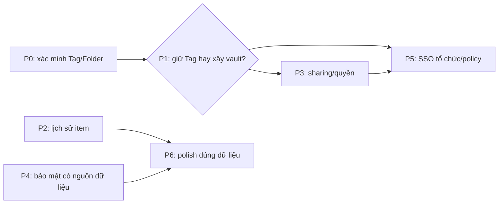

# NodeWarden × Proton Pass: kế hoạch đối chiếu

> **Trạng thái: kế hoạch, chưa triển khai các khoảng thiếu dưới đây.** Nguồn: phân tích ảnh/tài liệu Proton trong `proton-pass-research/BRD.md` và `proton-pass-research/UX-UI.md` (chưa khảo sát trực tiếp ứng dụng Proton đang chạy). Hai file nghiên cứu và ảnh vẫn là tài liệu tham khảo *chưa được đưa vào Git*; các mã F bên dưới là mã trong BRD đó, không phải cam kết tương thích giao thức Proton. NodeWarden tiếp tục dùng giao thức Bitwarden. Tag/Folder không phải vault Proton; Send không phải chia sẻ item; Password History không phải lịch sử phiên bản item.

## Danh mục không bỏ sót

| Mã BRD | Hiện trạng | Hướng xử lý / cổng |
|---|---|---|
| F-01–05 | All Items có; Tag/Folder dùng phân loại, Trash toàn cục, chưa có vault độc lập/ACL/share vault | P1 quyết định mô hình; P3 chỉ khi chốt quyền và khóa |
| F-10–16 | CRUD, form Login, Trash có; move đến Folder/Tag; detail có địa chỉ Open/Copy, mật khẩu che mặc định, **Last copied**; không có Last autofill hay nhãn Vulnerable inline | P0 kiểm chứng move/tag; P4 chỉ hiển thị đánh giá có dữ liệu; P6 polish địa chỉ |
| F-20–23 | Search, All/Recent 30 ngày, multiple select và nhóm ngày khi sort Edited có; chưa có nhãn Today/Yesterday | P6 nếu cần |
| F-30–31 | Soft delete/Restore và một Trash chung có | Trash theo vault phụ thuộc P1 |
| F-40–45 | Metadata và Password History có; Item History (timeline/compare/Restore toàn item) đã có trong Web Vault; `Last autofill` chưa có; app/extension chính thức chưa hiện timeline | P2 xong phần Web; app chưa thu; không đổi tên Password History thành Item History |
| F-50–56 | Password Health quét thủ công và kiểm tra rò rỉ email tài khoản có; không phải giám sát credential Proton; thiếu Inactive 2FA, excluded items, Account protection và card hướng dẫn | P4; trạng thái unknown/lỗi phải rõ |
| F-60–64 | Nội dung item mã hóa client-side, có passkey tài khoản và mã TOTP item; Web Vault không tạo passkey website, autofill do client; thiếu Emergency Access và advanced protection tương ứng | P4 đánh giá threat model trước khi tuyên bố tương đương Proton |
| F-70–74 | Generator tạo alias qua provider SimpleLogin-compatible bên ngoài; chưa quản lý mailbox/domain hoặc gửi mail từ alias tại NodeWarden | P5; chốt provider vs tự vận hành |
| F-80–85 | Attachment, SSO OIDC và audit log có; share item/vault, organization/role, compliance report và policy enforcement chưa có | P3/P5; Send không thay thế share item |
| F-90–93 | Đồng bộ client Bitwarden và import nhiều nguồn có; không có CLI phát hành riêng hay hệ ứng dụng Proton cho app switcher | P6 mặc định không làm CLI/app switcher |
| Pricing tiers | NodeWarden chưa có gói Free/Plus/Business của Proton | Ngoài phạm vi nếu không có yêu cầu sản phẩm/billing riêng |

## Phụ thuộc và cổng quyết định

- **P1-A (mặc định):** giữ Tag/Folder, không nhận F-01/02/04/05/14 là vault Proton. Chỉ thiết kế chia sẻ bản sao qua link nếu có nhu cầu; không thêm ACL/vault giả.
- **P1-B (chỉ khi cần nhiều vùng chứa có quyền độc lập):** định nghĩa owner, membership/role, vault mặc định, item thuộc vault nào, Tag tách khỏi vault, khóa theo vault, cấp/thu hồi quyền, Trash và cách client Bitwarden cũ nhìn thấy item. Khi đó mới lập migration và thiết kế P3/P5 thực thi. Thiết bị đã tải plaintext không thể bị thu hồi dữ liệu từ xa.
- P2 và các lát P4 không dựa vào vault có thể được thiết kế độc lập; P3 và phần tổ chức của P5 **không được vượt cổng P1**. Không thêm nút, trạng thái hoặc tính năng giả trong lúc chờ.

## P0 — tính đúng Tag/Folder trước mọi mở rộng

**Đã xác minh trên Worker/D1 local cô lập:** tạo Login với `Work, Shared`, tạo Tag `Personal`, bulk move sang `Personal` cho kết quả `Personal (1), Shared (1), Work (0)` ngay sau thao tác, sau Sync Vault và sau đăng xuất/đăng nhập lại. Move về “No tag” đưa `Shared` lên đầu, hiển thị `Shared (1), Personal (0)` và detail `Shared`. Lỗi phát hiện trong lần kiểm tra đầu: Folder Web có tên mã hóa nhưng backend đã chèn ciphertext vào Tag, khiến detail hiển thị Personal còn lọc `Personal (0)`; đường tạo/đổi Folder nay ghi tên Tag riêng, còn tên Folder trả cho client vẫn mã hóa. Item nhiều Tag được kiểm tra qua UI thật; các kiểm thử DB/API, `/sync`, quyền owner, rename/delete và conflict ở `scripts/vault-compatibility.test.ts`, `scripts/user-key-id.test.ts`, `scripts/cipher-tags.test.ts`.

**Hồi quy hiện tại:** `scripts/vault-compatibility.test.ts` kiểm tra 31 trường hợp, gồm full/partial/bulk move, Folder mã hóa thiếu `tag_name`, move lặp, owner, conflict và chuyển đổi Folder có điều kiện revision. `scripts/cipher-tags.test.ts` 7/7; `scripts/user-key-id.test.ts` 7/7; `scripts/folder-legacy-encryption.test.ts` 3/3; `scripts/folder-tag-backup.test.ts` 3/3; `scripts/folder-plaintext-inventory.test.ts` 5/5. Hai typecheck, i18n và build đạt. Các phép thử mật mã dùng khóa thật; không coi chuỗi giả EncString là bằng chứng giải mã. Sửa lỗi kèm theo: endpoint revision giờ luôn đẩy revision của vault lên (tối thiểu +1 ms so với revision trước) sau khi repair Tag, vì revision là tín hiệu để client tải payload đã sửa; trước đó repair chạy trong cùng mili-giây với revision cũ thì client không tải lại.

**Cùng vault Web/CLI chính thức trên Worker/D1 local cô lập:** Web Vault tạo tài khoản với khóa thật và Login `Work, Shared`; CLI Bitwarden 2025.1.0 đăng nhập, unlock, giải mã tên Folder, tên item và username, cùng thấy Folder ID `Work`. Web bulk move sang `Personal` giữ Tag phụ `Shared`; sau `bw sync`, CLI thấy item trong Folder `Personal` cùng ID. CLI đổi Folder item sang `Shared`; Web Sync Vault thấy `Shared`. Web thêm Tag phụ `Extra`, CLI đổi Folder sang `Shared`; Web Sync Vault thấy `Shared, Extra`. CLI tạo Folder `CLI Created`, Web Sync Vault thấy Folder đó và bulk move item vào giữ `Extra`; CLI sync thấy đúng Folder ID, tên item và username. Web đăng xuất/đăng nhập lại vẫn hiển thị `CLI Created (1), Extra (1)`. CLI không hiển thị Tag phụ vì giao thức Bitwarden chỉ có Folder; chỉ Web xác nhận Tag phụ còn nguyên.

**Extension Bitwarden chính thức 2026.10.2 trên cùng vault local:** tải bản Chrome từ release `browser-v2026.10.2` của `bitwarden/clients`, đối chiếu SHA-256 với asset công bố, chạy trong Chromium/profile riêng qua HTTPS local. Extension đăng nhập và tải item `P0 Crossclient Login`, username `crossclient-user`; lọc Folder `CLI Created` thấy đúng item. Extension sửa Folder item sang `Personal`; detail hiển thị `Folder Personal`. Web Vault đăng nhập cùng vault thấy `Personal (1), Extra (1)`; lọc từng Tag và Sync Vault vẫn thấy item; D1 giữ `folder_id` của Personal và `tags=["Personal","Extra"]`. Đây là bằng chứng browser extension, không phải app desktop/mobile.

**Desktop Bitwarden chính thức 2026.10.2 trên cùng vault local:** AppImage Linux từ release `desktop-v2026.10.2` của `bitwarden/clients`, SHA-256 khớp asset công bố (`07ce693427984332832be0889e652a74a65c1f0b680cf9fc3684a6fb0458494c`), chạy với profile riêng và CA thử nghiệm chỉ tin trong profile đó. App đăng nhập self-hosted qua HTTPS local, giải mã Folder `CLI Created`, `Extra`, `Personal`, `Shared`, `Work`, item `P0 Crossclient Login` và username `crossclient-user`. Lọc `Personal` thấy item; sửa Folder sang `CLI Created`, detail và lọc `CLI Created` thấy item, lọc `Personal` không còn item. Web Vault đăng nhập cùng vault thấy `CLI Created (1), Extra (1), Personal (0)`; lọc `CLI Created` và `Extra` vẫn thấy item sau Sync Vault. D1 giữ Folder ID `63d8b710-ed6a-4812-9ad6-002b4ef8e38d` và `tags=["CLI Created","Extra"]`. Không suy ra tương thích app mobile từ desktop.

**Bulk move desktop đã sửa và xác minh:** lỗi 409 trước đây được tái hiện bằng desktop 2026.10.2. Sau sửa, UI “Add to folder” gửi `PUT /api/ciphers/move` vào `Desktop Untagged P0` (`tag_name=NULL`) và nhận 204. Server giữ Folder ID, bỏ Tag vị trí cũ và giữ `Extra`, không chèn ciphertext. Web dùng khóa phía client giải mã tên Folder và dựng Tag đầu: `Desktop Untagged P0 (1), Extra (1), CLI Created (0)`; lọc đúng sau Sync Vault và đăng xuất/đăng nhập lại. Desktop lọc và detail xác nhận Folder đích. Full/partial move dùng cùng quy tắc; move khỏi Folder chưa biết tên không làm mất Tag phụ.

**Android chính thức đã xác minh:** APK từ [release v2026.11.0-bwpm](https://github.com/bitwarden/android/releases/tag/v2026.11.0-bwpm), SHA-256 khớp `84d2d210aeefbba18bd32d72c45fd539d66bfe8d533eb8bbec33a13bc1ecb592`, chạy trên emulator Android 14 riêng; không thao tác điện thoại thật. App từ chối HTTP; sau tin CA thử nghiệm trong emulator, đăng nhập HTTPS cùng vault, giải mã item/username và lọc `Desktop Untagged P0`. App sửa Folder sang `Personal`, manual Sync báo hoàn tất, lọc `Personal` thấy item; Web Sync và D1 xác nhận `tags=["Personal","Extra"]`. App chỉ biết Folder nên `Extra (0)` trong app không thay thế `Extra (1)` trong Web. UI được quan sát qua hierarchy thật; FLAG_SECURE chặn screenshot, không tắt bảo vệ app.

**Khôi phục backup admin đã chạy thật trên hai D1 cô lập:** nguồn là đúng vault crossclient (8 Folder có `tag_name`, một Folder không tag, item `P0 Crossclient Login` với `tags=["Legacy Plain P0","Extra"]`). `POST /api/admin/backup/export` trả ZIP mà tên file mang checksum của chính bytes; `POST /api/admin/backup/import` multipart vào một D1 trống (đăng ký admin tạm để cấp quyền, archive thay users bằng tài khoản gốc). Sau khôi phục, hàng `folders`/`ciphers`/`users` của D1 đích giống hệt nguồn, `/api/sync` trả cùng layout, và giải mã phía client bằng đúng master password gốc cho lại đúng 8 tên Folder (Folder không tag vẫn không tag), đúng `folder_id` và `tags` của item. `scripts/folder-tag-backup.test.ts` 3/3 giữ hồi quy cho đường archive/khôi phục.

**Chuyển đổi Folder plaintext có backup boundary:** Web → Import & Export → Folder compatibility kiểm kê tên raw; chỉ chuyển đổi khi người dùng xác nhận có backup và xác nhận lần hai. Bỏ qua tên mã hóa/không giải mã được, tên có padding, quá 64 ký tự hoặc lệch Tag. GET lại trước mỗi PUT và `If-Match` revision ngăn ghi đè concurrent rename; lỗi được báo riêng và có thể thử lại. Smoke D1 cô lập đã tạo backup SQLite trước, chuyển `Legacy Plain P0` thành ciphertext với khóa vault thật, giữ nguyên Folder ID, `folder_id`, `tags=["Legacy Plain P0","Extra"]` và timestamp item. Web báo `Encrypted 1, skipped 0, failed 0`; Android sync giải mã đúng tên, lọc và detail vẫn thấy item. Folder có tên plain nhưng `tag_name=NULL` (ví dụ nhập từ Bitwarden JSON) khi mã hóa tên sẽ lấy chính tên cũ làm `tag_name`, nên Tag của item không bị thay bằng ciphertext; `scripts/vault-compatibility.test.ts` giữ trường hợp này. Chạy lại đúng đường UI sau khi sửa trên D1 cô lập: panel liệt kê 2 Folder plaintext, xác nhận 2 bước, báo `Encrypted 2, skipped 0, failed 0`; 12/12 tên Folder thành ciphertext, `tagName` giữ nguyên văn, menu Tags hiện đủ tên thật và lọc Folder vừa chuyển trả đúng item.

**Dọn Tag rác dạng ciphertext:** bản build trước backfill `tags[0] = folder.name` vô điều kiện, nên vault nhập từ Bitwarden với Folder mã hóa bị ghi chính ciphertext tên Folder vào Tag của item. Kiểm kê một vault thật: 822/876 item như vậy, cả 300 Folder đều `tag_name=NULL`. Migration nay bỏ mọi tag mang đúng dạng EncString khi Folder không có tên plain để backfill, giữ nguyên `folder_id` và Tag thật; Tag thật bị giới hạn 64 ký tự nên không thể có dạng EncString. Diễn tập trên archive thật: 822 → 0 tag rác, 0 Folder đổi, 0 `folder_id` đổi, 0 Tag thật mất, chạy lần hai không đổi; không ghi plaintext nào nên `tag_name` vẫn NULL. Hai lỗi phải sửa kèm mới làm được trên production: (1) migration sửa cipher mà không bump revision nên cache `/sync` (key theo revision) vẫn trả payload cũ; (2) Web Vault và client chính thức hỏi `/api/accounts/revision-date` trước rồi **bỏ qua `/api/sync` khi revision không đổi**, nên một vault không đổi dữ liệu sẽ không bao giờ chạm tới migration — revision endpoint nay chạy đúng migration đó một lần cho mỗi tài khoản (marker `tags.legacy-repair.v1:<userId>`) và bump revision khi có ghi. Kết quả trên production sau deploy: 822 → 0 tag rác, `max(ciphers.updated_at)` và `revision_date` nhảy sang thời điểm sửa; 300 Folder giữ nguyên id/name/`tag_name`, 0 khác biệt ở `folder_id`/`name`/`notes`/`key`/`type`, `data` chỉ khác ở `tags`, users giống hệt.

**Đọc trạng thái sống của production không cần mở khóa vault:** server giữ tên Folder và payload item ở dạng ciphertext, nên nó tự trả lời được "vault còn sạch không": tên Folder không phải chuỗi mã hóa là plaintext, còn Tag là chuỗi mã hóa thì chỉ có thể là dư lượ của đường backfill folder→tag cũ. `npm run audit:prod-vault` đọc D1 production qua Cloudflare API, chỉ in số đếm và marker (không in nội dung vault, không ghi gì); workflow `prod vault audit` chạy script đó bằng secret sẵn có trong repo. Test `scripts/prod-vault-audit.test.mjs` chạy audit trước một API cục bộ đặt hàng bằng hàng của archive thật: vault sạch phải báo sạch, vault còn Tag dạng ciphertext phải bị báo.

**Kiểm kê Folder plaintext trước cutover:** `npm run inventory:folders -- <backup.zip>` đọc archive admin hoàn toàn offline (không gọi server, không cần khóa tài khoản), nhóm Folder theo user trong `db.json` và chỉ liệt kê tên mà đúng quy tắc của Web Vault coi là plain text (dùng chung `inspectFolderNames`), kèm lý do `plaintext`/`padded`/`too_long` và Folder ID. Smoke: archive thật sinh từ import Bitwarden JSON có Folder `Legacy JSON Folder` (tên plaintext do đường import lưu nguyên) được liệt kê đúng một dòng cho đúng tài khoản; archive của instance vừa khôi phục (toàn tên mã hóa) trả "nothing to convert"; thiếu tham số exit 2, file hỏng exit 1.

**Phạm vi phát hành:** code P0 và P2 đã lên production (deploy 2026-11-07, `nodewarden.lucndm.workers.dev`). **Trạng thái sống của production đã được đọc trực tiếp** bằng `npm run audit:prod-vault` (đọc D1 qua Cloudflare API, chỉ in số đếm và marker, không ghi gì): 1 account, 300 Folder, 876 item; **0 tên Folder plaintext**, **0 Tag dạng ciphertext**, 0 Folder trùng tên, 0 item trỏ vào Folder không tồn tại, 0 payload không parse được, 0 Tag quá 64 ký tự; marker `tags.legacy-repair.v1` = `done` và revision = 2026-11-07T08:37:20Z — tức repair Tag **đã tự chạy trên production** ngay sau deploy 08:31, **không cần đăng nhập thủ công**. 822/876 item nằm trong Folder và **không item nào còn Tag** (kể cả Tag phụ): Tag của item suy ra từ Folder, Tag phụ nằm trong `data.tags`. 300/300 Folder có `tag_name=NULL` và tên đã mã hóa ⇒ **không còn tên Folder plaintext để chuyển đổi**; đường Folder compatibility và repair Tag chỉ còn là công cụ dự phòng. Audit này chạy tự động sau **mỗi lần deploy** (workflow `deploy`), nên một thay đổi phá layout vault bị bắt trong chính lần deploy đó; workflow `prod vault audit` chạy tay được khi cần kiểm tra ngoài lúc deploy. **Archive đã qua diễn tập khôi phục và archive đang chạy là cùng một vault:** `npm run test:local-restore -- <backup.zip>` trên archive export của vault production (`nodewarden_backup_20261107_084308_5124e.zip`) — 21/21 xanh: checksum trong tên file khớp SHA-256 của file, mọi item nằm trong Folder của chính tài khoản, không tài khoản nào có hai Folder trùng tên, mọi payload parse được, không Tag nào dạng ciphertext, không Tag nào vượt 64 ký tự, import trả đủ 300 Folder + 876 item + 1 tài khoản, và hàng `folders`/`ciphers`/`users` sau khi khôi phục giống hệt archive. Cùng công cụ `vaultDigest` in ra digest của các hàng quyết định layout: digest archive = digest vault production sống = `c1622e034a9c7a923e5ad2d4a624391a44f74473320036df06e00adca4bda7a0`. Vì `vaultRevision` vẫn là `2026-11-07T08:37:20Z`, vault không đổi sau lúc repair chạy, nên **mọi archive export từ vault này từ 08:37 trở đi đều mang cùng digest** — file backup anh tạo lúc 12:14 chứa đúng dữ liệu đã qua diễn tập, không chỉ là bản sao của nó; server còn tự kiểm checksum tên file lúc import nên file hỏng bị chặn ngay. Không tự đổi production hoặc coi checkbox là backup đã được kiểm tra; iOS và macOS không được suy ra từ Android/Linux.

## P1 — quyết định kiến trúc Vault

- **A — giữ Tag/Folder:** chốt giới hạn F-01/02/04/05/14 trong tài liệu và UI. Phù hợp khi chỉ cần phân loại item; không đổi giao thức để giống giao diện.
- **B — xây vault thật:** sau khi có yêu cầu quyền/cộng tác, lập hợp đồng storage–khóa–API–sync cho mọi đường đọc/ghi item, attachment, import/export, Trash và notification. Server không được trả item của vault sai quyền qua `/sync` chỉ vì UI đã ẩn. Migration item hiện có vào vault mặc định phải giữ ID, ciphertext và Tag; thử idempotency, backup và rollback có cả thay đổi phát sinh sau migration. Thử hai user, thiết bị cũ/mới, revoke, offline và concurrent writes trước UI vault.
- **Đầu ra P1:** quyết định A/B được duyệt và hợp đồng dữ liệu/quyền/tương thích; chưa tạo bảng/nút vault khi chưa có quyết định.

**Đã chốt: P1-B theo model Bitwarden** (Organization + Collection + Group, không phải vault độc lập của Proton). Lý do: client Bitwarden chính thức đã nói chuyện theo mô hình này, nên dùng nó thì client chính thức hiểu ngay; mô hình vault của Proton không có client nào hỗ trợ. Hợp đồng quyền đã chốt và đã có hồi quy:

1. **Ba cờ:** `readOnly`, `hidePasswords`, `manage` — mỗi collection mà user chạm tới mang một bộ ba cờ này, lấy từ gán trực tiếp (`CollectionUser`) hoặc từ group (`CollectionGroup`).
2. **Gán trực tiếp thắng gán qua group** cho cùng một collection: group là lối tắt tới collection, không phải cách mở rộng quyền đã bị giữ lại. Nếu user ở hai group cùng cấp quyền cho một collection thì lấy bộ quyền tốt hơn.
3. **Item lấy bộ quyền cao nhất user chạm tới**, xếp theo thứ tự `manage` (4) > `edit` (2) > `view password` (1) — **không** phải AND/OR. Đây là quy tắc của server Bitwarden chính thức: `src/Sql/dbo/Vault/Stored Procedures/Cipher/CipherDetails_ReadByUserId.sql` (đường `/sync`) và `GetCipherPermissionsForUserQuery` (đường organization). Client chính thức đọc đúng ba boolean `edit`/`viewPassword`/`manage` từ server, nên server phải ra đúng ba số đó.
4. **Lọc quyền nằm ở tầng query, không ở UI**: item user không chạm tới thì không được trả trong `/sync`, kể cả khi UI đã ẩn.
5. **`/sync` trả về** `collections` (kèm quyền của user trên từng collection), `organizations` và `policies` cùng `ciphers`; client tự tính quyền theo `collectionIds` của item.

**Lưu ý khi đọc vaultwarden:** vaultwarden dùng AND cho `readOnly`/`hidePasswords` và OR cho `manage` (`src/db/models/cipher.rs:660-677`), **khác** quy tắc rank của server chính thức — khác nhau ngay ở case item nằm trong một collection read-only và một collection có `manage`. NodeWarden theo **server chính thức**, không theo vaultwarden, vì client chính thức dựa vào đó. Hàm `src/services/collection-access.ts` cài đúng quy tắc rank và `scripts/collection-access-sql.test.ts` chạy SQL gốc của upstream trên SQLite rồi so kết quả, nên sai lệch sẽ lộ ra.

**Đã có (đo được bằng test):**

- `src/services/collection-access.ts` — hợp đồng quyền, hàm thuần, không chạm DB.
- `scripts/collection-access.test.ts` — 9 case cho quy tắc rank và gán trực tiếp thắng group.
- `scripts/collection-access-sql.test.ts` — 4 case chạy **chính SQL của server upstream** trên SQLite rồi so với hàm; lệch là đỏ.
- 8 bảng D1: `organizations`, `organization_users`, `collections`, `groups`, `group_users`, `collection_users`, `collection_groups`, `collection_ciphers`, cộng `ciphers.organization_id`. Có cả trong `migrations/0001_init.sql` lẫn `src/services/storage-schema.ts`; schema version đã bump.
- `src/services/storage-collection-repo.ts` — đọc tổ chức/collection/group/quyền, và `getVisibleCiphers` lọc theo quyền **trong query**.
- `/sync` trả `collections` (kèm `readOnly`/`hidePasswords`/`manage`) và `organizations` thật; item của organization mà user không chạm tới **không** được trả về.
- `GET /api/collections` và `GET /api/organizations` trả danh sách thật. Route tạo/sửa/xoá trả **501** thay vì giả thành công.
- Backup export/import đã mang theo 8 bảng và `ciphers.organization_id`; diễn tập khôi phục trên archive production thật vẫn 21/21.
- `npm run test:collection-access` (13 case) và `npm run test:collection-storage` (9 case), cả hai đã nối vào `npm run test:local`.

**Phân phối khóa organization (đã có):** server **không bao giờ thấy khóa organization**. Owner tự sinh khóa đối xứng + cặp khóa RSA cho organization phía client, gửi lên dạng đã bọc:

- `organizations.private_key` — khóa riêng RSA của organization, đã mã hóa bằng khóa organization.
- `organizations.public_key` — khóa công khai RSA.
- `organization_users.key` — khóa organization **bọc riêng cho từng thành viên** bằng public key của họ.

Luồng: owner `POST /api/organizations` (kèm `key` đã bọc + `keys`), admin `POST /api/organizations/:id/users` để mời, rồi `POST /api/organizations/:id/users/:memberId/confirm` để gắn khóa đã bọc cho thành viên đó. `POST /api/organizations/:id/users/public-key` cho client của admin lấy public key của người cần bọc. `/sync` trả `profile.organizations[].key` đúng dạng đã bọc cho người đang hỏi; thành viên mới được mời nhưng chưa confirm thì nhận `key: null`.

`scripts/organization-keys.test.ts` (5 case) chạy **RSA-OAEP + AES-GCM thật**: tạo organization, mời, confirm, rồi chứng minh owner và member mở ra **cùng một khóa**, người ngoài **không mở được**, người ngoài không thấy organization, plain member không confirm được, không tạo được owner thứ hai, và backup mang theo khóa đã bọc.

**Item chia sẻ (đã có):**

- `POST /api/ciphers` nhận `organizationId` + `collectionIds`; từ chối 400 khi không có collection nào (`a shared item must be placed...`), 404 khi collection thuộc organization khác, 403 khi member chỉ có quyền đọc collection đó.
- `PUT /api/ciphers/:id`: chủ sở hữu item cá nhân, hoặc member có quyền ghi trên item chia sẻ. Quyền đọc-only → **403**, không đọc được → **404**. Đổi `collectionIds` cần quyền ghi trên collection đích; `organizationId` **không đổi** qua đường edit (khớp upstream).
- `GET /api/ciphers/:id`, `GET /api/ciphers`, `/api/sync` trả item theo quyền đọc; response có `organizationId` + `collectionIds`. `GET /api/ciphers` và `/api/sync` dùng `getVisibleCiphers` nên item ngoài quyền không rời server.
- Owner/admin của organization chạm tới **mọi** collection của nó (khớp `AllowAdminAccessToAllCollectionItems` của upstream); member thường chỉ chạm collection được gán trực tiếp hoặc qua group.
- `scripts/shared-item.test.ts` (6 case) chạy qua router thật: tạo item chia sẻ, member đọc thấy, người ngoài 404, read-only member sửa → 403, không đặt được vào organization khác, không để item không thuộc collection nào, và chuyển collection cần quyền ghi ở đích.

**Kiểm quyền ở đường ghi (đã có):** mọi thao tác trên item — sửa, xoá mềm, khôi phục, archive/unarchive, move, xoá vĩnh viễn, cả bản một item lẫn bản hàng loạt — đều lọc qua `filterWritableCipherIds` trước khi chạm dữ liệu:

- Quyền ghi = `!readOnly || manage` trên **mức cao nhất** member chạm tới (rank ≥ 2); owner/admin của organization có rank 7 nên chạm mọi collection của nó.
- **Xoá vĩnh viễn** item chia sẻ đòi **manage** (rank ≥ 4): người chỉ có quyền sửa không được xoá item của cả tổ chức.
- Đọc-only → **403** ở đường một item, và **không đổi gì** ở đường hàng loạt (id bị lọc bỏ, request vẫn 204).
- Người ngoài → **404**, không phân biệt được "không có" với "không có quyền".
- Đường đọc (`getCiphersByIds`) vẫn chỉ trả item của chính user; danh sách sau bulk đọc lại từng item qua `getCipherForUser` nên id do client gửi không thể kéo ra item ngoài quyền.
- `scripts/shared-item.test.ts` phủ cả hai đường, gồm move thật vào folder và xoá vĩnh viễn bị chặn cho editor.

**Một quy tắc đọc cho cả ba đường:** `list`, `/sync` và **phân trang** dùng chung `visibleCiphersSql` trong `storage-cipher-repo.ts`. Trước đó phân trang chỉ đọc item cá nhân nên client chính thức (dùng phân trang khi vault lớn) không thấy item chia sẻ; nay cả ba trả cùng một tập. `scripts/shared-item.test.ts` có case đi hết các trang với `pageSize=1` và kiểm phần tử chia sẻ xuất hiện.

**Quản trị organization (đã có):**

| Route | Việc |
|---|---|
| `POST /api/organizations/:id/collections` | owner/admin tạo collection |
| `PUT /api/organizations/:id/users/:memberId` | owner/admin đổi role và **thay toàn bộ** quyền collection của member (`collections: [{id, readOnly, hidePasswords, manage}]`) |
| `DELETE /api/organizations/:id/users/:memberId` | owner/admin thu hồi member |

- Chỉ owner/admin (type ≤ 1) làm được; member thường nhận **404**, không phải 403.
- Collection của organization khác → **404**.
- Owner **không bị thu hồi** (400); không tự thu hồi mình; không tạo owner thứ hai.
- Quyền thay đổi **có hiệu lực ngay** ở request kế tiếp (test: cấp quyền ghi → reader sửa được; thu về read-only → 403 ngay).
- **Thu hồi member**: xoá membership + collection assignments + group memberships, nên mọi query quyền trả rỗng ngay. Test xác nhận member bị xoá không còn thấy organization, collection hay item.

**Hai lỗ hổng phát hiện khi làm phần này:**

1. `getCipherForUser` khớp `user_id` nên **người bị thu hồi vẫn đọc được item do chính họ tạo**. Nay đường đọc cá nhân chỉ khớp `organization_id IS NULL`; item chia sẻ chỉ đến từ quyền collection.
2. `getCollectionRights` trả cờ 0 cho collection owner chưa được gán — owner thấy collection nhưng `manage=false`. Nay owner/admin nhận `readOnly=false, hidePasswords=false, manage=true` trên **mọi** collection của organization (khớp `CanEditAllCiphersAsync` của upstream), và `getCollectionRightsForCollections` dùng cùng quy tắc.

**Xoay khóa organization (đã có):** `POST /api/organizations/:id/rotate-key` — **chỉ owner** (admin xoay được sẽ khoá owner ra ngoài). Client của owner sinh khóa mới rồi gửi lên:

| Trường | Nội dung |
|---|---|
| `privateKey` | khóa riêng RSA của organization, mã hóa lại bằng khóa mới |
| `members[]` | `{ membershipId, key }` — khóa mới bọc cho **từng** member còn lại |
| `ciphers[]` | `{ id, key, data }` — item key bọc lại bằng khóa mới, kèm payload đã mã hóa lại |

Server **không đọc được blob nào** và **không tự xoay được**. Ba tính chất đã kiểm bằng test: ghi trong **một batch** nên xoay dở dang không để lại member/item lẻ; revision của **mọi** member được đẩy lên nên client tải blob mới thay vì dùng cache; một id không thuộc organization (member hoặc item) làm **toàn bộ** request bị từ chối — không có chuyện xoay nửa chừng.

**Giới hạn đã biết, và cách xoay khóa giải quyết:** thu hồi member **không** lấy lại được khóa organization họ đã mở — dữ liệu họ đã tải vẫn đọc được. Xoay khóa sau khi thu hồi mới là thứ khiến việc thu hồi có nghĩa: member đó không còn nhận được khóa mới nên không mở được item đã xoay. Dữ liệu họ **đã tải trước đó** thì không thể thu hồi từ xa — giới hạn của zero-knowledge, không phải lỗi cài đặt.

**Xoay khóa phía client (đã có):** `webapp/src/lib/organization-key-rotation.ts` làm toàn bộ phần mật mã, không gọi server:

- Sinh khóa organization mới (64 byte), **không** giữ lại sau khi trả về.
- Mã hóa lại khóa riêng RSA của organization bằng khóa mới.
- Bọc khóa mới cho từng member bằng RSA-OAEP SHA-1, dạng `4.` mà client chính thức đọc.
- Mỗi item chia sẻ nhận **item key mới** và **payload được mã hóa lại** — đây là điểm quan trọng: chỉ bọc lại item key cũ thì ai giữ khóa organization cũ vẫn mở được item. Item vốn dùng khóa organization trực tiếp (không có `key`) cũng được cấp key riêng.
- Payload không phải chuỗi mã hóa (`type`, `tags`, username plaintext…) giữ nguyên. Một chuỗi **trông như** mã hóa nhưng không giải được bằng khóa cũ sẽ **dừng cả lần xoay** thay vì để lại payload nửa cũ nửa mới.

`scripts/organization-key-rotation.test.ts` (7 case, RSA + AES thật): hai member mở ra **cùng khóa mới** và khác khóa cũ; khóa organization cũ **không** mở được private key mới, item key mới, hay tên/payload mới; payload giải đúng dưới khóa mới; giá trị không mã hóa giữ nguyên; payload lạ dừng lần xoay; một member mở được khóa bằng private key của chính họ và người khác thì không.

Case cuối chạy **toàn bộ đường** qua router thật: `openOrganizationKey` → `rotateOrganizationKey` → `POST /api/organizations/:id/rotate-key` → D1, rồi member thứ hai mở khóa mới từ API và đọc lại item đã xoay. Đây là chỗ phát hiện ra **`name`/`notes` là cột riêng**, không nằm trong `data`: xoay khóa mà chỉ mã hóa lại `data` thì tên item vẫn nằm dưới khóa cũ. Nay rotation mang theo `name`/`notes`, và câu UPDATE dùng `COALESCE(?, name)` để archive cũ không có trường này vẫn khôi phục được.

Hai hàm phía client: `openOrganizationKey` (mở khóa organization hiện tại bằng private key của member — giải private key bằng vault key rồi RSA-OAEP SHA-1) và `applyOrganizationKeyRotation` (mở khóa cũ → sinh khóa mới → gửi lên).

**Web Vault hiển thị và lọc theo organization/collection (đã có):**

- Sidebar có mục **Organizations**, mỗi organization là một dòng, collection nằm dưới nó, kèm số item. Chọn một trong hai để lọc; item cá nhân biến mất khỏi danh sách khi lọc theo collection.
- Item detail hiện dòng `organization · collection` kèm nhãn **Shared**, nên item chia sẻ không còn bị hiển thị như item cá nhân.
- **Giải mã item chia sẻ:** `decryptVaultCore` mở khóa organization bằng private key của member (RSA-OAEP SHA-1) rồi dùng khóa đó mở item key. Trước bước này, item chia sẻ hiện `(No Name)` — test UI đã bắt đúng lỗi đó và nay đã xanh.
- `webapp/src/lib/api/organizations.ts` đọc `/api/organizations` và `/api/collections`; dữ liệu đi qua `AppMainRoutes` → `VaultPage` → `VaultSidebar`/`VaultDetailView`.
- Kiểm chứng trong Chromium thật (`npm run test:local-ui`, thêm 6 check): sidebar nêu tên organization và collection; chọn collection giữ đúng item chia sẻ và loại item cá nhân; detail nêu tên organization và nhãn Shared.

**Ba rủi ro đã đóng:**

1. **Thu hồi member mà không xoay khóa** — thu hồi nay **bật cờ `key_rotation_required`** trên organization (`organizations.key_rotation_required`, hiện trong `/api/organizations` và `profile.organizations` của `/sync`). Web Vault hiện biểu tượng cảnh báo cạnh tên organization; cờ chỉ tắt khi xoay khóa xong. Test: xóa member → cờ `true`; xoay → cờ `false`.
2. **`rotate-key` nhận payload tùy ý** — trần cứng: 200 member, 200 item, 8 MiB tổng, 64 KiB mỗi trường — quá thì **413**. Quan trọng hơn: trường quá dài bị **từ chối**, không bị cắt, vì ciphertext bị cắt là item hỏng mà client không bao giờ biết. (Đây là lỗi test bắt được: `text()` cắt âm thầm payload 70 KB thành 64 KB rồi trả 200.)
3. **`filterWritableCipherIds` quét toàn bộ organization** — truy vấn rank nay nhận danh sách id cần hỏi, nên bulk action trên vài item không còn đi qua mọi item của organization.

**Nút xoay khóa organization (đã có):**

- Owner thấy nút **Rotate key** ngay dưới organization trong sidebar; bấm ra hộp xác nhận nói rõ hậu quả (mọi thành viên nhận khóa mới, mọi item chia sẻ được mã hóa lại).
- `GET /api/organizations/:orgId/rotation-data` — **chỉ owner** được đọc, trả về private key đã mã hóa của organization, các thành viên còn lại kèm public key RSA, và các item chia sẻ **đúng như server đang lưu** (payload thô, không bị chuẩn hoá khi đi ra) để việc mã hóa lại là tròn vẹn.
- Khóa mới **chỉ tồn tại trong client**: sinh ở `applyOrganizationKeyRotation`, bọc lại cho từng thành viên bằng public key RSA của họ, mỗi item nhận một item key mới và payload được mã hóa lại từ key cũ — nên người đã rời đi giữ khóa cũ cũng không đọc được item.
- Sau xoay, client đọc lại organization, collection và vault, nên item vẫn đọc được ngay.
- Kiểm chứng trong Chromium thật (`npm run test:local-ui`, thêm 4 check): owner thấy nút; hộp xác nhận hỏi trước; xoay xong có thông báo; **item chia sẻ vẫn đọc được sau khi xoay** — đó mới là bằng chứng rằng việc mã hóa lại đúng.

**Editor tạo item chia sẻ (đã có):**

- Trong form tạo/sửa item có ô **Share with**: danh sách `Tổ chức / Collection`, cộng lựa chọn **My vault**. Collection mà member chỉ đọc được thì hiện nhưng không chọn được; item đang nằm trong collection đó vẫn hiện đúng chỗ của nó.
- Item được chia sẻ thì **mã hóa bằng khóa organization**, không phải khóa user: client mở khóa organization (bọc RSA cho riêng member này), sinh một **item key mới**, bọc item key đó bằng khóa organization, và mã hóa toàn bộ payload bằng item key. Server không bao giờ thấy khóa.
- Sửa một item đã chia sẻ: item key cũ được mở bằng khóa organization và **dùng lại**, nên item vẫn đọc được bởi các member khác — không bị đổi thành item cá nhân trong lúc sửa.
- Item chia sẻ không mang tag (tag là folder cá nhân), nên chọn collection sẽ xoá tag.
- Kiểm chứng trong Chromium thật (`npm run test:local-ui`, thêm 3 check): tạo được item trong collection; **item mới đọc được sau khi tạo** (chứng minh payload nằm dưới đúng khóa); sửa xong item **vẫn còn `organizationId`** — đọc thẳng từ API để không phải tin phần hiển thị.

**Quản trị organization (đã có):**

- Nút **Manage organization** dưới organization trong sidebar (owner và admin) mở hộp **Organization**: ai đang ở trong đó, vai trò, và quyền của họ trên từng collection.
- **Mời**: admin nhập email → server tạo membership → client lấy **public key RSA** của người mời, **bọc khóa organization** bằng key đó rồi **confirm**. Người chưa có public key thì mới ở trạng thái *invited*, chưa mở được item — và hộp thoại nói rõ điều đó.
- **Quyền trên collection** là 5 mức: không có / xem / xem trừ mật khẩu / sửa / quản lý — bám đúng ba cờ `read_only`, `hide_passwords`, `manage` mà client chính thức dùng.
- **Thu hồi**: xoá member → mất quyền ngay, nhưng **hộp thoại nói thẳng** rằng họ vẫn giữ khóa organization đã mở → organization bật cờ `key_rotation_required` → nút xoay khóa ngay trong hộp thoại đó.
- **Vai trò**: chỉ **owner** đổi được vai trò (server từ chối admin đổi vai trò, trả 403) — admin không thể trao quyền admin cho người khác, kể cả chính mình.
- Endpoint mới: `GET /api/organizations/:orgId/users` (chỉ owner/admin) trả member + email + vai trò + quyền từng collection.
- Kiểm chứng trong Chromium thật (`npm run test:local-ui`, thêm 6 check): hộp thoại tên organization và liệt kê member; **mời được và member được confirm** (đọc `status` từ API); **xoá được member**; organization báo phải xoay khóa; xoay khóa xong item vẫn đọc được.

**Kiểm chứng bằng client chính thức (đã chạy):**

`npm run test:local-cli` chạy **CLI Bitwarden chính thức 2025.1.0** trên Worker/D1 local qua HTTPS, tổng **42 check**, trong đó nhánh chia sẻ:

- CLI mở **khóa organization** bằng RSA private key của member (định dạng bọc `4.<base64>` đúng như client chính thức).
- CLI **giải mã item chia sẻ do server tạo** (item key bọc dưới khóa organization, payload dưới item key) — đọc đúng tên và username.
- CLI **giải mã tên collection** (tên collection phải là EncString dưới khóa organization).
- CLI **move một item cá nhân vào organization** qua `PUT /ciphers/{id}/share`, rồi đọc lại từ organization; server giữ đúng `organizationId` và `collectionIds`.

Kiểm chứng này tìm ra và đã sửa **5 lỗi tương thích thật**:

1. `POST /api/organizations` **không bump revision date** → client chính thức thấy "không có gì thay đổi" và **không bao giờ thấy organization mới** cho tới khi có thay đổi khác. Nay đã bump + notify.
2. `POST /api/organizations/:orgId/collections` cũng vậy → nay bump revision cho mọi member đã confirm.
3. `GET /api/organizations/:orgId/collections` **không tồn tại** (501) → client không lấy được danh sách collection. Đã thêm (chỉ member đã confirm, trả quyền của họ).
4. `PUT /api/ciphers/:id/share` **không tồn tại** (404) → `bw move`/`bw share` không dùng được. Đã thêm: nhận `{ cipher, collectionIds }` (collection nằm **cạnh** cipher), kiểm quyền ghi, xoá folder/tag cá nhân, đặt `organizationId` + collection.
5. `PUT /api/ciphers/:id/collections_v2` **không tồn tại** → client mới không gán được collection sau khi share. Đã thêm.

**Chia sẻ thật giữa hai thành viên (đã chạy, CLI chính thức):**

- Tạo **account thứ hai** (mời bằng invite code của owner), owner **mời** nó vào organization và **bọc khóa organization bằng public key RSA của người mời**; owner gán **collection** cho member (member chỉ thấy item qua collection mình có quyền).
- Member thứ hai đăng nhập bằng CLI chính thức (data dir riêng) và **đọc được item do owner viết** — đúng tên, đúng username. Đây mới là bài toán chia sẻ thật, không phải mô phỏng phía server.
- **Sau khi xoay khóa**: member vẫn đọc được item bằng khóa mới, và owner vẫn đọc được item nó đã share. Tức là vòng xoay tạo ra khóa mà **client chính thức mở được** — không chỉ mở được bởi Web Vault của chính mình.
- `npm run test:local-cli` nay **55 check**, tất cả xanh.

Ngoài ra Web Vault nay **giải mã tên collection** bằng khóa organization (`decryptCollectionNames`), có fallback hiển thị nguyên văn cho collection cũ lưu plaintext — trước đó tên do client thật tạo sẽ hiện thành `2.xxx`.

**Còn làm (P1-B):** chưa có endpoint quản lý group, và mời member bằng email còn thiếu bước **member tự chấp nhận** (hiện admin confirm ngay khi người mời đã có public key; nếu chưa có thì phải admin bấm lại sau).

**Tham chiếu thực tế từ `dani-garcia/vaultwarden` (đọc source `17b159b`):** đây là server Bitwarden-compatible tự host, đã làm phần lớn P3/P4/P5 mà NodeWarden còn mở, nên nó cho biết hình hình thực tế trước khi chốt. Những gì **không** có trong vaultwarden, tức là phần NodeWarden đang đi trước: không có bảng `tags` (chỉ `folders`), không có cột usage/`last_used_at` cho cipher, không có bảng version của item (chỉ `password_history`), **không** có kiểm tra tên Folder plaintext — `folders.name` lưu thẳng chuỗi client gửi lên (`src/db/models/folder.rs:52-61`), nên NodeWarden phải tự kiểm tra ciphertext-vs-plaintext như đã làm. Những gì vaultwarden có: Organizations + Collections + Groups + Member Roles (Owner/Admin/Manager/User/Custom), Event Logs, Policies, Directory Connector, Emergency Access, SSO OIDC; SCIM thì **không** (`"useScim": false` vì không thuộc AGPLv3). Bài học dùng được cho P1-B/P3/P5: `/sync` chỉ trả cipher **visible** cho user — `Cipher::find_by_user_visible` (`src/db/models/cipher.rs:926`) và `get_access_restrictions` trả `None` khi user không có quyền, nên lọc quyền nằm ở tầng query chứ không ở UI; và **gán trực tiếp thắng gán qua group** cho cùng collection (upstream cũng vậy: `WHERE NOT EXISTS (SELECT 1 FROM CollectionUser ...)` trong SQL của server chính thức). Lưu ý: vaultwarden cộng dồn quyền bằng AND cho `read_only`/`hide_passwords` và OR cho `manage`, khác quy tắc rank của server chính thức; NodeWarden theo server chính thức, chi tiết ở mục P1.

## P2 — Item History (F-40–45)

**Đã có:** card metadata (đổi tên thành *Item Information*) và danh sách mật khẩu cũ vẫn giữ nguyên (`webapp/src/components/vault/VaultDetailView.tsx`). Bảng `cipher_versions` giữ từng trạng thái cũ của item dưới dạng ciphertext; server không bao giờ thấy plaintext.

**Hợp đồng đã chốt:**

1. **Snapshot:** `type`, `name`, `notes`, `key`, `reprompt` và payload mã hóa **không kèm Tag**. Tag/Folder là tổ chức, không phải nội dung: đổi Folder không tạo version và Restore không kéo item về Folder cũ. Attachment nằm ngoài payload nên metadata và bytes không bị Restore đụng tới; item xóa vĩnh viễn mất luôn version.
2. **Ghi version:** chỉ khi ghi item **thành công** và payload mã hóa thay đổi. Bản ghi version và bản ghi item nằm trong **cùng một batch D1**; version chỉ được ghi khi item thật sự đã tới revision mới, nên ghi bị từ chối (conflict) không để lại version nào. Mỗi version gắn owner (`user_id`), item (`cipher_id`) và revision của vault. Không lưu plaintext. **Server zero-knowledge nên không tự biết plaintext có đổi hay không:** client giữ item key (Web Vault) chỉ mã hóa lại field đã sửa, nên với Web một đổi Folder hay một lưu no-op là không sinh version; client mã hóa lại toàn bộ item (CLI chính thức xoay item key ở mỗi lần sửa) thì mọi lần ghi đều sinh version, kể cả khi nội dung không đổi — UI báo rõ là không có khác biệt.
3. **API:** `GET /api/ciphers/:id/versions` (danh sách, có tên mã hóa và item key của từng mốc), `GET /api/ciphers/:id/versions/:versionId` (snapshot đầy đủ), `POST /api/ciphers/:id/versions/:versionId/restore`. Cả ba kiểm tra quyền trước: version của người khác trả 404, không trả 403. Restore kiểm tra `If-Match` (revision client đang hiển thị) → 409 nếu lệch; giữ trạng thái đang có thành version mới nên Restore hoàn tác được; giữ nguyên item ID và không khôi phục bytes attachment đã xóa; sau khi ghi thì bump revision và báo sync.
4. **Retention:** mỗi item giữ 20 trạng thái mới nhất, bản cũ hơn bị cắt khi ghi version mới. Item có sẵn chỉ có lịch sử từ lần sửa đầu tiên sau khi bật tính năng — không dựng lại lịch sử quá khứ.
5. **UI:** `View Item History` trong card Item Information → timeline (Current Version trước, rồi từng mốc) → bấm một mốc để xem nội dung đã giải mã và so sánh từng trường với bản hiện tại (name, username, password, website, notes, TOTP) → xác nhận Restore. Password History giữ tên và vị trí riêng.
6. **Test:** `scripts/cipher-versions.test.ts` 8/8: ghi version khi sửa nội dung, no-op và đổi Folder không tạo version, ghi thua race không tạo version, quyền sai, item bị xóa, retention 20 mốc, Restore (nội dung cũ về, trạng thái bị thay giữ lại, ID giữ nguyên, revision chạy) và Restore với revision cũ bị từ chối.

**Kế hoạch kiểm thử local (trước khi deploy):** `npm run test:local-cli` chạy CLI Bitwarden chính thức (2025.1.0 và 2026.10.1 đều xanh) với Worker local + D1 cô lập: CLI đăng nhập, tạo item, đọc lại, sửa item (bản ghi cũ được ghi thành version), tạo Folder, chuyển item vào Folder (tên Folder mã hóa không được chèn vào Tag; nội dung item không đổi), sync và đọc lại item sau khi Restore — 27/27 đạt. `npm run test:local-api` chạy cùng luồng qua HTTP để kiểm các đường client không đi tới (quyền sai, revision cũ, payload sync) — 29/29 đạt. `npm run test:local-ui` chạy Web Vault trong Chromium (timeline, so sánh, Restore) — 7/7 đạt. Mỗi lần chạy tự bật Worker riêng (`wrangler dev --local`) với D1 tạm và xóa sau đó; CLI chính thức từ chối http nên Worker được phục vụ qua https với chứng thư tạm mà CLI tin (`NODE_EXTRA_CA_CERTS`). Deploy chỉ là bước cuối, không phải nơi kiểm thử.

**Còn mở:** app Bitwarden chính thức chưa dùng được API này (client chỉ hiển thị Folder, không có timeline); `Last autofill` (F-40–45) **không làm được với client chính thức, đã kiểm tra bằng gói cài thật**: desktop 2026.10.2 giữ `lastUsedDate` trong **local data** (`localData.lastUsedDate`) và không gửi lên server; extension 2026.10.2 và CLI không có route usage nào; `CiphersController` của upstream `bitwarden/server` cũng không có endpoint usage ⇒ server không thể biết client đã autofill lúc nào. Web Vault chỉ biết lúc người dùng **copy** mật khẩu, đã hiện là `Last copied`; thêm một hàng `Last autofill` sẽ là dữ liệu luôn rỗng, nên không thêm. Phần F-40 còn lại đã có: Item Information hiện `Last copied`, `Last edited`, `Created`, và Item History hiện mốc `Current Version` (số version tính từ bản cũ nhất, server chỉ trả số thứ tự chứ không trả plaintext). dữ liệu có sẵn không hoàn lịch sử quá khứ.

## P3 — Sharing (F-05, F-80–81)

**Phụ thuộc P1.** `/api/ciphers/:id/share` hiện chỉ trả lại item; organizations/collections rỗng (`src/router-authenticated.ts:364,428-438`). Bitwarden Send chia sẻ text/file tạm, không cấp quyền đọc/sửa item.

1. Quyết định **link chia sẻ bản sao** hay **quyền thành viên trên item/vault**; không gọi link Send là vault share. Nếu P1-A, không đưa ra lời hứa chia sẻ vault có ACL.
2. Với quyền thành viên: hợp đồng invitation/accept/expiry, read/edit role, phân phối khóa client-side, revoke/rotate, attachment, audit, quyền ở từng endpoint và `/sync`; không gửi khóa plaintext cho server. Với link: payload xác định, khóa, hết hạn, giới hạn lượt, revoke và lộ metadata.
3. Xây authorization và API thật trước UI; route stub không được trả thành công giả. Test owner/invitee/người lạ, link hết hạn, nhiều thiết bị, offline, revoke, import/export và attachment. Nêu rõ thiết bị từng tải plaintext không thể bị xóa từ xa.

## P4 — bảo mật sản phẩm (F-50–56, F-60–64)

Lập **plan riêng cho từng lát**; không biến Pass Monitor thành tập hợp card báo “an toàn” không có dữ liệu.

| Lát | Nguồn/cổng bắt buộc và nghiệm thu |
|---|---|
| Password Health inline | Tái sử dụng kết quả quét thủ công trong `webapp/src/lib/password-security-cache.ts`, gắn revision/fingerprint item; chưa quét/lỗi/hết hạn ≠ Strong/Safe. Exposed/Weak/Reused chỉ hiện khi có kết quả hợp lệ. |
| Credential monitoring | Xác định corpus/provider, dữ liệu gửi ra, đồng ý người dùng, tần suất/quota và định nghĩa kết quả theo từng credential; kiểm tra rò rỉ **email tài khoản** hiện tại không đồng nghĩa Dark Web Monitoring cho toàn vault. |
| Inactive 2FA | Chỉ kết luận website hỗ trợ 2FA từ nguồn đáng tin; item không có TOTP không đủ làm bằng chứng. Tách không rõ/không hỗ trợ/chưa bật. |
| Excluded items | Chốt nơi lưu trạng thái theo item, phạm vi từng phép quét, sync, opt-in/out và audit; item excluded không được báo safe. |
| Account protection | Định nghĩa biện pháp bật/tắt có thực thi ở auth/API và cách khôi phục khi mất thiết bị; new-device verification hiện bị từ chối khi thiếu kênh email (`src/handlers/accounts.ts:870-910`). |
| Emergency Access | Threat model riêng: người nhận, thời gian chờ, hủy, xác thực, thông báo, cấp/thu hồi khóa và audit; không gửi master password/secret thô. |
| Passkey/2FA/zero-knowledge | Phân biệt passkey tài khoản và passkey website; TOTP item và 2FA đăng nhập; autofill ở client Bitwarden. Rà mô hình mã hóa thực tế trước khi tuyên bố tương đương Proton. |

Mọi lát phải kiểm tra trạng thái unknown/error, không lộ secret khi log/export, và review bảo mật trước phát hành. Card giáo dục F-56 là nội dung tùy chọn sau khi luồng thật ổn định.

## P5 — Alias và doanh nghiệp (F-70–74, F-83–85)

- **Alias:** quyết định tích hợp SimpleLogin-compatible hay tự vận hành mail trước. Với tích hợp hiện tại (`webapp/src/lib/simplelogin-forwarder.ts`): kiểm tra provider hỗ trợ list/disable/delete alias → chọn mailbox chuyển tiếp → domain do provider xác nhận → gửi thư từ alias *chỉ nếu có API thực*. Chốt token/secret, quota, lỗi upstream, đồng bộ cấu hình, và không hứa tính năng Proton do NodeWarden sở hữu. Không thêm pricing tier giả.
- **SSO tổ chức:** OIDC account link hiện có (`README.md:54`) không phải membership/SCIM; phụ thuộc P1/P3. Chốt ánh xạ user–organization, provisioning/deprovisioning, thu hồi quyền và case IdP mất kết nối; không suy ra quyền từ `domainHint`.
- **Compliance:** audit log đang có (`src/handlers/admin.ts:121-165`). Chốt scope/role, metadata được phép xuất, định dạng, retention và redaction trước CSV/PDF; thử không lộ secret và user không được phép không truy cập được.
- **Policy:** `/api/policies` hiện rỗng (`src/router-authenticated.ts:483-488`). Chỉ thêm sau khi có đối tượng organization và hành vi cần kiểm soát; kiểm thử enforcement tại share/export/sync/API với client cũ, không chỉ khóa nút UI.

## P6 — polish độc lập và các mục cố ý không làm

- F-23: Today/Yesterday theo locale/múi giờ, chỉ với sort nhóm ngày; test chuyển ngày/nửa đêm và ngày không hợp lệ (`VaultListPanel.tsx:130-137`).
- F-15: Website giữ Open/Copy; nếu chuyển sang hyperlink thực, chỉ URL an toàn, keyboard/screen-reader hợp lệ và không tạo hai Open trùng nhau (`VaultDetailView.tsx:510-529`). Last copied **không** đổi nhãn thành Last autofill nếu chưa có sự kiện autofill từ client.
- F-50/56: chỉ đổi bố cục/tên Pass Monitor sau P4, không nhân bản nội dung hay trạng thái đo không có. Kiểm tra dark/light, mobile/desktop, tương phản và focus.
- F-92/93: mặc định **không làm** CLI riêng hoặc app switcher Proton; server đã tương thích client Bitwarden CLI, NodeWarden không sở hữu hệ Proton Mail/Drive/VPN. Pricing tiers cũng ngoài phạm vi trừ khi có yêu cầu sản phẩm thực.

## Mẫu chốt plan cho từng item và cổng phát hành

Mỗi item phải có: (1) hành vi và mã BRD, điều **không** làm; (2) đường UI → state → API → storage → sync/client đang chạy và tái hiện lỗi nếu có; (3) ranh giới quyền/khóa/metadata/retention; (4) tương thích dữ liệu cũ, client Bitwarden, backup/rollback; (5) lát triển khai không có stub; (6) nghiệm thu hành vi thành công, lỗi, offline, đồng thời, desktop/mobile, accessibility; (7) review security, test hợp đồng và smoke đường thực trước release. Push code **không chứng minh** deploy thành công hoặc an toàn production.
