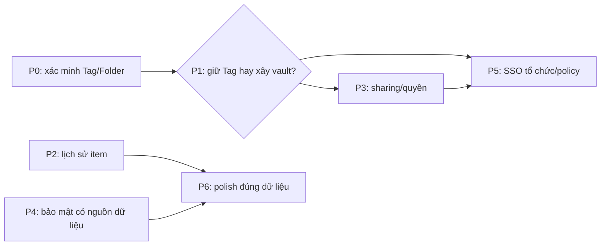

# NodeWarden × Proton Pass: kế hoạch đối chiếu

> **Trạng thái: kế hoạch, chưa triển khai các khoảng thiếu dưới đây.** Nguồn: phân tích ảnh/tài liệu Proton trong `proton-pass-research/BRD.md` và `proton-pass-research/UX-UI.md` (chưa khảo sát trực tiếp ứng dụng Proton đang chạy). Hai file nghiên cứu và ảnh vẫn là tài liệu tham khảo *chưa được đưa vào Git*; các mã F bên dưới là mã trong BRD đó, không phải cam kết tương thích giao thức Proton. NodeWarden tiếp tục dùng giao thức Bitwarden. Tag/Folder không phải vault Proton; Send không phải chia sẻ item; Password History không phải lịch sử phiên bản item.

## Danh mục không bỏ sót

| Mã BRD | Hiện trạng | Hướng xử lý / cổng |
|---|---|---|
| F-01–05 | All Items có; Tag/Folder dùng phân loại, Trash toàn cục, chưa có vault độc lập/ACL/share vault | P1 quyết định mô hình; P3 chỉ khi chốt quyền và khóa |
| F-10–16 | CRUD, form Login, Trash có; move đến Folder/Tag; detail có địa chỉ Open/Copy, mật khẩu che mặc định, **Last copied**; không có Last autofill hay nhãn Vulnerable inline | P0 kiểm chứng move/tag; P4 chỉ hiển thị đánh giá có dữ liệu; P6 polish địa chỉ |
| F-20–23 | Search, All/Recent 30 ngày, multiple select và nhóm ngày khi sort Edited có; chưa có nhãn Today/Yesterday | P6 nếu cần |
| F-30–31 | Soft delete/Restore và một Trash chung có | Trash theo vault phụ thuộc P1 |
| F-40–45 | Metadata và Password History có; Item History (timeline/compare/Restore toàn item) đã có trong Web Vault; `Last autofill` chưa có; app/extension chính thức chưa hiện timeline | P2 xong phần Web; app chưa thu; không đổi tên Password History thành Item History |
| F-50–56 | Password Health quét thủ công và kiểm tra rò rỉ email tài khoản có; không phải giám sát credential Proton; thiếu Inactive 2FA, excluded items, Account protection và card hướng dẫn | P4; trạng thái unknown/lỗi phải rõ |
| F-60–64 | Nội dung item mã hóa client-side, có passkey tài khoản và mã TOTP item; Web Vault không tạo passkey website, autofill do client; thiếu Emergency Access và advanced protection tương ứng | P4 đánh giá threat model trước khi tuyên bố tương đương Proton |
| F-70–74 | Generator tạo alias qua provider SimpleLogin-compatible bên ngoài; chưa quản lý mailbox/domain hoặc gửi mail từ alias tại NodeWarden | P5; chốt provider vs tự vận hành |
| F-80–85 | Attachment, SSO OIDC và audit log có; share item/vault, organization/role, compliance report và policy enforcement chưa có | P3/P5; Send không thay thế share item |
| F-90–93 | Đồng bộ client Bitwarden và import nhiều nguồn có; không có CLI phát hành riêng hay hệ ứng dụng Proton cho app switcher | P6 mặc định không làm CLI/app switcher |
| Pricing tiers | NodeWarden chưa có gói Free/Plus/Business của Proton | Ngoài phạm vi nếu không có yêu cầu sản phẩm/billing riêng |

## Phụ thuộc và cổng quyết định

- **P1-A (mặc định):** giữ Tag/Folder, không nhận F-01/02/04/05/14 là vault Proton. Chỉ thiết kế chia sẻ bản sao qua link nếu có nhu cầu; không thêm ACL/vault giả.
- **P1-B (chỉ khi cần nhiều vùng chứa có quyền độc lập):** định nghĩa owner, membership/role, vault mặc định, item thuộc vault nào, Tag tách khỏi vault, khóa theo vault, cấp/thu hồi quyền, Trash và cách client Bitwarden cũ nhìn thấy item. Khi đó mới lập migration và thiết kế P3/P5 thực thi. Thiết bị đã tải plaintext không thể bị thu hồi dữ liệu từ xa.
- P2 và các lát P4 không dựa vào vault có thể được thiết kế độc lập; P3 và phần tổ chức của P5 **không được vượt cổng P1**. Không thêm nút, trạng thái hoặc tính năng giả trong lúc chờ.

## P0 — tính đúng Tag/Folder trước mọi mở rộng

**Đã xác minh trên Worker/D1 local cô lập:** tạo Login với `Work, Shared`, tạo Tag `Personal`, bulk move sang `Personal` cho kết quả `Personal (1), Shared (1), Work (0)` ngay sau thao tác, sau Sync Vault và sau đăng xuất/đăng nhập lại. Move về “No tag” đưa `Shared` lên đầu, hiển thị `Shared (1), Personal (0)` và detail `Shared`. Lỗi phát hiện trong lần kiểm tra đầu: Folder Web có tên mã hóa nhưng backend đã chèn ciphertext vào Tag, khiến detail hiển thị Personal còn lọc `Personal (0)`; đường tạo/đổi Folder nay ghi tên Tag riêng, còn tên Folder trả cho client vẫn mã hóa. Item nhiều Tag được kiểm tra qua UI thật; các kiểm thử DB/API, `/sync`, quyền owner, rename/delete và conflict ở `scripts/vault-compatibility.test.ts`, `scripts/user-key-id.test.ts`, `scripts/cipher-tags.test.ts`.

**Hồi quy hiện tại:** `scripts/vault-compatibility.test.ts` kiểm tra 31 trường hợp, gồm full/partial/bulk move, Folder mã hóa thiếu `tag_name`, move lặp, owner, conflict và chuyển đổi Folder có điều kiện revision. `scripts/cipher-tags.test.ts` 7/7; `scripts/user-key-id.test.ts` 7/7; `scripts/folder-legacy-encryption.test.ts` 3/3; `scripts/folder-tag-backup.test.ts` 3/3; `scripts/folder-plaintext-inventory.test.ts` 5/5. Hai typecheck, i18n và build đạt. Các phép thử mật mã dùng khóa thật; không coi chuỗi giả EncString là bằng chứng giải mã. Sửa lỗi kèm theo: endpoint revision giờ luôn đẩy revision của vault lên (tối thiểu +1 ms so với revision trước) sau khi repair Tag, vì revision là tín hiệu để client tải payload đã sửa; trước đó repair chạy trong cùng mili-giây với revision cũ thì client không tải lại.

**Cùng vault Web/CLI chính thức trên Worker/D1 local cô lập:** Web Vault tạo tài khoản với khóa thật và Login `Work, Shared`; CLI Bitwarden 2025.1.0 đăng nhập, unlock, giải mã tên Folder, tên item và username, cùng thấy Folder ID `Work`. Web bulk move sang `Personal` giữ Tag phụ `Shared`; sau `bw sync`, CLI thấy item trong Folder `Personal` cùng ID. CLI đổi Folder item sang `Shared`; Web Sync Vault thấy `Shared`. Web thêm Tag phụ `Extra`, CLI đổi Folder sang `Shared`; Web Sync Vault thấy `Shared, Extra`. CLI tạo Folder `CLI Created`, Web Sync Vault thấy Folder đó và bulk move item vào giữ `Extra`; CLI sync thấy đúng Folder ID, tên item và username. Web đăng xuất/đăng nhập lại vẫn hiển thị `CLI Created (1), Extra (1)`. CLI không hiển thị Tag phụ vì giao thức Bitwarden chỉ có Folder; chỉ Web xác nhận Tag phụ còn nguyên.

**Extension Bitwarden chính thức 2026.10.2 trên cùng vault local:** tải bản Chrome từ release `browser-v2026.10.2` của `bitwarden/clients`, đối chiếu SHA-256 với asset công bố, chạy trong Chromium/profile riêng qua HTTPS local. Extension đăng nhập và tải item `P0 Crossclient Login`, username `crossclient-user`; lọc Folder `CLI Created` thấy đúng item. Extension sửa Folder item sang `Personal`; detail hiển thị `Folder Personal`. Web Vault đăng nhập cùng vault thấy `Personal (1), Extra (1)`; lọc từng Tag và Sync Vault vẫn thấy item; D1 giữ `folder_id` của Personal và `tags=["Personal","Extra"]`. Đây là bằng chứng browser extension, không phải app desktop/mobile.

**Desktop Bitwarden chính thức 2026.10.2 trên cùng vault local:** AppImage Linux từ release `desktop-v2026.10.2` của `bitwarden/clients`, SHA-256 khớp asset công bố (`07ce693427984332832be0889e652a74a65c1f0b680cf9fc3684a6fb0458494c`), chạy với profile riêng và CA thử nghiệm chỉ tin trong profile đó. App đăng nhập self-hosted qua HTTPS local, giải mã Folder `CLI Created`, `Extra`, `Personal`, `Shared`, `Work`, item `P0 Crossclient Login` và username `crossclient-user`. Lọc `Personal` thấy item; sửa Folder sang `CLI Created`, detail và lọc `CLI Created` thấy item, lọc `Personal` không còn item. Web Vault đăng nhập cùng vault thấy `CLI Created (1), Extra (1), Personal (0)`; lọc `CLI Created` và `Extra` vẫn thấy item sau Sync Vault. D1 giữ Folder ID `63d8b710-ed6a-4812-9ad6-002b4ef8e38d` và `tags=["CLI Created","Extra"]`. Không suy ra tương thích app mobile từ desktop.

**Bulk move desktop đã sửa và xác minh:** lỗi 409 trước đây được tái hiện bằng desktop 2026.10.2. Sau sửa, UI “Add to folder” gửi `PUT /api/ciphers/move` vào `Desktop Untagged P0` (`tag_name=NULL`) và nhận 204. Server giữ Folder ID, bỏ Tag vị trí cũ và giữ `Extra`, không chèn ciphertext. Web dùng khóa phía client giải mã tên Folder và dựng Tag đầu: `Desktop Untagged P0 (1), Extra (1), CLI Created (0)`; lọc đúng sau Sync Vault và đăng xuất/đăng nhập lại. Desktop lọc và detail xác nhận Folder đích. Full/partial move dùng cùng quy tắc; move khỏi Folder chưa biết tên không làm mất Tag phụ.

**Android chính thức đã xác minh:** APK từ [release v2026.11.0-bwpm](https://github.com/bitwarden/android/releases/tag/v2026.11.0-bwpm), SHA-256 khớp `84d2d210aeefbba18bd32d72c45fd539d66bfe8d533eb8bbec33a13bc1ecb592`, chạy trên emulator Android 14 riêng; không thao tác điện thoại thật. App từ chối HTTP; sau tin CA thử nghiệm trong emulator, đăng nhập HTTPS cùng vault, giải mã item/username và lọc `Desktop Untagged P0`. App sửa Folder sang `Personal`, manual Sync báo hoàn tất, lọc `Personal` thấy item; Web Sync và D1 xác nhận `tags=["Personal","Extra"]`. App chỉ biết Folder nên `Extra (0)` trong app không thay thế `Extra (1)` trong Web. UI được quan sát qua hierarchy thật; FLAG_SECURE chặn screenshot, không tắt bảo vệ app.

**Khôi phục backup admin đã chạy thật trên hai D1 cô lập:** nguồn là đúng vault crossclient (8 Folder có `tag_name`, một Folder không tag, item `P0 Crossclient Login` với `tags=["Legacy Plain P0","Extra"]`). `POST /api/admin/backup/export` trả ZIP mà tên file mang checksum của chính bytes; `POST /api/admin/backup/import` multipart vào một D1 trống (đăng ký admin tạm để cấp quyền, archive thay users bằng tài khoản gốc). Sau khôi phục, hàng `folders`/`ciphers`/`users` của D1 đích giống hệt nguồn, `/api/sync` trả cùng layout, và giải mã phía client bằng đúng master password gốc cho lại đúng 8 tên Folder (Folder không tag vẫn không tag), đúng `folder_id` và `tags` của item. `scripts/folder-tag-backup.test.ts` 3/3 giữ hồi quy cho đường archive/khôi phục.

**Chuyển đổi Folder plaintext có backup boundary:** Web → Import & Export → Folder compatibility kiểm kê tên raw; chỉ chuyển đổi khi người dùng xác nhận có backup và xác nhận lần hai. Bỏ qua tên mã hóa/không giải mã được, tên có padding, quá 64 ký tự hoặc lệch Tag. GET lại trước mỗi PUT và `If-Match` revision ngăn ghi đè concurrent rename; lỗi được báo riêng và có thể thử lại. Smoke D1 cô lập đã tạo backup SQLite trước, chuyển `Legacy Plain P0` thành ciphertext với khóa vault thật, giữ nguyên Folder ID, `folder_id`, `tags=["Legacy Plain P0","Extra"]` và timestamp item. Web báo `Encrypted 1, skipped 0, failed 0`; Android sync giải mã đúng tên, lọc và detail vẫn thấy item. Folder có tên plain nhưng `tag_name=NULL` (ví dụ nhập từ Bitwarden JSON) khi mã hóa tên sẽ lấy chính tên cũ làm `tag_name`, nên Tag của item không bị thay bằng ciphertext; `scripts/vault-compatibility.test.ts` giữ trường hợp này. Chạy lại đúng đường UI sau khi sửa trên D1 cô lập: panel liệt kê 2 Folder plaintext, xác nhận 2 bước, báo `Encrypted 2, skipped 0, failed 0`; 12/12 tên Folder thành ciphertext, `tagName` giữ nguyên văn, menu Tags hiện đủ tên thật và lọc Folder vừa chuyển trả đúng item.

**Dọn Tag rác dạng ciphertext:** bản build trước backfill `tags[0] = folder.name` vô điều kiện, nên vault nhập từ Bitwarden với Folder mã hóa bị ghi chính ciphertext tên Folder vào Tag của item. Kiểm kê một vault thật: 822/toàn bộ item như vậy, cả toàn bộ Folder đều `tag_name=NULL`. Migration nay bỏ mọi tag mang đúng dạng EncString khi Folder không có tên plain để backfill, giữ nguyên `folder_id` và Tag thật; Tag thật bị giới hạn 64 ký tự nên không thể có dạng EncString. Diễn tập trên archive thật: 822 → 0 tag rác, 0 Folder đổi, 0 `folder_id` đổi, 0 Tag thật mất, chạy lần hai không đổi; không ghi plaintext nào nên `tag_name` vẫn NULL. Hai lỗi phải sửa kèm mới làm được trên production: (1) migration sửa cipher mà không bump revision nên cache `/sync` (key theo revision) vẫn trả payload cũ; (2) Web Vault và client chính thức hỏi `/api/accounts/revision-date` trước rồi **bỏ qua `/api/sync` khi revision không đổi**, nên một vault không đổi dữ liệu sẽ không bao giờ chạm tới migration — revision endpoint nay chạy đúng migration đó một lần cho mỗi tài khoản (marker `tags.legacy-repair.v1:<userId>`) và bump revision khi có ghi. Kết quả trên production sau deploy: 822 → 0 tag rác, `max(ciphers.updated_at)` và `revision_date` nhảy sang thời điểm sửa; toàn bộ Folder giữ nguyên id/name/`tag_name`, 0 khác biệt ở `folder_id`/`name`/`notes`/`key`/`type`, `data` chỉ khác ở `tags`, users giống hệt.

**Kiểm kê Folder plaintext trước cutover:** `npm run inventory:folders -- <backup.zip>` đọc archive admin hoàn toàn offline (không gọi server, không cần khóa tài khoản), nhóm Folder theo user trong `db.json` và chỉ liệt kê tên mà đúng quy tắc của Web Vault coi là plain text (dùng chung `inspectFolderNames`), kèm lý do `plaintext`/`padded`/`too_long` và Folder ID. Smoke: archive thật sinh từ import Bitwarden JSON có Folder `Legacy JSON Folder` (tên plaintext do đường import lưu nguyên) được liệt kê đúng một dòng cho đúng tài khoản; archive của instance vừa khôi phục (toàn tên mã hóa) trả "nothing to convert"; thiếu tham số exit 2, file hỏng exit 1.

**Phạm vi phát hành:** các đường P0 ở code và client local trên đã có bằng chứng; chưa triển khai production hay chuyển đổi vault production. Đường export→import admin mới chỉ chạy trên D1 local cô lập, chưa với backup production. Trước cutover thực tế phải tạo/kiểm tra backup của đúng vault, chạy `npm run inventory:folders` trên archive đó, chuyển đổi bằng khóa phía client và dùng HTTPS với CA được thiết bị tin cậy. Không tự đổi production hoặc coi checkbox là backup đã được kiểm tra. iOS và macOS không được suy ra từ Android/Linux.

## P1 — quyết định kiến trúc Vault

- **A — giữ Tag/Folder:** chốt giới hạn F-01/02/04/05/14 trong tài liệu và UI. Phù hợp khi chỉ cần phân loại item; không đổi giao thức để giống giao diện.
- **B — xây vault thật:** sau khi có yêu cầu quyền/cộng tác, lập hợp đồng storage–khóa–API–sync cho mọi đường đọc/ghi item, attachment, import/export, Trash và notification. Server không được trả item của vault sai quyền qua `/sync` chỉ vì UI đã ẩn. Migration item hiện có vào vault mặc định phải giữ ID, ciphertext và Tag; thử idempotency, backup và rollback có cả thay đổi phát sinh sau migration. Thử hai user, thiết bị cũ/mới, revoke, offline và concurrent writes trước UI vault.
- **Đầu ra P1:** quyết định A/B được duyệt và hợp đồng dữ liệu/quyền/tương thích; chưa tạo bảng/nút vault khi chưa có quyết định.

## P2 — Item History (F-40–45)

**Đã có:** card metadata (đổi tên thành *Item Information*) và danh sách mật khẩu cũ vẫn giữ nguyên (`webapp/src/components/vault/VaultDetailView.tsx`). Bảng `cipher_versions` giữ từng trạng thái cũ của item dưới dạng ciphertext; server không bao giờ thấy plaintext.

**Hợp đồng đã chốt:**

1. **Snapshot:** `type`, `name`, `notes`, `key`, `reprompt` và payload mã hóa **không kèm Tag**. Tag/Folder là tổ chức, không phải nội dung: đổi Folder không tạo version và Restore không kéo item về Folder cũ. Attachment nằm ngoài payload nên metadata và bytes không bị Restore đụng tới; item xóa vĩnh viễn mất luôn version.
2. **Ghi version:** chỉ khi ghi item **thành công và có thay đổi nội dung**. Bản ghi version và bản ghi item nằm trong **cùng một batch D1**; version chỉ được ghi khi item thật sự đã tới revision mới, nên ghi bị từ chối (conflict) hoặc no-op không để lại version nào. Mỗi version gắn owner (`user_id`), item (`cipher_id`) và revision của vault. Không lưu plaintext.
3. **API:** `GET /api/ciphers/:id/versions` (danh sách, có tên mã hóa và item key của từng mốc), `GET /api/ciphers/:id/versions/:versionId` (snapshot đầy đủ), `POST /api/ciphers/:id/versions/:versionId/restore`. Cả ba kiểm tra quyền trước: version của người khác trả 404, không trả 403. Restore kiểm tra `If-Match` (revision client đang hiển thị) → 409 nếu lệch; giữ trạng thái đang có thành version mới nên Restore hoàn tác được; giữ nguyên item ID và không khôi phục bytes attachment đã xóa; sau khi ghi thì bump revision và báo sync.
4. **Retention:** mỗi item giữ 20 trạng thái mới nhất, bản cũ hơn bị cắt khi ghi version mới. Item có sẵn chỉ có lịch sử từ lần sửa đầu tiên sau khi bật tính năng — không dựng lại lịch sử quá khứ.
5. **UI:** `View Item History` trong card Item Information → timeline (Current Version trước, rồi từng mốc) → bấm một mốc để xem nội dung đã giải mã và so sánh từng trường với bản hiện tại (name, username, password, website, notes, TOTP) → xác nhận Restore. Password History giữ tên và vị trí riêng.
6. **Test:** `scripts/cipher-versions.test.ts` 8/8: ghi version khi sửa nội dung, no-op và đổi Folder không tạo version, ghi thua race không tạo version, quyền sai, item bị xóa, retention 20 mốc, Restore (nội dung cũ về, trạng thái bị thay giữ lại, ID giữ nguyên, revision chạy) và Restore với revision cũ bị từ chối.

**Còn mở:** app Bitwarden chính thức chưa dùng được API này (client chỉ hiển thị Folder, không có timeline); `Last autofill` (F-40–45) chưa làm; dữ liệu có sẵn không hoàn lịch sử quá khứ.

## P3 — Sharing (F-05, F-80–81)

**Phụ thuộc P1.** `/api/ciphers/:id/share` hiện chỉ trả lại item; organizations/collections rỗng (`src/router-authenticated.ts:364,428-438`). Bitwarden Send chia sẻ text/file tạm, không cấp quyền đọc/sửa item.

1. Quyết định **link chia sẻ bản sao** hay **quyền thành viên trên item/vault**; không gọi link Send là vault share. Nếu P1-A, không đưa ra lời hứa chia sẻ vault có ACL.
2. Với quyền thành viên: hợp đồng invitation/accept/expiry, read/edit role, phân phối khóa client-side, revoke/rotate, attachment, audit, quyền ở từng endpoint và `/sync`; không gửi khóa plaintext cho server. Với link: payload xác định, khóa, hết hạn, giới hạn lượt, revoke và lộ metadata.
3. Xây authorization và API thật trước UI; route stub không được trả thành công giả. Test owner/invitee/người lạ, link hết hạn, nhiều thiết bị, offline, revoke, import/export và attachment. Nêu rõ thiết bị từng tải plaintext không thể bị xóa từ xa.

## P4 — bảo mật sản phẩm (F-50–56, F-60–64)

Lập **plan riêng cho từng lát**; không biến Pass Monitor thành tập hợp card báo “an toàn” không có dữ liệu.

| Lát | Nguồn/cổng bắt buộc và nghiệm thu |
|---|---|
| Password Health inline | Tái sử dụng kết quả quét thủ công trong `webapp/src/lib/password-security-cache.ts`, gắn revision/fingerprint item; chưa quét/lỗi/hết hạn ≠ Strong/Safe. Exposed/Weak/Reused chỉ hiện khi có kết quả hợp lệ. |
| Credential monitoring | Xác định corpus/provider, dữ liệu gửi ra, đồng ý người dùng, tần suất/quota và định nghĩa kết quả theo từng credential; kiểm tra rò rỉ **email tài khoản** hiện tại không đồng nghĩa Dark Web Monitoring cho toàn vault. |
| Inactive 2FA | Chỉ kết luận website hỗ trợ 2FA từ nguồn đáng tin; item không có TOTP không đủ làm bằng chứng. Tách không rõ/không hỗ trợ/chưa bật. |
| Excluded items | Chốt nơi lưu trạng thái theo item, phạm vi từng phép quét, sync, opt-in/out và audit; item excluded không được báo safe. |
| Account protection | Định nghĩa biện pháp bật/tắt có thực thi ở auth/API và cách khôi phục khi mất thiết bị; new-device verification hiện bị từ chối khi thiếu kênh email (`src/handlers/accounts.ts:870-910`). |
| Emergency Access | Threat model riêng: người nhận, thời gian chờ, hủy, xác thực, thông báo, cấp/thu hồi khóa và audit; không gửi master password/secret thô. |
| Passkey/2FA/zero-knowledge | Phân biệt passkey tài khoản và passkey website; TOTP item và 2FA đăng nhập; autofill ở client Bitwarden. Rà mô hình mã hóa thực tế trước khi tuyên bố tương đương Proton. |

Mọi lát phải kiểm tra trạng thái unknown/error, không lộ secret khi log/export, và review bảo mật trước phát hành. Card giáo dục F-56 là nội dung tùy chọn sau khi luồng thật ổn định.

## P5 — Alias và doanh nghiệp (F-70–74, F-83–85)

- **Alias:** quyết định tích hợp SimpleLogin-compatible hay tự vận hành mail trước. Với tích hợp hiện tại (`webapp/src/lib/simplelogin-forwarder.ts`): kiểm tra provider hỗ trợ list/disable/delete alias → chọn mailbox chuyển tiếp → domain do provider xác nhận → gửi thư từ alias *chỉ nếu có API thực*. Chốt token/secret, quota, lỗi upstream, đồng bộ cấu hình, và không hứa tính năng Proton do NodeWarden sở hữu. Không thêm pricing tier giả.
- **SSO tổ chức:** OIDC account link hiện có (`README.md:54`) không phải membership/SCIM; phụ thuộc P1/P3. Chốt ánh xạ user–organization, provisioning/deprovisioning, thu hồi quyền và case IdP mất kết nối; không suy ra quyền từ `domainHint`.
- **Compliance:** audit log đang có (`src/handlers/admin.ts:121-165`). Chốt scope/role, metadata được phép xuất, định dạng, retention và redaction trước CSV/PDF; thử không lộ secret và user không được phép không truy cập được.
- **Policy:** `/api/policies` hiện rỗng (`src/router-authenticated.ts:483-488`). Chỉ thêm sau khi có đối tượng organization và hành vi cần kiểm soát; kiểm thử enforcement tại share/export/sync/API với client cũ, không chỉ khóa nút UI.

## P6 — polish độc lập và các mục cố ý không làm

- F-23: Today/Yesterday theo locale/múi giờ, chỉ với sort nhóm ngày; test chuyển ngày/nửa đêm và ngày không hợp lệ (`VaultListPanel.tsx:130-137`).
- F-15: Website giữ Open/Copy; nếu chuyển sang hyperlink thực, chỉ URL an toàn, keyboard/screen-reader hợp lệ và không tạo hai Open trùng nhau (`VaultDetailView.tsx:510-529`). Last copied **không** đổi nhãn thành Last autofill nếu chưa có sự kiện autofill từ client.
- F-50/56: chỉ đổi bố cục/tên Pass Monitor sau P4, không nhân bản nội dung hay trạng thái đo không có. Kiểm tra dark/light, mobile/desktop, tương phản và focus.
- F-92/93: mặc định **không làm** CLI riêng hoặc app switcher Proton; server đã tương thích client Bitwarden CLI, NodeWarden không sở hữu hệ Proton Mail/Drive/VPN. Pricing tiers cũng ngoài phạm vi trừ khi có yêu cầu sản phẩm thực.

## Mẫu chốt plan cho từng item và cổng phát hành

Mỗi item phải có: (1) hành vi và mã BRD, điều **không** làm; (2) đường UI → state → API → storage → sync/client đang chạy và tái hiện lỗi nếu có; (3) ranh giới quyền/khóa/metadata/retention; (4) tương thích dữ liệu cũ, client Bitwarden, backup/rollback; (5) lát triển khai không có stub; (6) nghiệm thu hành vi thành công, lỗi, offline, đồng thời, desktop/mobile, accessibility; (7) review security, test hợp đồng và smoke đường thực trước release. Push code **không chứng minh** deploy thành công hoặc an toàn production.
